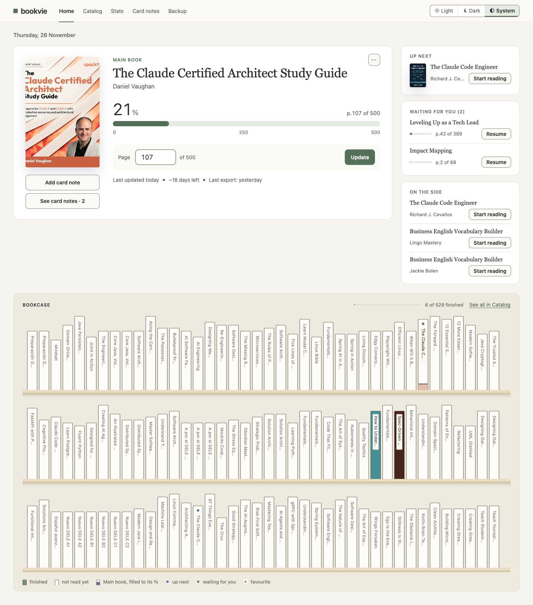
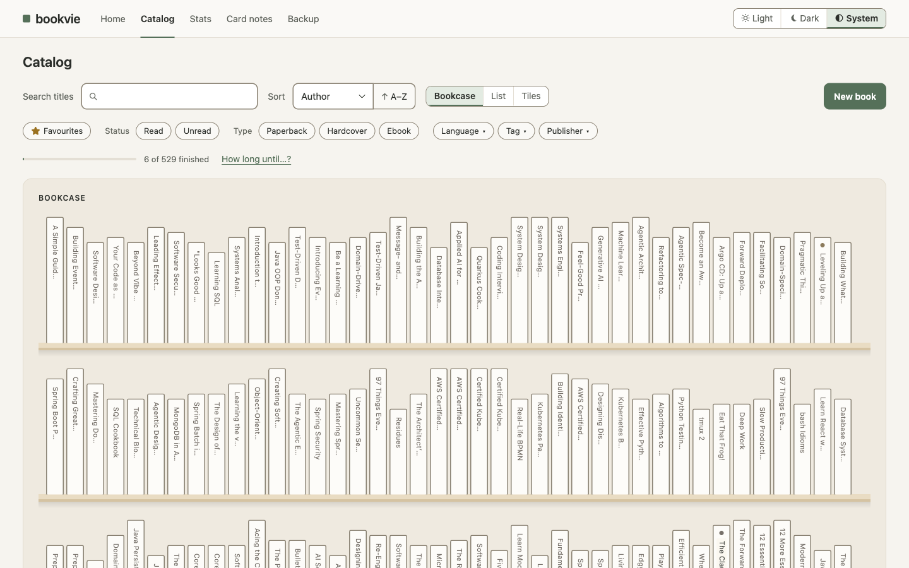
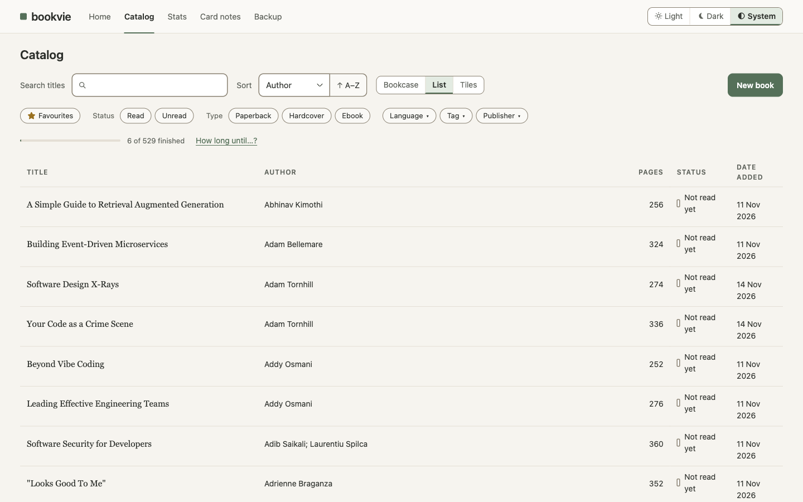
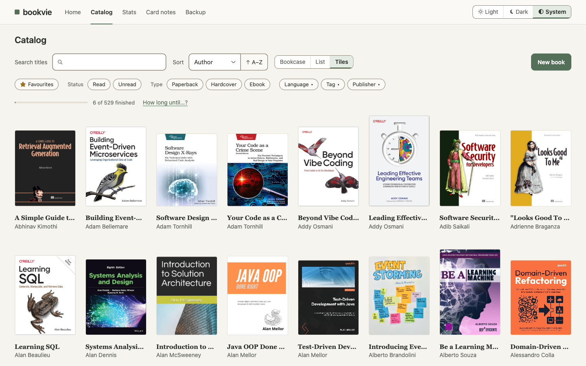
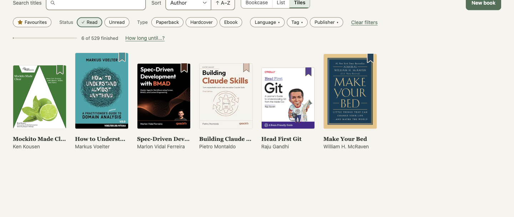
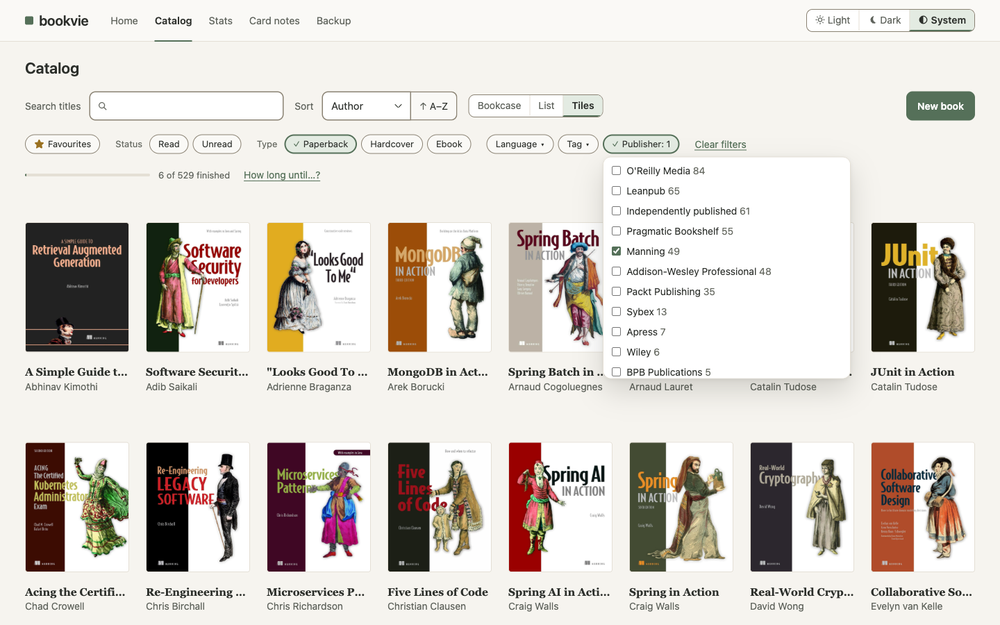
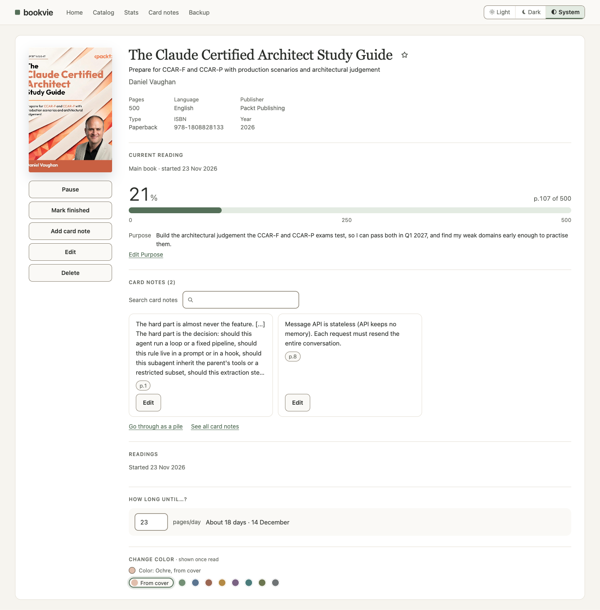
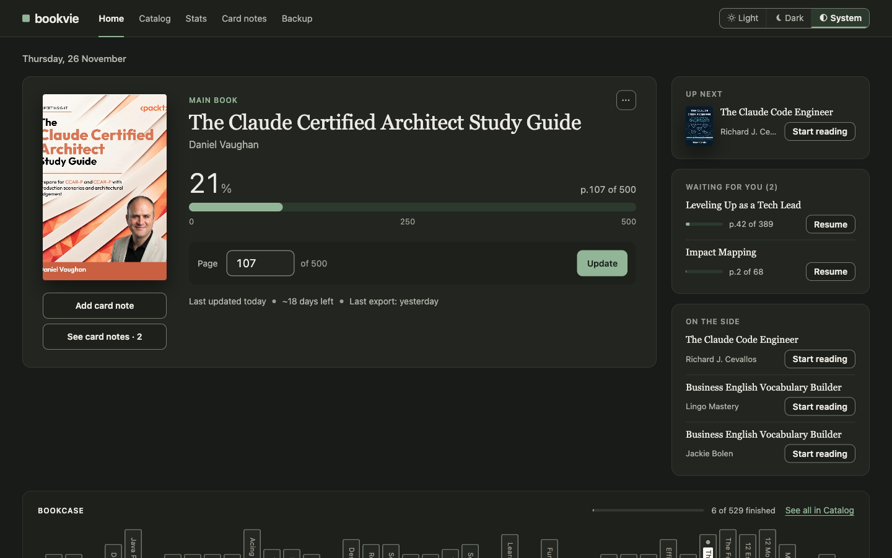

# bookvie

[](https://github.com/olegood/bookvie/actions/workflows/test.yml)
[](LICENSE)

A personal, local-first web app for organizing my home library and tracking my reading. It replaces a paper reading diary as the single source of truth for reading progress. The diary can stay on the nightstand for quick notes; I catch up in the app on my next visit by entering the page I reached.

## Why

I read almost every day, but my pace depends on work. The pattern that keeps breaking my reading is the **urgency chain**: an urgent work book interrupts the one I'm reading, I lose its context, re-reading feels like no progress, and the paused book never gets picked up again.

bookvie breaks that chain by allowing exactly one tracked **Main book**, making every switch a deliberate, visible trade-off, and keeping every paused book in view until I pick it up again. Three pillars guide every decision:

- **Visible progress.** Every real reading effort moves something you can see: a percentage, a gauge, and a spine on the bookcase.
- **Conscious reading.** A Purpose when I start a book, and "Purpose fulfilled?" when I finish.
- **Simplicity.** Less state means less stress, and removing a state also removes a failure signal. No streaks to break, no "abandoned" status, nothing that resets. Simplicity beats completeness of history.

Re-reading is welcome and never counts as lost progress.

## Core ideas

- **Book → Readings.** A Book is a catalog entry for a copy I own; each read-through is a separate Reading with its own current page, Purpose, dates and rating. A re-read is a new Reading. Books I read before bookvie get a back-filled Reading from a **Finished on** date.
- **One Main book.** Starting a new one shows the trade-off first: "Start X? This pauses Y at p.120 (64%)".
- **Pause, don't abandon.** Paused Readings keep their page. An interrupted book becomes **Up next**; other paused Readings wait in **Waiting for you**, oldest first.
- **The bookcase.** Every Book is a spine on a pale birch shelf. Unread Books are outlined; finished ones show their spine color; the Main book's spine fills as I read. Coloring in the library, one spine at a time, is the only reward.
- **Quick pace calculator.** Type a pages/day value and see when a book, or the whole unread library, would be finished.
- **Card notes.** Quotes or notes with a page or page range, attached to a Book, reviewable as a pile and searchable across all Books.

## Features

- **Home.** The Main book with its gauge and page field: type the page you reached, press Enter, and the percentage, "~N days left" and the bookcase slice follow. Up next, Waiting for you and up to three Side reads keep every paused book in view.
- **Reading.** Start a book with an optional Purpose, pause it, set what's Up next, and finish it with "Purpose fulfilled?" and a 1–5 rating. Re-reads are new Readings, and books read before bookvie get a back-filled one from a Finished on date.
- **Catalog.** See the library as a Bookcase of spines, a List or Tiles of covers; books without a cover get a typeset one. Sort it either way. Filter by Favourites, Status, Type, Language, Tag and Publisher, and combine them. Star the books that mattered to you.
- **New book panel.** Agent-friendly labels, required fields, a cover, and a duplicate warning by ISBN or title + author.
- **Card notes.** Quotes and notes with a page or page range. Browse them as boxes, one per book in its spine color, or as a list; go through a book's notes as a pile; search across all books.
- **Pace and stats.** The quick pace calculator for one book or the whole unread library, and Stats for any date range, with a bar per month (per year past 24 months).
- **Backup.** One-click export to a single zip and a restore that checks the whole file first. With the skills below, daily backups to Dropbox and restore from them.
- **Agents.** MCP tools served by the running app, and four Claude Code skills that add books, summarize card notes, back up and restore.
- **Themes.** Light, dark or system.

## Out of scope

bookvie is deliberately small. It won't have multiple users or sharing, phone layouts, borrowed books, batch or in-app import, a session timer, per-day page logs, an abandoned status, an audiobook format, or email or push nudges, and there are no streaks, greetings, praise or other guilt mechanics.

It runs in desktop Chrome (the only supported browser) on one laptop or desktop (1024px minimum width), with no account, network or database server, in English only. No action silently deletes data, and a failed save is never silent.

Ideas for what comes next are tracked as [GitHub issues](https://github.com/olegood/bookvie/issues?q=label%3Aenhancement).

## Design

The visual direction is **Birch Morning**: bright, flat and Nordic, with pale birch wood and one sage accent. The dark theme is the same room in the evening. Sans-serif for everything the app says, serif only for book titles. The app has five pages (Home, Catalog, Stats, Card notes, Backup) plus Book detail.

## Getting started

You need Python 3.14 with [uv](https://docs.astral.sh/uv/), and Node 24+ (see `.nvmrc`) with npm.

```sh
npm install                              # frontend dependencies and Playwright's Chromium
npm run build                            # builds the SPA into backend/bookvie/http/static/
uv tool install --reinstall ./backend    # puts `bookvie` on your PATH
bookvie                                  # serves 127.0.0.1:8765 and opens the browser
```

**Updating:** `npm run install:local` rebuilds and reinstalls in one step. Then restart a running `bookvie` (Ctrl+C, run it again). A tab left open from before the update then shows a notice under the top bar, "bookvie was updated to X. Reload to use it.", and **Reload** loads the new bundle. A rebuild that keeps the same version shows no notice, so reload such tabs yourself.

**Options:** `--data-dir DIR` (default `~/bookvie-data`, or `~/bookvie-data-dev` with `--dev`), `--port N` (default 8765, or 8766 with `--dev`), `--no-browser`, `--dev` (a development server: its own folder and port, accepts the Vite dev origin on `:5173`, and refuses `~/bookvie-data`) and `--fake-today YYYY-MM-DD` (tests only, with `--no-browser`). Only one `bookvie` runs per data folder; a second launch reopens it.

**Data folder:** `library.json` holds the whole library and is written atomically; `covers/` holds the cover images, and `local-state.json` remembers "Last export" on this machine. Back up and restore from the Backup page: an export is a zip of `library.json` and `covers/`, and a restore checks the whole file before replacing anything.

**Development:** run `bookvie --dev --no-browser` in one terminal and `npm run dev` in another, then open `http://127.0.0.1:5173`. A dev server uses `~/bookvie-data-dev` on port 8766 (pass `--data-dir` for a scratch folder), so it runs beside your normal `bookvie`, and it refuses to open your real library (`~/bookvie-data`) in any form. A second `bookvie --dev` from another checkout (another git worktree) refuses to join a dev server that already runs on the same folder and exits 1; stop that one, or give this one its own `--port` and `--data-dir`. `npm run dev` always proxies to port 8766 and Vite needs port 5173, so only one Vite dev stack runs at a time; a second `--dev` on another port serves only its own built app and API. `npm run dev` proxies `/api`, `/media` and `/favicon.svg` to port 8766. A dev tab shows an amber favicon, a DEV pill after the wordmark and a `DEV · ` title prefix.

**Tests:** `npm run check` runs `check:api` (API type drift, frontend lint, type check and unit tests), then `check:py` (ruff and pytest with coverage gates) and `check:e2e` (Playwright) at the same time, then `check:smoke` (install and serve), stopping at the first failure; each also runs alone. See [docs/ci.md](docs/ci.md#running-it-locally). `npm run format` applies both formatters. No check touches `~/bookvie-data`. See [`frontend/e2e/README.md`](frontend/e2e/README.md) for the e2e suite.

**CI:** GitHub Actions runs the same four checks on every push to `master` and every pull request, plus a weekly and per-PR e2e burn-in. See [`docs/ci.md`](docs/ci.md).

## Agent tools

A running `bookvie` serves MCP tools at `/mcp`, so an agent in Claude Code can talk to your library with nothing else to start. A production server and a `--dev` server each serve their own tools on their own library. Add both to Claude Code once:

```sh
claude mcp add --transport http --scope user bookvie http://127.0.0.1:8765/mcp
claude mcp add --transport http --scope user bookvie-dev http://127.0.0.1:8766/mcp
```

bookvie must be running for its tools to appear. If you start `bookvie` (or `bookvie --dev`) after the Claude Code session started, run `/mcp` in Claude Code, pick the entry and choose reconnect. The URL is exactly `/mcp`, with no trailing slash. A request from a web page is refused by the same guard as the app's API: a foreign `Origin` or `Host`, or a cross-site or same-site `Sec-Fetch-Site`.

**Daily backup to Dropbox, and restore.** A second command installed with bookvie, `bookvie-dropbox`, is an MCP server with one tool, `upload_backup`, which uploads a daily backup to bookvie's own Dropbox App folder, checks Dropbox's copy and keeps 3 daily copies. Claude Code starts it; sign in once with `bookvie-dropbox auth`. An agent can restore your library from a backup in bookvie's backups folder, but only after two confirmations it can't skip: Claude Code's permission prompt and bookvie's own question, which shows what the restore would lose. bookvie saves a safety copy of your current library first, so a restore can be undone. [Backing up to Dropbox, and restoring](docs/dropbox-backup.md) sets up the Dropbox app, the sign-in, both MCP servers and the permission rule, and explains both prompts, the safety copy and each refusal.

## AI skills

The repo ships four bookvie skills for Claude Code in [`.claude/skills/`](.claude/skills/). All four talk to a local `bookvie` on `127.0.0.1:8765`.

- **[`bookvie-new-book`](.claude/skills/bookvie-new-book/SKILL.md)** adds a book to the catalog. It starts `bookvie` if needed and checks the catalog for a duplicate. It then looks up the metadata and front cover on amazon.com, manning.com, leanpub.com or oreilly.com, saves the book with bookvie's `add_book` agent tool (bookvie downloads the cover from its address) and tags it `added-by-skill`.
  - "Add *Designing Data-Intensive Applications* to bookvie"
  - "I just bought this one: https://www.manning.com/books/…"
- **[`bookvie-notes-summary`](.claude/skills/bookvie-notes-summary/SKILL.md)** turns a book's card notes into a printable one-page Word summary of what you learned, grouped by theme. It saves the file to `~/Documents`. The book needs a Purpose and at least one card note. With no title given, it uses the Main book.
  - "Summarize my card notes for *Fluent Python*"
  - "Make a study sheet from what I learned in my current book"
- **[`bookvie-backup`](.claude/skills/bookvie-backup/SKILL.md)** backs up the library to bookvie's own Dropbox App folder once: it exports today's daily backup, uploads it with `bookvie-dropbox` unless nothing changed since the last upload, tells bookvie how the run went and answers in one line. It never uploads from a `--dev` server. Set it up first with [Backing up to Dropbox, and restoring](docs/dropbox-backup.md).
  - "/bookvie-backup"
  - "Back up my library to Dropbox now"
- **[`bookvie-restore`](.claude/skills/bookvie-restore/SKILL.md)** restores the library from a backup on this computer or in bookvie's Dropbox App folder. It lists both as one numbered list, newest first, and lets you pick; a Dropbox backup is downloaded first. It shows what the restore would lose, asks in the chat, and restores only after your yes, Claude Code's permission prompt and bookvie's own question, saving a safety copy first. Run it in the Claude Code terminal. Set it up with [Backing up to Dropbox, and restoring](docs/dropbox-backup.md) → Restoring.
  - "/bookvie-restore"
  - "Restore my library from Thursday morning's backup"

## Architecture

One local Python process owns the data; browsers (mine and the cataloging agent's) are just clients.

- **Server-owned domain.** A FastAPI server on `127.0.0.1:8765` is the only reader and writer of `~/bookvie-data/`. Every domain rule and every number on screen is computed on the server; the client holds no domain state.
- **Intents, not CRUD.** Each user action is one `POST /api/intents/<verb>` call that applies all its consequences and commits once, or changes nothing and returns a refusal with a stable error code. Export is a plain `GET /api/export` with an `X-Bookvie-Export: 1` header, which keeps another site from triggering it (`curl -H 'X-Bookvie-Export: 1' -o backup.zip http://127.0.0.1:8765/api/export`).
- **One JSON document.** All text data lives in a single `library.json`, written atomically (temp file, fsync, rename). Covers sit next to it in `covers/`. Schema changes go through versioned migrations with a backup copy.
- **One command.** `bookvie` starts the server and opens the browser; a lock file keeps it to one instance per data folder. It installs with `uv tool install` (the built frontend ships inside the Python package), and Node is needed only to build the frontend.
- **One check.** `npm run check` at the repo root runs pytest with coverage gates, the API-types drift check, the Playwright suite and an install smoke test, and never touches `~/bookvie-data`.

**Stack:** Python 3.14, FastAPI, Pydantic, Uvicorn, Pillow, packaged with uv and hatchling; React 19, TypeScript 5.9, Vite, React Router 8, TanStack Query, CSS Modules over DESIGN.md tokens, with API types generated by openapi-typescript; pytest (with Hypothesis) and Playwright for tests.

## Releases

bookvie follows [Semantic Versioning](https://semver.org/spec/v2.0.0.html). Each release is a `vX.Y.Z` tag on `master` with a GitHub Release; the Backup page shows the version you're running. See the [Changelog](CHANGELOG.md) for what changed in each release, and [Releasing](docs/release.md) for how a release is made.

## Project docs

- [Changelog](CHANGELOG.md): what changed in each release
- [Releasing](docs/release.md): keeping the changelog current with `scripts/changelog.sh` and releasing with `scripts/release.sh`
- [Backing up to Dropbox, and restoring](docs/dropbox-backup.md): the Dropbox app, sign-in, MCP servers and permission rule
- [CI](docs/ci.md): the GitHub Actions jobs, quality gates, burn-in and artifacts
- [e2e suite](frontend/e2e/README.md): how the Playwright tests are organized and run
- [AGENTS.md](AGENTS.md): rules for AI agents (and people) working in this repo: formatters, the story pipeline, the supported browser
- [Ideas](https://github.com/olegood/bookvie/issues?q=label%3Aenhancement): feature ideas, tracked as GitHub issues

**Product and design**

- [PRD](_bmad-output/planning-artifacts/prds/prd-bookvie-2026-10-28/prd.md): vision, glossary, functional requirements and scope
- [DESIGN.md](_bmad-output/planning-artifacts/ux-designs/ux-bookvie-2026-10-28/DESIGN.md): how bookvie looks: tokens, colors, typography, components
- [EXPERIENCE.md](_bmad-output/planning-artifacts/ux-designs/ux-bookvie-2026-10-28/EXPERIENCE.md): how bookvie behaves: information architecture, states, accessibility, Agent Label Contract, key flows
- [Architecture spine](_bmad-output/planning-artifacts/architecture/architecture-bookvie-2026-10-29/ARCHITECTURE-SPINE.md): design paradigm, architecture decisions, stack, structure and capability map

Planning follows the [BMad Method](https://github.com/bmad-code-org/BMAD-METHOD); its framework files live in `_bmad/`.

## Screenshots

**Home**: the Main book with its gauge and page field, Up next, Waiting for you, On the side, and the bookcase slice.



**The Catalog in three views**: Bookcase, List and Tiles.

<table>
  <tr>
    <td></td>
    <td></td>
    <td></td>
  </tr>
  <tr>
    <td align="center">Bookcase</td>
    <td align="center">List</td>
    <td align="center">Tiles</td>
  </tr>
</table>

**Filters**: Favourites, Status and Type chips, and Language, Tag and Publisher lists, which combine.

<table>
  <tr>
    <td></td>
    <td></td>
  </tr>
  <tr>
    <td align="center">Status: Read</td>
    <td align="center">Type: Paperback + Publisher: Manning</td>
  </tr>
</table>

**Book detail**: progress, Purpose, card notes and the pace calculator.



**The dark theme**: the same room in the evening.



## License

[MIT](LICENSE) © 2026 Oleg Anastassov
