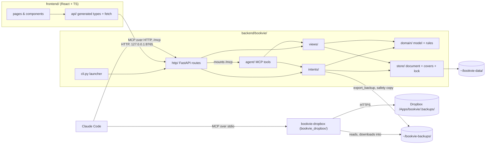
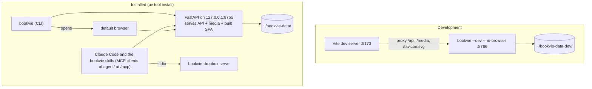
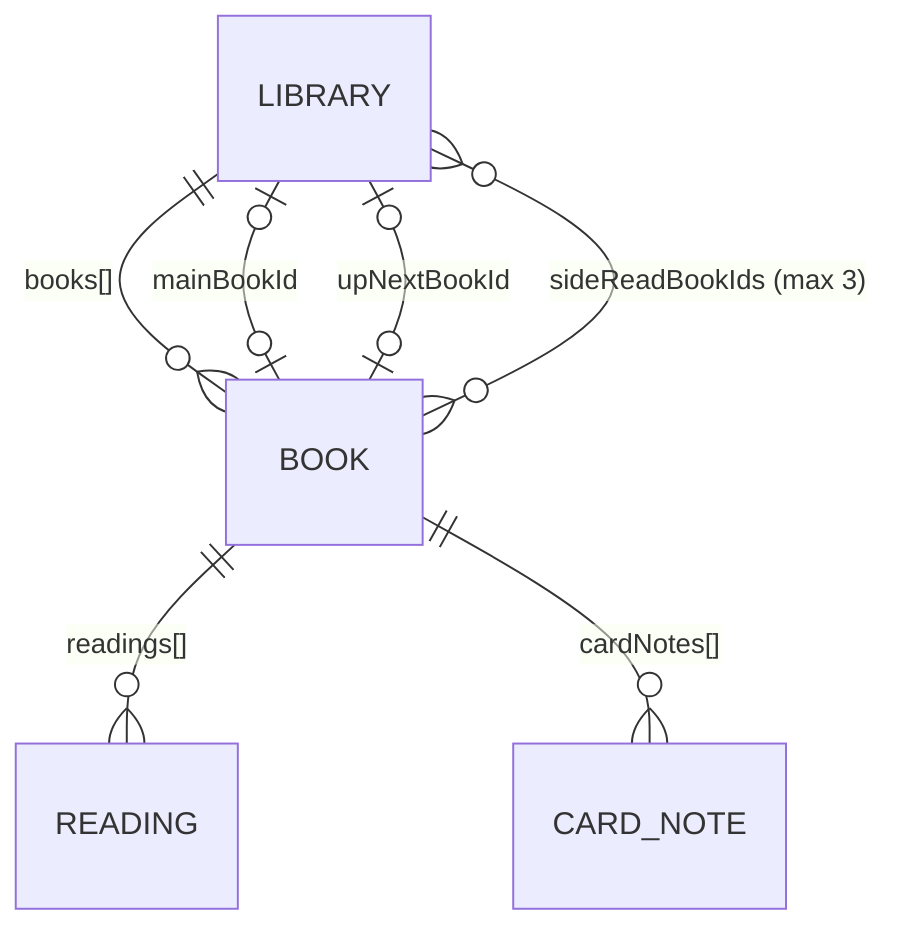

# Architecture Spine: bookvie

## Design Paradigm

**Server-owned domain, intent API, server-computed views.** One local Python process is the only reader and writer of the data folder. Its clients are the user's browser and AI agents in Claude Code, through the agent tools at `/mcp` (AD-21; Epic 12). The four bookvie skills are such agents: `bookvie-new-book` and `bookvie-notes-summary` (Stories 12.7 and 12.8), `bookvie-backup` (Story 13.4) and `bookvie-restore` (Story 13.8). They read and write only through the tools, and call bookvie over plain HTTP only in step 1: `/api/health` and a probe of `/mcp` (AD-8). They send **intents** (one user action each) and read **views** (read models the server computes), which the browser renders. No client holds domain state of its own. The diagram shows the browser client; an agent's tool call reaches the same `intents/` and `views/` through `agent/` (AD-21). The Dropbox backup (Epic 13) adds a second process, `bookvie-dropbox`: a stdio MCP server that Claude Code starts. It never touches the data folder or calls bookvie, and the bookvie server never calls Dropbox (AD-22).



Dependency direction (an arrow means "may import"): `http → intents, views → domain`; `intents, views → store`; `agent → intents, views` (`http/app` mounts `agent/`; `agent` never imports `http/api`); `views → intents.contract` only, for the refusals a view raises (book not found, the stats range, `find_book`'s blank query; Story 12.2), while `intents` never imports `views` (`backend/tests/test_layers.py` `ALLOWED_MODULES`); `domain` imports nothing from the other layers; `store` imports only `domain` types; `bookvie` and `bookvie_dropbox` never import each other, and nothing under `bookvie/` imports `dropbox` or `keyring` (AD-22). Export is `GET /api/export`, implemented in `intents/export` but not under `/api/intents/`; restore is the intent `POST /api/intents/restore` (`intents/restore`). The frontend imports only `api/`, never server internals.

## Invariants & Rules

### AD-1: One local process owns the data folder [ADOPTED]

- **Binds:** A1, all persistence, FR-28, FR-29, FR-30
- **Prevents:** browser-local storage (IndexedDB, localStorage, File System Access) splitting the agent's catalog from the user's; any code other than `store/` writing data files, or reading them outside the AD-4 lock.
- **Rule:** All data lives in one folder on disk, and only the server touches it. Every write goes through `store/`, except `bookvie.lock`, which the launcher's `instance.py` creates, hands over and removes before and after the server runs (AD-5). The one read outside `store/` is export: `intents/export` packages `library.json` (the bytes on disk) and the referenced covers itself, while holding the AD-4 lock, because export *is* the data folder packaged (AD-14; decided in story 2.1, reconciled in Epic 2 retro item 1). No feature may persist domain data in the browser. The one thing written outside the data folder is an agent's backup (AD-21; story 12.6): `export_backup` creates the backups folder (with its parents) when it is missing, writes a `.bookvie-backup-<date>.zip.tmp*` temp file there and renames it to that day's `bookvie-backup-<date>.zip`. The zip is a copy, read back only by a restore the user runs, and by AD-22's readers: `record_backup_upload`'s hash check, `list_local_backups` and `preview_restore`. An agent's restore (AD-22) also writes a safety copy, `bookvie-pre-restore-<YYYY-MM-DDTHHMM>.zip`, into the same folder; `write_safety_copy` creates the folder (with its parents) when it is missing, and resolves it through symlinks (story 13.1). `bookvie-dropbox` is another process: it writes only `from-dropbox/` inside a backups folder, and never the data folder (AD-22). `download_backup` creates `from-dropbox/` with its parents, so it can create a missing backups folder too (story 13.7).

### AD-2: The text store is one JSON document, written atomically [ADOPTED]

- **Binds:** A3, Data-safety NFR, FR-22, FR-23
- **Prevents:** partial writes; a second store; two code paths serializing differently.
- **Rule:** All textual data is a single `library.json` with the shape in AD-18. `store.serialize()` is the only function that produces its bytes: UTF-8, camelCase keys, nulls kept, keys in model order, 2-space indent, non-ASCII written as is (`ensure_ascii=False`), LF line endings, exactly one trailing newline. Every commit writes a temp file in the same folder, fsyncs it, renames it over the original, and then fsyncs the folder so the rename survives a power cut (skipped on filesystems that can't fsync a folder). The rename is the commit: a failed folder fsync after it is logged, not reported. If any step fails, the original is untouched and the intent reports `couldnt_save`. A change may instead report that nothing changes (`store.UNCHANGED`, AD-9's no-op): then nothing is written, and any new files it brought are removed again under the same AD-4 lock (story 4.4). Before the first commit, every start fsyncs the data folder's parent (and the parent of any ancestor it creates) and the data folder itself, so the data folder, `covers/` and `.staging/` survive a power cut even after an interrupted earlier start. A failed flush refuses startup, except for a parent bookvie can't read, which is logged and skipped. At startup the server deletes leftover `library.json.tmp*` and `local-state.json.tmp*` files from an interrupted write (AD-15), and exits non-zero with a message naming the path if the data folder isn't writable. If `library.json` is missing but `covers/` holds files, startup is refused before `library.json` or `covers/` changes (any entry in `covers/` counts, and an unreadable `covers/` is refused too): an empty library would let the AD-12 sweep delete every cover (decided in story 1.13). The message says to restore `library.json` or empty `covers/`.

### AD-3: Domain rules live only in the server; mutations arrive only as intents [ADOPTED]

- **Binds:** FR-1, FR-3, FR-5 to FR-10, FR-14, FR-16 (Custom's pre-check), FR-17, FR-22, FR-23, FR-28, FR-31, A2, A3
- **Prevents:** rules duplicated in TypeScript and Python without a shared check (the sanctioned pre-checks are below); stale whole-library writes overwriting another browser's changes; one user action split across several calls that can half-fail.
- **Rule:** Each user action is exactly one intent call: `POST /api/intents/<verb>`. An intent validates, applies **every** consequence, runs `domain.check_invariants()`, and commits once (AD-2), or it changes nothing: it returns a refusal, or, when it asks for what is already so, a 200 no-op that commits nothing and so runs no `check_invariants()` (AD-9; story 4.4). An edit is never such a no-op: `edit-book` and `edit-card-note` commit an unchanged edit (AD-9; story 5.2). No CRUD or PATCH endpoints on entities, and no whole-document write endpoint. A client may pre-check an input against a rule the server also enforces, to refuse or correct it without a round trip, showing the server's exact copy whenever it shows one:
  - the page field's range check ("Page must be between 0 and N.", story 3.3, `frontend/src/lib/pageField.ts`);
  - the Start dialog's "Which page?" (story 4.7, `frontend/src/components/StartDialog.tsx`), which the dialog asks only for a Side read. It reuses that range check, and refuses an empty value with "Which page? is required.";
  - the Stats page's Custom range (story 6.3, `frontend/src/lib/stats.ts` `orderedRange`, `frontend/src/pages/StatsPage.tsx`). It sends no request while either date is empty or invalid, sends the earlier date as `from`, and swaps a To before From in the fields silently when focus leaves them. So the user never meets the stats view's 422s for a half range or a `to` before `from` (AD-9). These have no copy shown in the app; the server still refuses such a request.

  The server still refuses the same input; the two dialogs show its exact copy. A shared case table keeps the range check in step (`frontend/src/lib/pageField.cases.json`, read by both the client's unit tests and `backend/tests/test_update_page.py`). Known gap: nothing shared keeps "Which page?"'s empty-value copy in step. Each side's tests hard-code it, and the e2e test never reaches the server (open in `deferred-work.md`). A pre-check never adds a rule the server lacks. `bookvie-new-book`'s same-book question isn't a pre-check: it never refuses, it only asks the user before `add_book` (AD-8 known gap). Every intent is `multipart/form-data` with a JSON part named `intent`, including those with no file (`delete-book`, `set-spine-color`, `set-favourite`), so every route parses its body one way. Intents that carry a file (`add-book`, `edit-book`, `restore`) add a file part. Each is still one call and at most one commit.
- **The favourite star** (FR-31; Epic 16): `POST /api/intents/set-favourite` with `{bookId, favourite}` sets the value it is sent and never toggles, so a second press before the refetch repeats the same value. Setting the current value is the 200 no-op above. A Book that is gone is 409 `book_not_found`, checked inside the commit like the other intents. It is the only writer of `favourite` (AD-18).
- **Agent tools are a second way in, not a second set of rules:** an agent's write tool is one intent call made in-process. It hands the route's own `parse_*_intent` the same JSON and calls the same handler, so it validates, refuses and commits exactly as the route does (AD-21). The one check a tool adds is `edit_book`'s refusal of a call missing a form key, made before the route's parser runs, so a partial edit can't clear the fields it left out (AD-21 Edits are whole; story 12.4). No tool mutates through any other path, except the tool-only writers `export_backup` and `record_backup_upload`, which write only outside `library.json`, and `restore_backup`, which wraps the restore handler's cores with its gate and safety copy (AD-21, AD-22; Epic 13).
- **Concurrency across tabs:** intents carry no version and no precondition. Each applies to the server's current state (AD-4 serializes them; AD-19 Targeting), so the last intent wins for every field it sends (A2). An open form keeps the values it opened with, and AD-7's refetch doesn't change them, so a stale form in one tab can undo a change made in another: an Edit panel opened before a popover color change puts the old color back on save, and a stale "Remove cover" removes a cover uploaded later. Within one tab the Edit panel is modal, so this can't happen; reloading shows the current data. This is A2 as written; the silent loss it allows (retro F-R1) is closed as an accepted deviation for single-tab use (Oleg, 2026-11-03). The agent's `edit_book` tool (AD-21) makes that case possible: a tab's open Edit panel can undo an agent's edit when it saves. That is accepted too, for the same reason (Oleg is both; 2026-11-19). Revisit, with a document `revision` and an `expectedRevision` refusal, if it ever loses an edit in practice.

### AD-4: All writes, export and restore are serialized

- **Binds:** AD-2, AD-3, AD-14
- **Prevents:** two concurrent requests both loading state and one silently discarding the other; an intent overwriting a restore; an export capturing a half-replaced cover.
- **Rule:** One in-process lock covers *apply intent → write files → commit document → swap in-memory state*. `export` and `restore` hold the same lock: export while it builds the zip (not while it sends it), and restore for the whole operation, staging included. Views read the committed in-memory state. The writes outside the lock are `local-state.json` ("Last export" and the upload state, AD-15), written after the download has gone out or the backup file is in place, or when an agent reports a backup run (AD-22), and an agent's backup file (AD-21). An agent's restore writes its safety copy inside the restore's own lock hold (AD-22). `local-state.json` never touches `library.json` or `covers/`, and it is atomic on its own (story 2.1). Three readers read it from disk, outside the lock: `views/backup`, `views/shelf` (home, story 3.1) and `export_backup`, which reads `autoBackup.lastUpload.libraryHash` for `unchangedSinceUpload` (`intents/backup_daily` `_last_upload_hash`, through `store/local_state` `read_group`; story 13.3).

### AD-5: One server instance per data folder [ADOPTED]

- **Binds:** AD-1, CLI
- **Prevents:** two processes writing the same folder.
- **Rule:** The server holds `bookvie.lock` (PID and port) in the data folder, created with exclusive-create so two launches can't both take it. When `bookvie` finds a live lock, it opens the browser at the recorded URL and exits. A lock is live only when its PID is alive **and** `GET /api/health` on the recorded port answers `{ "app": "bookvie", "dataDir": "<path>", "pid": <int> }` for this data folder (`pid` added in story 1.2 for the AD-16 hand-over). A `--dev` server's health also carries `checkout`, and a `--dev` launch that finds a live dev server from another checkout refuses instead of opening it (AD-16; Epic 11 retro item 80). A lock younger than 5 seconds may belong to a server that is still starting: a second launch polls health instead of taking it over, and if nothing answers in time it says "bookvie is starting in another window; try again." and exits 1. Any other lock (dead PID, a reused PID, no answer) is taken over. On SIGINT or SIGTERM the server waits for the AD-4 lock, then removes `bookvie.lock` and exits.

### AD-6: The server owns domain numbers and selections; the client owns presentation [ADOPTED]

- **Binds:** FR-4, FR-7, FR-11, FR-15, FR-16, FR-17, FR-18, FR-19, FR-20, FR-24, FR-25, FR-26, FR-27, FR-31
- **Prevents:** percentage, Measured pace, days left, Waiting order, stats or library scope being computed in two places with different results; the client deciding for itself whether it talks to a development server.
- **Rule:**
  - **The server computes:** percentages (`floor(page × 100 ÷ pages)`, so 100% only at the last page; story 3.1, `domain/progress`), Measured pace, days left, pages left (per Book and library scope; below), Waiting for you and its order (every paused Reading except the Up next Book's, `pausedAt` oldest first with a Reading that has none before all, then the title key, then Book id; `pausedAt` itself is never sent; story 4.2), whether Home's Up next is paused (`upNext.paused`, story 4.1), each Book's role and its waiting page (Main book, then Up next, then waiting for a paused Reading; `views/shelf` `_role_reading`; stories 4.1 and 4.6), a Book's Card notes in page order (`pageStart`, then `createdAt`, ties keeping stored order; `views/shelf` `card_note_views`, story 5.1), the `card-notes` view's groups (one per Book that has notes, ordered by the title key, then Book id; `?book=<id>` scopes it to that Book's group, empty when it has none; story 5.3; each group and the scope carry `spineColor`, the Book's stored resolved color (AD-11) as stored, the scope even when the Book has no notes, story 14.1), the Main book's note count on Home (`cardNoteCount`, story 5.3), the Home bookcase slice's priority, stats for a requested date range including the bars, the "X of Y finished" meter, and the `book` view's `editForm` (story 12.4): the Edit panel's 13 fields as strings, exactly as the panel prefills them, which `edit_book` accepts back unchanged (AD-21). The panel still builds its own prefill (`lib/bookDetail` `toPanelFields`); one case table keeps the two equal (`frontend/src/lib/editForm.cases.json`, read by `lib/bookDetail.test.ts` and `backend/tests/test_edit_form_parity.py`; Epic 12 retro item 87).
  - **Pages left** (`domain/progress` `pages_left`, story 6.1): a Book with an unfinished Reading (active or paused) has max(pages − `currentPage`, 0) left; a Book with no Reading has all its pages; a Book whose Readings are all finished has 0, so a finished Book queued for a re-read counts 0 until the re-read starts (FR-15; Epic 6 retro E6-R2, accepted). The `book` view carries the Book's `pagesLeft`; the `catalog` view carries the library's, the sum of every Book's, so the two scopes can't disagree (story 6.2). Both carry `measuredPace` (`null` without one) for the calculator. Home's days left uses the same `pages_left`.
  - **Stats view** (`views/stats`, stories 6.3 and 6.4): `GET /api/views/stats?from=YYYY-MM-DD&to=YYYY-MM-DD`, both inclusive local dates; omit both for All time. Response `{ books, pages, bucket: "month" | "year", buckets: [{ period, books, pages }] }`. Every finished Reading whose `finishDate` falls in the range counts once with its stored `finishedPages` (AD-11), back-fills and re-reads included; Side read marks change nothing.
    - **Buckets:** one per calendar month the range touches, both ends included, so a range starting 15 March has a March bucket counting from the 15th. `bucket` is `year` when that is more than 24 months (exactly 24 stays `month`). `period` is `YYYY-MM`, or `YYYY` by year. Buckets come oldest first, and a period with no finishes is 0 books and 0 pages, never left out. All time spans the earliest finish to the latest; with no finished Reading it returns 0 books, 0 pages, `bucket: "month"` and `buckets: []`, the only case with no buckets.
    - **Refusals:** a half range, a value that isn't a `YYYY-MM-DD` date (a datetime or `2026-02-30` included), or a `to` before `from` is 422 `invalid_fields` on that field (AD-9).
    - **Presets:** the browser resolves them to dates from its local today, never UTC: This month = the 1st..today, This year = 1 January..today, Last year = the full year, All time = no dates (`lib/stats.ts` `presetRange`). Custom's range is AD-3's pre-check.
  - **App info** (`views/app_info`, FR-26 and FR-27; story 11.2): `GET /api/views/app-info` returns `{ version, mode: "dev" | "production", dataDir, commit }`. `version` is `bookvie.__version__`. `mode` is `dev` exactly when the server was started with `--dev`, whatever served the bundle; it is the only dev signal the client may read (the DEV pill, the `DEV · ` title prefix), never `import.meta.env.DEV`. The one other is the Backup page's `dropboxBackup.state` `dev`, which the server decides the same way (AD-22 Dropbox backup line; story 13.6). `dataDir` is the resolved data folder as the server formats it for display: `~` for the home folder, a full absolute path outside it. `commit` is the short git hash, read once at startup and only with `--dev` (`git rev-parse --short HEAD` in the package's source folder); it is `null` in production and when git or a checkout isn't there, never an error. `create_app` holds the view as `app.state.app_info`; the CLI passes `version` and `commit` in, because `views` can't import the package's top level. `/api/health` stays the AD-5 instance probe, outside the OpenAPI schema; it gains only the dev-only `checkout` (AD-16).
  - **The client may only apply presentation to the views it has fetched:**
    - the catalog sort (`lib/catalog.ts` `sortBooks`, `lib/catalogSort.ts`, `components/SortSelect.tsx`; story 7.1): Author sorts by the first listed author string, Title A–Z, Date added newest `createdAt` first, Pages fewest first. Names compare with one `Intl.Collator` with `numeric: true`, so "Volume 2" comes before "Volume 10" (7.1 review). Every key then breaks ties by title, then `createdAt` older first (compared as instants, since offsets can differ), then Book id by code unit, so the order is total and equal keys never swap between fetches. Reversed (FR-20 Sort direction, `components/SortDirectionToggle.tsx`; story 10.1): `sortBooks` negates only the primary compare and never the tie-break chain, so ties keep the same order in both directions; choosing another key resets the reversal to false. The collator uses the browser's default locale. The bookcase spines, the List rows and the bookcase keyboard order all follow one sorted array. The choice is a UI preference (AD-15: `bookvie.catalogSort`, default Author; the reversal in its own `bookvie.catalogSortReversed`, default false). Home's slice reads it (key and reversal) when it mounts and packs its rows in that order before `slicePriority` picks them (below);
    - the catalog filter chips (`lib/catalogFilter.ts`, `components/FilterChips.tsx`; story 7.2): Favourites (Epic 16), a lone on/off toggle that keeps only Books whose `ShelfBook.favourite` is true and counts as its own group for the AND rule, then Status (Read is the view's `finished`, so a finished Book queued for a re-read is Read), Type, Language, Tag and Publisher (Epic 15). Chips in a group combine with OR; groups combine with each other and with Search titles with AND; an empty group is no constraint. Type, Language, Tag and Publisher compare the Book's stored `type`, `language`, `tags` and `publisher`, which the catalog view's `ShelfBook` carries as stored; Language, Tag and Publisher ignore case, and a Book with no tags never matches a Tag filter. The client builds the Language, Tag and Publisher value lists itself from the catalog view's Books: each value once, keyed by `toLocaleLowerCase` with the first spelling in library order as its label. Language and Tag are in collator order. Publisher is ordered by its Book count in the whole catalog view, most first, then collator order, and each value carries that count; the count and order never depend on the other filters or Search titles. The server's `merge_tags` keys by `casefold`, so a pair such as ß/SS can merge on one side only (story 7.2 review, accepted). Each filter change announces the combined search and filter count, "N books match." (`lib/catalog.ts` `matchCountCopy`), and the filters apply to the bookcase and the List alike. Checked values that no Book has any more after a refetch are ignored (`liveFilters`), and once the view is loaded they are also removed from the page's filter state, so a Book that gets the value back later in the same visit shows unfiltered under an unchecked row (`pages/CatalogPage`; Epic 15 retro item 105). Filters are page state only: never stored, reset when Catalog unmounts or a Book is added, and never applied to Home's slice or the "X of Y finished" meter. Favourites follows the same rules, except that `liveFilters` never turns it off: with nothing starred it stays on and the catalog shows its empty state. It counts as a filter for "Clear filters", which turns it off, and for that empty state. When an unstar with the chip on hides that Book, `pages/CatalogPage` owns what follows, never the star's own flow or `useSpinePopover`'s fallback: it takes the success line through `useFavourite`'s `onSaved` (AD-7) and holds the Book as a pending unstar. Once the refetched view no longer shows the Book, it moves focus to the next shown Book in sort order, else the previous, else Search titles, but only when the render took focus away: focus on nothing, on `body`, on `main` (where a closed popover's fallback puts it) or on an element the render hid (`focusTakenAway`). A refetch nobody pressed for leaves focus where the person is. Either way it then cancels a Search titles count still waiting and announces the star line and the match count as one message (EXPERIENCE.md → Favourite star). The pending unstar belongs to its press only until the person acts again: a Search titles change, a filter change (Clear filters too), the next star press or a New book save drops it silently, so an unstar whose refetch failed never moves focus or speaks later. Turning the chip off first speaks only the filter count, with no star line (Epic 16 retro item 107);
    - packing spines into rows by viewport width, and on Home choosing up to 3 of those rows from the view's `slicePriority` (Book ids: the Main book, then Up next, then finishes newest first; story 3.5): free slots up to 3 are filled from the first bookcase rows, priority ids not on the shelf are ignored, and the Main book's row comes first with the others in bookcase order, which is the remembered catalog sort (`frontend/src/lib/slice.ts`);
    - spine names (`lib/catalog` `spineName`, `spineNames`): "*Title* by *First author*, *status*". Twins, Books whose full names are equal, get their edition, then year, then pages appended until they differ. A starred Book's name then ends with ", favourite", after the status. Twins are found on the name without it, so starring one Book never renames another (Epic 16). `spineNames` runs over every Book of the catalog view, never a searched, filtered or sliced subset, so the bookcase, Home's slice and the Tiles view give a Book the same name;
    - the catalog Tiles view (FR-25; `pages/CatalogTiles.tsx`; stories 8.1 to 8.3): packing tiles into columns by viewport width (`repeat(auto-fill, minmax(140px, 1fr))`), in the same sorted and filtered array as the bookcase and the List; tiles the search or filters leave out are `hidden`. A tile's marks read the catalog view as is: the finished ribbon is the view's `finished`, and the reading bar shows only when `percent` is not null and fills to `percent` (never recomputed from `currentPage` and `pages`; story 8.2). The tile's accessible name comes from the same builder as the spine's name, so the two can't disagree. The cover is `/media/<coverFile>` (`lib/bookDetail` `coverSrc`, as on Home and Book detail), where `coverFile` is the stored `covers/<name>` (AD-12) on the catalog view's `ShelfBook` (added in Python first, then `api:gen`, AD-8); it loads lazily at its stored size, with no thumbnails (Deferred → Cover thumbnails). A Book without a cover, or whose cover fails to load, gets a typeset cover in Tiles only: read (the view's `finished`) is the exact `spineColor` with a plate holding the title and first author; unread is the `spine-unread-*` colors with no plate (story 8.3). The Main book card, the Up next thumbnail and Book detail keep the no-cover placeholder;
    - the gauge's ticks: 0 · round(pages ÷ 2) · pages, the half tick dropped under 4 pages (story 3.1);
    - case-insensitive substring text search (Search titles, Search card notes). It compares the text as stored, with no Unicode normalisation (unlike the server's title key), so a decomposed accent can fall outside a match (Epic 5 retro E5-R3, accepted). Search card notes wraps each match in `<mark>` and counts the matching notes itself for "N notes match." on the List and the open box, and in Boxes view for the shelf sentence ("N card notes in M Books contain “…”.", `shelfCountLine`). The Card notes page picks the line for the view shown (`countLine`); `useSearchCount` is generic and reads that line when the typing pause ends, and a carried search's one announcement reads it once the view is settled, ready and not fetching (AD-7; `lib/cardNotes.ts`, `lib/useSearchCount.ts`, `pages/CardNotesPage.tsx`; stories 5.3, 14.4 and 14.5);
    - Book detail's Card notes block showing the first three notes of the view's page order, and every matching note while its search holds text (stories 5.1 and 5.3);
    - pile order and shuffle, with an injectable random source (`lib/cardNotes.ts` `shuffled`; story 5.4);
    - the Card notes page's two views (FR-19; Epic 14): Boxes and List render the `card-notes` view's groups in the view's order, and neither sorts. A Card note box's front and the open box strip (`scope.spineColor`) use the view's `spineColor` exactly, whether the Book is read or unread, never the `spine-unread-*` colors. One matcher (`lib/cardNotes.ts`) decides what matches for the List's filter, the open box, each box's "M of N" and the shelf sentence's totals, so the two views and a carried search (AD-7) can't count differently. The pile's height step (EXPERIENCE.md → Card notes shelf), the count line's totals (a sum over the loaded groups), each box's accessible name and the match counts are computed in `lib/cardNotes.ts`, not in the page;
    - copy and date formatting, including relative "N days ago" counted in local calendar days;
    - the Quick pace calculator's arithmetic and line (`lib/pace.ts`, `components/PaceCalculator.tsx`; stories 6.1 and 6.2). Book detail hosts it for the Book's `pagesLeft`, and Catalog for the library's, behind "How long until…?". Days to finish = max(1, ceil(pages left ÷ pages per day)), and the finish date = today + days by local calendar day: the same rounding and minimum as the server's days left. A shared case table keeps the two in step (`frontend/src/lib/pace.cases.json`, read by `lib/pace.test.ts` and `backend/tests/test_pace_calculator.py`). Under 60 days the line reads days; otherwise months = round(days ÷ 30.4375), and from 24 months years = round(months ÷ 12). The field takes plain decimals only (no sign, exponent or comma). Anything else, a pages-per-day of zero or less, or a finish date out of range shows no result and no message. With nothing left to read it shows "Nothing left to read." instead of the field. The field is prefilled with `measuredPace` rounded to one decimal, a trailing ".0" dropped. While its text is that prefill, the days use the unrounded `measuredPace`, so Book detail agrees with Home's days left; any other text uses the typed number (Epic 6 retro item 55; EXPERIENCE.md → Pace calculator);
    - the Stats bars (`components/StatsBars.tsx`, `lib/stats.ts`; story 6.4): each bar's height is its pages over the range's largest (`barShare`), the period under it reads "Jan" with the year added on the first bar and on each January, and a year bucket reads "2026". The chart is `aria-hidden`; a visually hidden table (Period, Books, Pages) carries the same buckets.
  - **Days left** is `max(1, ceil(pages left ÷ Measured pace))`, and null when there is no Measured pace, when it is 0, or when no pages are left (story 3.4); the client then omits "~N days left".
  - **One agent-side derivation (accepted, story 12.7):** `bookvie-notes-summary` derives a label for the document it writes. From `get_book`'s `currentReading` and `readings[]` (each Reading carries its `purpose`), it picks the Reading whose Purpose the summary uses and labels the book in progress, finished or not started. The label never goes back into bookvie and isn't AD-19's Reading status. This is the only accepted exception to the server computing selections. Any other client that needs this label, or another derivation, gets it from a view instead, and `get_book` would then compute this one (Epic 12 retro item 82).

### AD-7: The client never patches cached state

- **Binds:** frontend data layer, FR-14 (finish moment), FR-19 (the carried Card notes search), FR-31 (the favourite star), A2, A3, Couldn't-save pattern, Tone NFR
- **Prevents:** optimistic UI showing a change that was refused or never written; features refreshing different subsets of views; the finish moment replaying; a one-shot announcement on arrival speaking a stale cached count; a reload or Forward bringing back a Card notes search, or Back bringing back the text a box was opened with instead of its latest.
- **Rule:** No optimistic updates. View queries are keyed `['view', name, params]`. After every intent response, success or refusal, the client invalidates **all** views. All views also refetch when the window regains focus or becomes visible. A success live-region announcement is made only after the refetched views have rendered. On `couldnt_save` or a network failure, the UI keeps the user's input and shows "Couldn't save. Your data wasn't changed." The finish moment plays only in the tab that received the successful `finish-reading` response, never because of a view change (story 3.7). It is carried as router state on the navigation to Home and cleared from that history entry once Home consumes it. When the finish lands while another Book is Main, the state is dropped unplayed, so a reload never replays it (retro item 22). The moment scrolls the finished spine into view if needed, then fills it from its current fill to full over about 600 ms with the highlight ring. A finished re-read plays the ring only. Under reduced motion the fill and ring are instant and the scroll uses `behavior: 'auto'`. A finish of a Book that wasn't Main when the Finish dialog opened stays on Book detail: focus moves to the page `h1`, then the `status` region reads "Finished *X*.", and no moment plays (story 4.5).
- **The favourite star** (FR-31; Epic 16) follows the rule: it changes only once `set-favourite` succeeds and the views have refetched, and a failure leaves it as it was, with nothing to roll back. This supersedes the favourite plan's D7 (Oleg, in the Epic 16 UX update). The flow is `lib/useFavourite`; the button is `components/FavouriteStar`, never disabled, so a second press while a save is out repeats the same value (AD-3). On success `status` says "*Title* is a favourite." or "*Title* is not a favourite." after the refetch. On a failure the `alert` line shows in the inline slot (Book detail, an open Spine popover) when the slot the press came from is still rendered as it fails, else in the row slot under Catalog's filter row, and moves to the row for good once the inline slot goes. Home's slice renders no row slot, so there the line stays in the shell's regions; it clears at the next save attempt and on a filter change. A caller may pass `onSaved`, called on success before the line: when it returns true, the caller speaks instead. Only `pages/CatalogPage` does, for an unstar with the Favourites chip on (AD-6). Catalog runs one flow for its three views and the popover; Book detail and Home's slice (`pages/Bookcase`) each run their own.
- **Last-page start:** a start that returns `reachedLastPage` (AD-19) carries the started Book's id as router state to Home. Home opens the Finish dialog for that Book once per history entry, and only when its home view shows that Book as Main at its last page with no other dialog of that entry open. Otherwise the hand-off is dropped, never applied to another Book, and a reload never reopens it (Epic 4 retro item 36). A page save that returns `reachedLastPage` opens the Finish dialog for the saved Book once per history entry, only when the home view rendered after the save still shows that Book as Main. There is no at-last-page check, so a failed refetch, which keeps the old view, still opens it; and unlike the start hand-off it has no other-dialog guard (`HomePage` `lastPageSave`; `deferred-work.md`, Low).
- **Carried Card notes search** (FR-19; Epic 14, story 14.5; EXPERIENCE.md → Card notes shelf). This supersedes "router state" for the text in plan D12 and EXPERIENCE.md's notes for architecture.
  - **Where the text lives:** only in React state of the route component `CardNotesPage`. It is never in the URL, in storage or in `history.state`, which the browser keeps across a reload. Nothing else crosses a navigation. The page's body is keyed by `location.key`, so each history entry gets a fresh body: a view query without placeholder data, and fresh pile, panels, pending count and focus maps. On each `location.key` change the page scrolls to the top (`behavior: 'auto'`) before the `h1` takes focus. After a client-side POP (Back or Forward within the app), the browser restores the entry's old scroll position after the router has rendered it, so the page scrolls to the top again once the view is `ready` and once more on the next frame, before it paints. Only after a POP: on a first load a queued frame could undo a scroll made after the content is shown (story 14.5).
  - **Router state** carries only navigation facts, and the page builds it. A box link's push (`CardNoteBox` takes it from the page) carries a carry marker and `openedFrom`, the shelf entry's `location.key`. That key can be `"default"`, compared like any other. The "In *X*" chip's push carries the marker. The marker is ignored on mount.
  - **When the text is kept:** on each `location.key` change on this route, in two cases only. One is a PUSH carrying the marker. The other is a POP that lands on the `openedFrom` of the entry just left (Back from the open box), which keeps the open box's latest text. Every other change starts empty: the nav link (a REPLACE on the shelf itself), any other link, Forward, any other POP. A reload, an arrival from another route, or a history move across a document remounts the page, so it starts empty too. A bfcache restore keeps the page as it was left, as before Epic 14. While the view is settled (ready and not fetching) with no groups, the text is dropped. A stale cached empty view that is still refetching doesn't count, since it can be older than the Book's notes (Epic 14 retro item 98). Switching Boxes ⇄ List is no navigation and keeps the text.
  - **The module:** `lib/carriedSearch.ts`. The route component calls `useCarriedSearch({ noGroups })`, which holds the text and the handled location and makes the decision below; `carryState(openedFrom?)` builds the router state for a box link's push (with `openedFrom`) and the chip's (without).
  - **How the page decides:** during render, never in an effect, and never by writing a ref in render. It keeps the last location it handled, `{ key, state }`, in React state and updates it together with the text in the same render (`HomePage`'s hand-off pattern). "The entry just left" is that handled location, and a move the router coalesced counts from it. A unit test runs the decision under `<StrictMode>`, because e2e runs a production build.
  - **Announcement:** a carried search is announced once, from the new entry's view once it is settled (ready and not fetching: `useCardNotesView`'s `fetching`) and after the `h1` has focus, by an effect that cancels on cleanup. The cached copy still renders at once; only the announcement waits. Typing, or opening Edit, Add, the pile or the chip, drops a pending carried line first (`silence()`), so the typed path or the opened surface speaks instead (Epic 14 retro item 98).
- **Dialogs read fresh views:** a dialog that fixes its answers when it opens waits for views fetched after it mounted, never a cached copy, because only active views refetch after an intent (retro item 22). Start and Finish wait for a `book` view; the Start dialog also waits for a home view fetched after it mounted (`useFreshHomeView`) for its trade-off and displacement lines (`upNext.id`, `upNext.paused`; story 4.1). Pause decides on its press from a home view fetched then (`useFetchFreshHomeView`, which also refreshes Home's cache; `usePauseFlow` `decide`, story 4.3): with an Up next it opens the Confirm dialog with the displacement line; without one, or when the Book isn't Main any more, it sends `pause` at once, and a stale tab's refusal takes the refusal path; a failed fetch sends nothing and shows the couldn't-save line. The remaining gap is a change made between that fetch and the intent (Deferred → Stale confirmation guard).
- **One-shot reads on arrival read a settled view** (Epic 14 retro item 99, E14-R1): an announcement or decision made once on arrival, on mount or on a history-entry change, acts only on a view that is settled, ready and not fetching, never on a stale cached copy. A view query with cached data shows it at once and refetches it (`staleTime` 0), so "ready" alone can be the copy from before an intent; and a one-shot read is not repeated when the refetch lands, so nothing corrects it. Rendering the cached copy at once stays (no loading flash on Back); only the one-shot read waits. The view hook reports `fetching` (the query's `isFetching`) for this, as `useCardNotesView` does for the carried Card notes search and its drop on an empty view (above). A dialog that fixes its answers when it opens follows the stricter rule above (a view fetched after it mounted). Settled means not fetching, not fetched: a failed refetch keeps the cached copy and counts as settled. That is accepted for the carried search (`deferred-work.md`, item 98's code review); a later view whose one-shot read can't accept it should wait for a fetch made after it arrived instead.
- **App info is an ordinary view** (stories 11.2 to 11.4): keyed `['view', 'app-info']`, invalidated after every intent and refetched on focus like the rest, which is how a tab left open finds a newer server. The client compares `version` with the version baked into its bundle (AD-8) and shows the update notice while they differ. A failed fetch keeps the last data; with no data yet, the shell looks like production and shows no notice. It is read by `AppShell` and `lib/page` (the DEV pill and title prefix), by Backup's About this copy (lines from `lib/aboutThisCopy`, shown only while the view has data), and by `components/UpdateNotice` (rules in `lib/updateNotice`). The notice is a band with Reload under the top bar, not a dialog, an alert or a live region: the shell's polite `status` region announces it when the shown version changes (when the shell loads with a differing version, and when a refetch brings another one), unless another message is still waiting for its tick (`lib/announce`'s `isAnnouncing()`). Then that message wins and the announcement is not retried; the band and Reload stay.

### AD-8: Python is the contract's source of truth; TS types are generated [ADOPTED]

- **Binds:** all intents, views and error codes; the agent tools' schemas (FR-28); the app version (FR-27)
- **Prevents:** hand-written TS types drifting from the Python models; the bundle and the server disagreeing about the version they ship as.
- **Rule:** Pydantic models define every intent body, view, success response and error code. TS types are generated from FastAPI's OpenAPI, using alias names, with `openapi-typescript` into `frontend/src/api/generated/`. They're never edited by hand. `npm run check:api` regenerates the types and fails on any diff. The bookvie skills are agent clients: `bookvie-notes-summary` (skill 2.0.0) and `bookvie-new-book` (skill 3.0.0) since Stories 12.7 and 12.8, `bookvie-backup` (1.0.0, story 13.4) and `bookvie-restore` (1.0.0, story 13.8). They read and write only through the agent tools, and the two older skills' scripts that built intent bodies and copied `domain/duplicates`' rule (`add_book.py`, `check_catalog.py`, `fetch_notes.py`) are deleted. Known gap: `bookvie-new-book` step 2 still judges "the same book" itself (an ISBN hit, or the same title, an author in common, the same `edition` and, when the format is known, the same `type`) to decide whether to stop and ask the user. That judgement differs from `domain/duplicates.is_duplicate`, and nothing keeps the two in step. It only decides what the skill asks; `add_book`'s 409 `duplicate_book` (AD-10) stays the guard. They still depend on two things the generated types don't check. One is `/api/health`, which starts their step 1. The other, since Epic 12 retro item 84, is a hand-written `curl` POST to `/mcp`: a sessionless `tools/call` of `get_app_info` with no `initialize`, which works only because the mount is stateless with JSON responses (AD-21). It tells an older bookvie (404 or 405, or no answer) from one with the tools. All four skill tests pin that step (`backend/tests/helpers.py` `check_the_older_bookvie_probe`). Claude Code connects to MCP servers when a session starts, so all four skills carry the same step 1: start bookvie if `/api/health` doesn't answer, probe `/mcp`, and when the tools are missing ask the user to reconnect the entry with Claude Code's `/mcp`, or give the README's one-time `claude mcp add` line. They use the `bookvie` entry (port 8765), or `bookvie-dev` (8766) when the user asks for the dev library, except `bookvie-backup`, whose step 1 is cut to the `bookvie` entry: a development library is never uploaded (AD-22). The tools' advertised schemas are generated from the same Pydantic models, and a test compares them (AD-21). The one hand-written part is the JSON type of each `JsonValue` property, declared in `agent/tool_base.py` `JSON_VALUE_TYPES` (AD-21 One validator). `bookvie_dropbox`'s three tools are outside this rule: it imports nothing from `bookvie`, so their input schemas are hand-written (`bookvie_dropbox/server.py` `UPLOAD_BACKUP_SCHEMA`, `LIST_BACKUPS_SCHEMA`, `DOWNLOAD_BACKUP_SCHEMA`, closed objects), and each tool checks its own arguments, answering a wrong argument set with cause `other` (AD-22 Dropbox tools; stories 13.2 and 13.7).
- **One version** (story 11.4): the bundle bakes its version at build time from `frontend/package.json` (`__BOOKVIE_VERSION__`, a Vite `define` declared for `tsc -b` in `src/globals.d.ts`); the server reports `bookvie.__version__` (AD-6 App info). `scripts/release.sh` sets both, and `frontend/scripts/version.test.mjs`, run by `check:api`, fails unless `bookvie.__version__`, `backend/pyproject.toml`, `package.json` and `frontend/package.json` agree, so a hand edit or a merge can't leave every tab showing a false update notice.

### AD-9: One response contract for success and failure

- **Binds:** all intents, the views that refuse (`book`, `card-notes`, `stats`, and the tool-only `find_book`), A3, bookvie's agent tools' errors (AD-21, and AD-22's bookvie tools). `bookvie-dropbox`'s tools answer their own `{cause, message}` instead (AD-22 Causes).
- **Prevents:** endpoints inventing their own error shapes; FastAPI's default `{"detail":[…]}` reaching the client; the UI unable to tell "refused" from "not saved", or unable to report several fields at once.
- **Rule:**
  - **Success:** HTTP 200 with `{ "ok": true, "ids"?: {<name>: <uuid>}, "reachedLastPage"?: true }`.
  - **Failure:** `{ "error": { "kind": "refusal" | "couldnt_save" | "couldnt_export", "code": "<snake_case>", "message": "<user copy>", "fields"?: [{ "field", "code", "message" }] } }`.
    - HTTP 422 means field validation or a refused upload. For field validation `code` is `invalid_fields`, and `fields` lists every failing field. `start-reading`'s `page` ("Which page?") is such a field: required for a Side read, and a whole number from 0 to the Book's pages whenever it is sent (story 4.7). For uploads: a cover that isn't a supported image is a field error, and a refused restore archive is a `refusal` with one of the AD-14 codes, `restore_invalid`, `restore_newer_version` or `restore_unsafe`, with no `fields`. `restore_unsafe` shows `restore_invalid`'s copy. A restore body over the upload limit plus 64 KiB of multipart framing is 422 `restore_unsafe`: refused before anything is read when `Content-Length` says so, otherwise as soon as the counted bytes pass the limit while the form is parsed. Either way it is before the restore takes the lock (story 2.3).
    - HTTP 413 `cover_too_large` means a cover upload over 20 MB (AD-12); `fields` carries "Cover must be 20 MB or smaller."
    - HTTP 409 means a state rule (e.g. `duplicate_book`, `pages_below_current_page`). An intent whose target is no longer in a state it can act on is refused, never applied to another Book: `book_not_found` (the Book was deleted), `not_main_book` (`update-page` or `pause` for a Book that isn't Main), `reading_already_finished`, `already_main` (`start-reading` for the Main book), `main_cannot_be_up_next`, `main_cannot_be_side_read`, `side_reads_full` ("You already have 3 side reads. Remove one first."), `card_note_not_found` (`edit-card-note` or `delete-card-note` for a note the Book no longer has, another Book's note id included; checked after `book_not_found` and before the fields; story 5.2). A 409 refusal about one field (e.g. `pages_below_current_page`) includes `fields`.
    - One view answers 422 `invalid_fields`: `GET /api/views/stats` for a half range, a value that isn't a `YYYY-MM-DD` date, or a `to` before `from`, on the `from` or `to` field (story 6.3). The parsing and the copy are in `views/stats.py` (`IsoDate`, `check_stats_range`; moved there in story 12.2), shared by the route and the `get_stats` tool. `find_book` (AD-21) refuses a blank query the same way: 422 `invalid_fields` on `query`, "Give part of a title, an author or an ISBN." (story 12.2). The app never sends these (AD-3's Custom pre-check), so its copy and the envelope's summary are only seen by hand-made requests (Epic 6 retro E6-R5, accepted).
    - HTTP 404 `book_not_found` (kind `refusal`) comes from a view, not an intent: `GET /api/views/book` for an id no Book has (decided in story 1.11), and `GET /api/views/card-notes?book=<id>` likewise (story 5.3). The client shows its not-found page.
    - On an intent route, a body that can't be parsed (broken multipart, a part over 1 MB, too many fields) is 422 `invalid_fields` on `intent`, the same refusal as a malformed `intent` part (retro item 8).
  - Unknown `/api` paths aren't enveloped: a GET or HEAD 404s through the SPA route, and any other method gets Starlette's 405 `{detail}`. No `/api` route answers `{detail}`. Outside `/api`, `_McpRoute` answers 404 `{"detail": "Not Found"}` for any `/mcp…` path other than `/mcp` itself, and the SDK's transport makes its own non-enveloped answers at `/mcp` (AD-21).
    - An intent that would change nothing is a no-op success, not a refusal. These return 200, change nothing and commit nothing:
      - `set-up-next` for the Book already Up next (story 4.4);
      - `mark-side-read` for a Book already a Side read, checked before `side_reads_full` (story 4.7);
      - `unmark-side-read` for a Book that isn't one (story 4.7);
      - `set-favourite` with the Book's current value, checked after `book_not_found` (Epic 16).

      The intent's change returns `store.UNCHANGED`, so `Store.apply` skips the commit under the AD-4 lock (AD-2). An edit is not a no-op: `edit-book` and `edit-card-note` commit an unchanged edit as normal (story 5.2).
    - HTTP 500 or 503 means `couldnt_save`. A restore write fault (staging, cover copy-in or the document commit) is 503 `couldnt_save`. When `check_invariants()` fails after validation passed, that is a server bug: the intent commits nothing, logs the failed rule to stderr, and returns 500 `couldnt_save`.
    - HTTP 503 with kind and code `couldnt_export` means export failed to read the data; nothing was sent (AD-14).
    - The agent restore tools add three codes (AD-22; story 13.1): 422 `restore_outside_backups` (a path outside the backups folder), 409 `restore_not_confirmed`, whose error object also carries `reason` (`declined`, `cancelled`, `unsupported`, `expired`, `changed`), the one code with that key, and 503 `safety_copy_failed` (kind `couldnt_save`).
  - A global `RequestValidationError` handler maps framework validation errors into this shape. The server owns all message copy (PRD §5 Tone), and the client renders it as is; the exceptions are AD-3's pre-checks, which show the server's copy verbatim before sending. Error codes are an enum in the contract.

### AD-10: Duplicate detection is a server refusal

- **Binds:** FR-3
- **Prevents:** the duplicate rule being implemented in the form and skipped by other paths.
- **Rule:** `add-book`, and `edit-book` when title, author or ISBN changed, refuse with 409 `duplicate_book` unless the intent carries `confirmDuplicate: true`. "Add anyway" resends the same intent with that flag. ISBN normalization and author-set comparison live in `domain/`.

### AD-11: Stored, not recomputed

- **Binds:** A4, FR-1, FR-14, FR-16, FR-24
- **Prevents:** stats or spine colors changing when Pages or the cover is edited later; the UI unable to tell a user's color from a derived one.
- **Rule:** These values are stored, never recomputed on read:
  - **Book spine colors:** `spineColorUser` (null = automatic), `spineColorFromCover` (computed once per uploaded cover), `spineColorCurated` (assigned at creation), and the resolved `spineColor` (user, else from-cover, else curated). The resolved color is re-resolved only by intents that change one of its inputs.
  - **Finished Reading:** `finishDate` (a local date) and `finishedPages` (the page count at finish).
  - **Back-filled Reading:** `startDate: null`.

### AD-12: Covers use immutable names; files go in before the document and come out after it

- **Binds:** A5, FR-1, FR-21, FR-22, FR-23
- **Prevents:** a failed commit leaving a document pointing at an overwritten image; browsers showing a cached old cover; dangling references.
- **Rule:**
  - The server downscales every uploaded cover to a long edge of at most 1200px, after re-decoding it with Pillow, which rejects anything that isn't an image. Uploads are capped at 20 MB, counted while streaming; a larger upload is refused with 413 `cover_too_large` (AD-9).
  - **Decoding:** EXIF orientation is applied before downscaling (`ImageOps.exif_transpose`). Pillow's `MAX_IMAGE_PIXELS` stays on, and a decompression bomb is refused like a non-image. CMYK is converted to RGB, and only the first frame of an animated image is kept. Formats Pillow can't decode without a plugin, such as HEIC, are refused with a message naming the supported formats (JPEG, PNG, WebP); no HEIC plugin is added.
  - **Output:** covers are re-encoded as JPEG, or PNG when the image has transparency. `<ext>` comes from the output format, never from the uploaded file name.
  - Each upload is stored under a new server-minted name, `covers/<book-id>-<uuid>.<ext>`, recorded in the Book's `coverFile`. A name is never reused or overwritten.
  - **The order is always,** unless the change is a no-op: write the new files (temp + rename), commit the document, then delete files no Book references. When the change turns out to be a no-op (AD-2, AD-9), the new files are deleted again and nothing is committed. No intent sends files with a possible no-op today.
  - **After the commit:** once the document commit succeeds, the intent has succeeded. A failure while deleting unreferenced files or emptying `.staging/` is logged to stderr and left for the startup sweep; the response is still 200, never `couldnt_save`.
  - **Remove cover:** `edit-book` with `removeCover: true` (offered only when a cover exists) clears `coverFile` and `spineColorFromCover`, re-resolves `spineColor` (AD-11), and deletes the file after the commit, per the order above.
  - Covers are served at `/media/covers/<file>` with immutable caching.
  - **No staging for covers:** each new cover is written as `covers/<name>.tmp*`, fsynced and renamed into place. `.staging/` is restore's scratch only (AD-14).
  - **Restored covers:** restore stores an archive's covers byte for byte, through the same temp + rename. The upload and output rules above (downscale, re-encode, minted name) don't apply; each referenced cover only has to be present and decodable. A name already in `covers/` is never overwritten: its file is kept, and when the archive's copy differs that is only logged (story 2.2).
  - At startup the server removes cover files that no Book references, including `covers/*.tmp*` leftovers. When `library.json` is missing but `covers/` holds files, startup is refused instead (AD-2).

### AD-13: Versioned document; one migration chain [ADOPTED]

- **Binds:** A6, FR-22, FR-23, startup load
- **Prevents:** restore and startup handling old formats differently; a newer file being half-understood; a migration bug destroying the only copy.
- **Rule:**
  - `library.json` carries an integer `schemaVersion`.
  - A single ordered migration chain in `store/migrations/` upgrades older versions, both at startup and on restore.
  - Store models use `extra="forbid"`: unknown keys are refused, never silently dropped. Every persisted-shape change bumps `schemaVersion` by exactly 1 with exactly one migration step, and a test asserts the chain is contiguous from 1 to the current version.
  - Before a startup migration rewrites the file, the server copies the original to `library.v<N>.bak.json`.
  - The chain runs in memory and the result is committed once. If any step raises, the server exits non-zero with a message, and the original file and its backup are unchanged.
  - A newer version or an invalid file is refused, and nothing changes.
  - Version 4 (Epic 16) adds each Book's `favourite`: the step from 3 sets it to `false` on every Book (`store/migrations` `CURRENT_VERSION` and `domain/model` `SCHEMA_VERSION` both become 4), so a library or a backup from before Epic 16 loads and restores with no Book starred.

### AD-14: Export is the data folder packaged; restore validates, then applies the AD-12 order [ADOPTED]

- **Binds:** FR-22, FR-23, A6
- **Prevents:** an export format that drifts from storage; a restore that fails halfway; malicious or damaged archives.
- **Rule:**
  - **Export:** `GET /api/export` returns one `.zip` holding `library.json` (the bytes on disk) and `covers/` (always present as a directory entry, even when empty) with every cover the library references, and nothing else. Unreferenced files in `covers/` are left out: the startup sweep would delete them anyway (story 2.1). The request guard requires `X-Bookvie-Export: 1` on this route (AD-16). Under the AD-4 lock the zip is built into a spooled temp file (in memory up to ~10 MB, then on disk); the lock is released, then the file is sent. A read failure happens before any header is sent and returns 503 `couldnt_export`. "Last export" (AD-15) is recorded only after the last byte has been sent with no client disconnect; a HEAD request or an aborted download records nothing. The server can't know whether the browser kept the file, so "Last export" means "last complete download", or the last backup file an agent wrote (AD-21).
  - **Restore route:** `POST /api/intents/restore`, multipart (AD-3), with the file in the `archive` part. Refusals are 422: `restore_invalid` (not a zip, damaged, no `library.json`, schema or invariant failure, missing or undecodable cover), `restore_newer_version`, and `restore_unsafe` (a path, symlink, duplicate, entry or size rule; same user copy as `restore_invalid`). A write fault before the commit is 503 `couldnt_save` (AD-9).
  - **Restore validation:** restore empties `.staging/`, then unpacks into it. It accepts only the entries `library.json`, the `covers/` directory and `covers/<name>` with a plain name: no absolute paths, no `..`, no symlinks. Names are compared under NFC + casefold (`NFC(casefold(NFC(name)))`): two names equal that way are duplicates, and so is a cover whose name differs only in case or Unicode form from one already in `covers/`, because on a case-insensitive filesystem, or on APFS (which ignores Unicode normalization), they would share one file (story 2.3; Unicode form added by Epic 2 retro action 2). Full casefolding also matches pairs APFS keeps apart, such as `ß` and `ss`; those are refused too, on the safe side. A cover whose name inside `covers/` is over 200 UTF-8 bytes is refused, which keeps it and its `<name>.tmp` + 8-character temp under the 255-byte file-name limit (minted names are 77 bytes); if the filesystem still rejects a staged file's name (ENAMETOOLONG, EILSEQ, EINVAL), that is `restore_unsafe` too, while any other write failure stays `couldnt_save`. A missing `covers/` counts as empty.
  - **Restore limits:** the upload is at most 1 GiB, the archive holds at most 5,000 entries (directory entries included), and at most 1 GiB is extracted. A central directory over 1 KiB per allowed entry is refused before it is parsed. The extracted size is counted on the bytes actually written, never on sizes declared in the zip headers, and extraction stops before the chunk that would pass the limit. An entry that inflates past its declared size is `restore_unsafe` even under the limit (story 2.3). These limits fit about 2,000 Books with downscaled covers (about 300 KB each) plus `library.json` up to its 10 MB performance ceiling. Then it validates the whole archive: schema, migrations, AD-18 invariants, and every referenced cover present and decodable.
  - **Refusal precedence:** the first rule broken decides the code. In order: a central directory over its limit (`restore_unsafe`); not a zip (`restore_invalid`); the upload size, entry count and name rules (`restore_unsafe`); no `library.json` (`restore_invalid`); unpacking, where passing a size rule or a file name the filesystem rejects is `restore_unsafe` and a damaged entry `restore_invalid`; a newer `schemaVersion` (`restore_newer_version`, decided before model validation and the cover checks); anything else (`restore_invalid`). A body far over the upload limit is already refused by the body cap (AD-9).
  - **Restore apply:** following the AD-12 order, restore adds the archive's covers, commits the document via AD-2, then deletes covers the new document doesn't reference.
  - **Failure and cleanup:** a failure before the commit leaves current data untouched. `.staging/` is emptied after every restore, refused or not, and at startup.
  - **Round trip:** export → restore at the same `schemaVersion` reproduces byte-identical `library.json` and covers. The one exception is AD-12's no-overwrite rule: a cover name already in `covers/` with different bytes keeps its file. Minted names are never reused, so only a hand-made archive reaches it.

### AD-15: State that is not exported [ADOPTED]

- **Binds:** A6, FR-22 "Last export", FR-29 (the upload state), FR-20, FR-24 and FR-25 (the remembered Sort and its direction, and Bookcase · List · Tiles), FR-17 (the remembered card note Add another), FR-19 (the remembered Card notes view)
- **Prevents:** "Last export" disagreeing between browsers; UI preferences polluting the export; an export wiping the upload state, or an upload moving "Last export".
- **Rule:** The last-export timestamp is stored in `local-state.json` in the data folder, as `{"lastExportAt": "<ISO-8601 with offset>"}`. It's outside the export, and restore never touches it (an archive entry with that name is `restore_unsafe`). It is written like a commit (temp `local-state.json.tmp*`, fsync, rename, folder fsync) but outside the AD-4 lock (AD-4); a write failure is only logged, because the download already succeeded. Its readers are `views/backup`, `views/shelf` (home, story 3.1) and `export_backup` (AD-4; story 13.3). Story 13.3 added a second key group, `autoBackup`, the upload state (AD-22). One writer, `store/local_state` `LocalStateWriter`, under its own `threading.Lock` (not the AD-4 lock), read-modify-writes only the group it changes and keeps every other key as it read it; `Store.record_export` is a call to it, and the whole-file `local_state_bytes` is gone. A test records an upload, an export, then an upload, and both groups survive.
  - **Damaged files:** a malformed file (not JSON, or not a JSON object) is logged and read as empty, and the next write replaces it with the written group alone. A file that can't be read (an `OSError` other than not-found) is `CouldntSave` for the writer and left as it is, so no key it holds is lost: an export only logs it, and `record_backup_upload` answers `couldnt_save` (story 13.3). A missing file reads as no export yet. An unreadable or malformed file, or a `lastExportAt` that isn't an ISO-8601 time with an offset, is logged and read the same way (`read_last_export`; story 2.1). A JSON object with no `lastExportAt` (`{}`, or a file holding only `autoBackup`) is valid: no export yet, and nothing is logged (story 13.3). `read_group` reads one group the same way and never raises; what the Dropbox backup line can't read is in AD-22.
  - **UI preferences** (theme, catalog view, sort, the sort's reversal, the Card note panel's Add another, the Card notes view) live in browser `localStorage`, per browser, wrapped in try/catch with defaults. The Card notes view is `bookvie.cardNotesView`, `"boxes"` or `"list"` (`lib/cardNotesView.ts`, like `lib/catalogView.ts`; story 14.2). A missing or junk value, or a read that throws, means Boxes, and a failed write keeps the choice for the visit. The sort's reversal is its own key (`bookvie.catalogSortReversed`), so the format of `bookvie.catalogSort` never changes; a missing or junk value, or a stored key that isn't one of the four or no stored key at all (Author is then only the fallback), reads as not reversed, so reversing also stores the shown key (story 10.1 review).

### AD-16: Stable loopback address, local trust

- **Binds:** CLI, FR-26, FR-28 (the `/mcp` mount is guarded like `/api`), §5 Look and feel (the favicon), security
- **Prevents:** the bookvie skills losing the app behind a random port; LAN or cross-site access to the user's data; a development server opening the real library or taking the real app's port.
- **Rule:**
  - **Binding:** the server binds `127.0.0.1` only, on port `8765` by default. `--port` overrides it, and the lock records the actual port. With `--dev` the defaults are port `8766` and the data folder `~/bookvie-data-dev`, so a development server and the real app run side by side; an explicit `--port` or `--data-dir` still wins (FR-26; story 11.2). A `--dev` server's `/api/health` also reports `checkout`, the resolved folder its `bookvie` package runs from. A `--dev` launch that finds a live server on its data folder (through the lock, or through a port conflict on the same folder after handing the lock back) joins it only when that checkout is the same folder as its own (`instance.same_folder`). A server that reports no checkout counts as another checkout. Otherwise the launch prints "bookvie: a --dev server from another checkout (<its checkout>) is already running on port <port> with <data folder>. Stop it, or start this one with --port <number> --data-dir <folder>." and exits 1. Production launches never compare (Epic 11 retro item 80).
  - **Real library refused:** with `--dev`, `cli.py` resolves the data folder (`~`, symlinks and `..` included) right after parsing and, when it is the same folder as the resolved `~/bookvie-data`, prints "bookvie: --dev won't use your real library (~/bookvie-data). Leave out --data-dir to use ~/bookvie-data-dev, or pass a scratch folder." and exits 2, before `instance.py` takes the lock or the store opens. "The same folder" is `instance.same_folder`: file identity (`os.path.samefile`, so firmlinks and case variants of an existing folder count), or equal resolved paths when a folder doesn't exist yet. Failing both, the two paths are also compared NFC-normalized and casefolded when the disk ignores case. That is probed on the real library's nearest existing ancestor whose name has a cased letter (its swapcase twin is the same folder); a probe error refuses, and the platform decides when no ancestor can be probed. On a case-sensitive disk a case variant is another folder and is allowed. No test touches the real `~/bookvie-data`: they set `HOME` to a temporary folder (story 11.2; Epic 11 retro item 76).
  - **Port conflict:** if the port is held by a process that isn't bookvie, startup exits with a message naming the port and `--port`. If `GET /api/health` on that port answers as bookvie for another data folder, the message says so and names that folder instead. If it answers for this data folder, this launch took over the lock of a server that is in fact alive. When health reports a live `pid`, it hands the lock back by rewriting `bookvie.lock` as the running server's `{pid, port}`; when it reports no live `pid` (only a pre-1.2 bookvie), the launch leaves `bookvie.lock` in place rather than removing it. That lock still names the exiting launch, so under AD-5 it is stale and the next launch takes it over. Either way it then opens the browser at that server (prints the URL with `--no-browser`) and exits 0 (decided in story 1.2), unless, with `--dev`, that server runs from another checkout (see Binding), when it exits 1 after the hand-back.
  - **Request guard:** requests are rejected when their `Host` isn't `127.0.0.1:<port>` or `localhost:<port>`, or when an `Origin` is present and isn't one of those. With `--dev`, the Vite dev origin is also allowed.
  - **Fetch metadata:** a simple cross-site GET carries no `Origin`, so requests to `/api/*`, `/media/*` and `/mcp` are also rejected when `Sec-Fetch-Site` is present and isn't `same-origin` or `none`. `same-site` is refused because any app on another loopback port is same-site. A missing header passes (curl, the bookvie skills' probes, browsers too old to send it), so GET routes still avoid side effects where they can. The one GET with a side effect, `/api/export` (it records "Last export"), also requires exactly one `X-Bookvie-Export: 1`, which the app's export fetch sends: a cross-site `` or no-cors GET can't set a custom header, and a cross-site fetch that sets one needs a CORS preflight, whose foreign `Origin` the guard refuses. This holds in browsers that send no `Sec-Fetch-Site`; scripts add the header. SPA routes and `/assets` stay open to cross-site links. `--dev` needs no exception: the Vite proxy forwards the browser's `same-origin` value.
  - **No authentication:** anything on the machine that can reach the loopback port is trusted.
  - **SPA routes:** the server serves the built SPA and falls back to `index.html` for client routes, with `Cache-Control: no-cache`, because it names the build's hashed assets, which a rebuild deletes. Other build files are served as is, except files named `index.html`, `favicon.svg` or `favicon-dev.svg` in any letter case: those get the fallback, so only the favicon route serves an icon and a production server serves no amber (Epic 11 retro item 76).
  - **Favicon** (stories 11.1 and 11.2): a dedicated `GET`/`HEAD` `/favicon.svg` route, registered before the SPA catch-all, serves the build's `favicon.svg` (sage) from a production server and `favicon-dev.svg` (amber) from a `--dev` one, as `image/svg+xml` with `Cache-Control: no-cache`, because a dev server on an explicit `--port 8765` shares the real app's origin. `index.html` links `/favicon.svg` once and the client never changes it. The Vite dev proxy forwards `/favicon.svg` with `/api` and `/media`, so a dev tab gets the backend's file, not Vite's own `public/` copy.

### AD-17: Accessible names are stable, and e2e drives by them

- **Binds:** the New book panel, the Duplicate dialog, Search titles, every flow the e2e suite drives
- **Prevents:** e2e tests coupled to markup or CSS classes for the controls the table names; a label renamed in one place and left stale in EXPERIENCE.md.
- **Rule:** EXPERIENCE.md's table of accessible names is the source of truth for the names it lists, and the Playwright suite finds the controls it lists by role and that name, not by test ids or classes. Renaming one is an ordinary change: EXPERIENCE.md, the component and the e2e tests change together. No agent depends on these names; agents use the tools (AD-21). (Narrowed on 2026-11-19 when FR-2 was retired; it was "The Agent Label Contract is a public interface".)

### AD-18: Canonical document shape and its invariants

- **Binds:** every intent, view and migration; FR-1, FR-5 to FR-8, FR-14, FR-17, FR-31
- **Prevents:** two epics storing the same entity in different places, e.g. Card notes nested in one epic and top-level in another; pointers left dangling after a delete.
- **Rule:**
  - `library.json` is `{ schemaVersion, mainBookId|null, upNextBookId|null, sideReadBookIds[], books[] }`. Each Book carries `id`, `createdAt` (timestamp, for the Date added sort), `ownership` (`owned`), `coverFile|null`, the AD-11 color fields, `favourite` (a bool, required in the store model with no default like every field, so a version 4 file or archive without it is refused, `restore_invalid` on restore; Epic 16), and its PRD fields. It owns its nested `readings[]` and `cardNotes[]` (`{ id, text, pageStart, pageEnd|null, createdAt }`). A Card note's `pageEnd` is null for one page and otherwise greater than `pageStart`, never equal to it: `add-card-note` and `edit-card-note` parse the Page field on the server (`domain/note_pages`), storing "42–42" as 42 with `pageEnd: null` (story 5.1). A Card note's `text` is non-blank and trimmed: both intents store it with `str.strip()` applied. `check_invariants()` enforces all three (`card_note_page_end_after_start`, `card_note_text_required`, `card_note_text_trimmed`; Epic 5 retro item 49). A Book's `language` and each of its `tags` are non-blank and trimmed: `add-book` and `edit-book` store them with `str.strip()` applied, the language required and empty tags dropped (`domain/book_fields`). `check_invariants()` enforces that too (`book_language_required`, `book_language_trimmed`, `book_tag_required`, `book_tag_trimmed`; Epic 7 retro item 60), so no whitespace can give Catalog's Language and Tag lists an unnamed or doubled checkbox; the lists merge case themselves (AD-6). A Book's `title`, each of its `authors` and its `publisher` are non-blank and trimmed too, with at least one author (`book_title_required`, `book_title_trimmed`, `book_authors_required`, `book_author_required`, `book_author_trimmed`, `book_publisher_required`, `book_publisher_trimmed`). No author holds a `;` and no tag a `,` (`book_author_no_semicolon`, `book_tag_no_comma`), since the Edit form joins them with "; " and ", " and `split_authors` and `split_tags` split there; no two tags are equal under `casefold()` (`book_tags_unique`), as `merge_tags` merges them. A non-null `coverFile` is `covers/<plain name>`, exactly what `domain/cover_file.cover_name` accepts (`book_cover_file_in_covers`), so no `coverFile` can point outside `covers/`; whether the file exists is restore's check (AD-14). Restore and startup share `validate_document`, so both refuse a `library.json` that breaks any of these rules. Nothing else is top-level.
  - **The favourite:** any Book can have it, read or not. It adds no `check_invariants()` rule. `add-book` stores `false`, and only `set-favourite` changes it (AD-3). `edit-book` and every other intent keep the stored value: `favourite` is not an Edit form field, so it is never in the `book` view's `editForm` or `edit_book`'s input (AD-21 Edits are whole), and a whole edit can't unstar a Book. The catalog and home views' `ShelfBook` and the `book` view carry it as stored, so Book detail, Tiles, List, the Bookcase, its popover and Home's slice read the same field.
  - Main book, Up next and Side reads exist only as root pointers. `domain.check_invariants()` runs before every commit and enforces:
    - Book ids are unique in the library, and Reading ids are unique within their Book (added with the Side-read rule, `spec-unique-side-reads-and-directory-fsync.md`). Card note ids are unique in the library (`unique_card_note_ids`; Epic 5 retro item 49), because the unscoped Card notes page keys its Edit buttons by note id across all Books;
    - every pointer references an existing Book;
    - the Main book is neither Up next nor a Side read;
    - no Book is a Side read more than once, and there are at most 3 Side reads;
    - a Book has at most one unfinished Reading;
    - the Main book has an unfinished Reading;
    - card-note pages and an unfinished Reading's `currentPage` are within the Book's page count. A Reading's `startPage` and its `earlierSegments` pages (whole numbers from 0) are deliberately not bounded by the page count, so they can exceed Pages after an edit (Epic 4 retro item 35);
    - a Reading with `earlierSegments` has a start date, and each segment's `endPage` differs from the next segment's `startPage` (or the Reading's own `startPage` after the last one), since a resume at the same page keeps the segment (spec-pace-counts-only-pages-read).
  - Pointers change only inside an intent's commit:
    - `start-reading`, `pause` and `set-up-next` move them as AD-19 states. Starting a Book also removes it from `sideReadBookIds`.
    - `mark-side-read` and `unmark-side-read` add a Book to `sideReadBookIds` or remove it, and nothing else (story 4.7).
    - Deleting a Book clears every pointer to it.
    - `finish-reading` clears `mainBookId` and `upNextBookId` when they name the Book, and removes it from `sideReadBookIds` (story 4.5).
    - An edit-book back-fill on a Book with no Readings removes it from `sideReadBookIds` and leaves `upNextBookId` (Epic 4 retro item 34).

    A vacated Main book or Up next stays empty: nothing fills it by itself.

### AD-19: Reading identity and status

- **Binds:** FR-1 (edit-mode Finished on), FR-5 to FR-11, FR-14, FR-15, FR-17 (Card note targeting), FR-24
- **Prevents:** a resumed Reading still counting as paused; two unfinished Readings on a re-read; the page update and the Finish dialog both finishing a Reading.
- **Rule:**
  - **Fields:** a Reading stores `id`, `startDate|null`, `startPage` (a whole number from 0: the page the Reading's current segment starts at; a new Reading's starting page, 0 on a back-fill; added in `schemaVersion` 2 by Epic 4 retro item 35, whose migration step sets it to 0 on every v1 Reading, so Measured pace is unchanged for old data), `earlierSegments` (a list of closed segments `{startPage, endPage}`, empty on a new or back-filled Reading; added in `schemaVersion` 3 by spec-pace-counts-only-pages-read, whose migration step sets it to `[]` on every v2 Reading, so each old Reading is one segment and its pace is unchanged), `currentPage`, `purpose|null`, `lastProgressUpdate|null` (timestamp; set by `update-page` and by `start-reading`; null on a back-filled Reading, and the re-entry line then omits "Last updated"), `pausedAt|null` (a local date, overwritten on every pause and never cleared, not by resume nor by finish), `finishDate|null`, `finishedPages|null`, `purposeFulfilled|null` and `rating|null`.
  - **Current Reading:** a Book's current Reading is its single unfinished Reading.
  - **Status:** `domain.reading_status()` is the only status function. A Reading is *finished* if it has a `finishDate`, *active* if its Book is `mainBookId`, and *paused* otherwise. `pausedAt` is ignored while the Reading is active. The notes-summary skill's "in progress / finished / not started" is a label for its document, not this status (AD-6, One agent-side derivation).
  - **Starting:** one `start-reading` intent resumes the current Reading, or creates a new one when the Book has none. It does all of the following in the same commit:
    - **The previous Main book.** Starting while another Book *Y* is Main pauses *Y*'s Reading (`pausedAt` = today) and makes *Y* `upNextBookId` (FR-7; stories 3.2 and 4.1). With no Main book, `upNextBookId` stays as it is, except that it becomes `null` when it was the started Book.
    - **The displaced Up next** only loses the pointer, and its Readings are untouched. So a paused one is in Waiting for you, and a Side read stays on the side (a paused Side read is in both). One that is neither is back in the catalog.
    - **A sent `page`** ("Which page?") becomes the Reading's `currentPage`, even below the paused page, and a new Reading's `startPage`. A resume at a page other than `currentPage` closes the current segment: `{startPage, endPage: currentPage}` is appended to `earlierSegments` and `startPage` becomes the sent page. A resume at the same page, or with no page, keeps the segment. The `page` is required for a Side read (422 on `page` without it) and honored for any Book. `update-page` never closes a segment. The started Book leaves `sideReadBookIds` (story 4.7).
    - **The Purpose** is stored trimmed, null when empty (`domain/purpose`).
  - **Pausing and Up next:** `pause` pauses the Main book's current Reading (`pausedAt` = today, overwriting an earlier one; nothing else of it changes), clears `mainBookId` and makes the Book `upNextBookId`, displacing an earlier Up next as above (story 4.3). `set-up-next` moves only `upNextBookId`, with the same displacement. The Main book can't be Up next (story 4.4).
  - **Back-filled finishes in edit:** edit-book's Finished on adds or moves a *past* finish only. With an active or paused Reading that has a start date, a new or changed date after that start is refused ("Finished on can't be after *date*, when the current reading started."); the start day itself is allowed (retro item 21). A back-fill on a Book with no Readings finishes it, so the Book leaves `sideReadBookIds` in the same commit; `upNextBookId` stays (Epic 4 retro item 34). A changed latest finish can't be before another finished Reading's `finishDate` ("Finished on can't be before *date*, when an earlier reading finished."); the same day is allowed, and the rule is an intent field check, not an invariant (spec-finished-on-keeps-readings-in-order).
  - **Finishing:** only `finish-reading` sets `finishDate` on a current Reading; edit-book's Finished on sets it on a past or back-filled Reading (above). `finish-reading` finishes any Book's current Reading, Main or not. For a Book with no Readings it appends a back-filled Reading (`startDate` null). In the same commit it clears `mainBookId` and `upNextBookId` when they name the Book, and removes the Book from `sideReadBookIds` (story 4.5). `update-page`, or `start-reading` with a `page`, at the last page saves the page and returns `reachedLastPage: true`. The client sends a `page` only for a Side read, so in practice that is a Side read's start. The client then opens the Finish dialog for that Book, under AD-7's Last-page rules.
  - **Targeting:** intents address `bookId` (and `readingId` where a finished Reading is edited, `cardNoteId` where a Card note is edited or deleted; story 5.2) and apply to the server's current state. A2 last-write-wins applies to confirmation dialogs too. [ADOPTED]

### AD-20: Time is injected and local

- **Binds:** domain, FR-10, FR-11, FR-14, FR-16, AD-19
- **Prevents:** tests and code disagreeing on "today"; finish dates shifting by timezone.
- **Rule:** `domain/` never calls the system clock directly. It receives a `Clock` (now, plus today as a local date in the machine timezone) that tests replace. Local dates are `YYYY-MM-DD`; timestamps are ISO 8601 with offset. Measured pace (`domain/pace`) is Σ pages read ÷ Σ (finishDate − startDate + 1) over every finished Reading with a start date, re-reads included, where a Reading's pages read are Σ max(`endPage` − `startPage`, 0) over its `earlierSegments` plus max(`finishedPages` − `startPage`, 0). Only tracked pages count, so a Side read started at p.300 adds only the pages after it (Epic 4 retro item 35), and a resume at another page skips the pages between (spec-pace-counts-only-pages-read). It excludes back-filled Readings and any Reading finished before it started, counts a missing `finishedPages` as 0, and lives only in `domain/` (story 3.4). The browser computes its own "today" for presentation (AD-6), so in e2e tests the Playwright fixture sets the browser clock (`page.clock`) to the same date it passes as `--fake-today`, and the browser `timezoneId` to the server's pinned `TZ`. The pinned zone is `Europe/Madrid`: `check:py` and `check:e2e` run with `TZ=Europe/Madrid`, and Playwright sets `timezoneId: 'Europe/Madrid'`. DST boundary tests use the last Sundays of March and October. Views don't carry the server's date.

### AD-21: The agent tools are an in-process MCP surface over the same intents and views

- **Binds:** FR-28, FR-30, FR-31, AD-3, AD-4, AD-5, AD-6, AD-8, AD-9, AD-12, AD-14, AD-15, AD-16, AD-20, AD-22
- **Prevents:** a second process opening the Store; an agent write validating, coercing or answering differently from its intent; a partial edit wiping a Book; a destructive action reachable without its confirm dialog; a cover download reaching the app itself or the local network; a scratch, test or development server writing over the real backups.
- **Rule** (built in Epic 12, stories 12.1 to 12.6; the backup report and restore tools in Epic 13, AD-22):
  - **Mount** (story 12.1): each `create_app` builds a fresh MCP server (`agent.build_mcp_server`), because an SDK session manager runs only once. It is the SDK's low-level `Server` (`mcp.server.lowlevel.Server`), not `MCPServer`: `MCPServer`'s tool registration validates and coerces arguments and wraps errors as "Error executing tool", which One validator below forbids. `streamable_http_app(json_response=True, stateless_http=True, …)` is called only to build the session manager, which holds the body cap and transport security. A custom route, `http/app` `_McpRoute`, serves that manager at exactly `/mcp` for every method. It answers 404 for any other `/mcp…` path (`/mcp/mcp`, `/MCP`, `/mcp/x`), and there is no redirect to `/mcp/`, which a Starlette `Mount` would add. It is registered before the API, media, asset and favicon routes and the SPA catch-all, and `mcp` joins the server prefixes the catch-all never serves. The session manager runs in the app's lifespan. Production and `--dev` alike, so starting `bookvie` starts the tools. Stateless, with JSON responses, so a restart never strands a client's session, and a client can call `tools/call` without `initialize` (the skills' step-1 probe relies on that, AD-8). The body cap is the intents' 1 MiB. There is no stdio transport and no subcommand. Claude Code is the only supported client; the skills' `curl` probe is the one hand-written call. Claude Code negotiates MCP 2026-07-28 with this mount, which `restore_backup`'s question relies on (AD-22).
  - **Guard:** `/mcp` sits behind the AD-16 request guard and its `Sec-Fetch-Site` check, like `/api`. The SDK's own Host/Origin check is turned off (`enable_dns_rebinding_protection=False`), so AD-16 is the only guard and every refusal is its 403, never a 421.
  - **Tools** (snake_case of the intent or view):
    - read: `get_app_info`, `find_book`, `get_book`, `list_catalog`, `get_card_notes` (all, or one Book's; the `card-notes` view as is, so it carries `spineColor` too, story 14.1), `get_home`, `get_stats` (optional `from`, `to`);
    - write: `start_reading`, `update_page`, `finish_reading`, `pause`, `set_up_next`, `edit_purpose`, `add_card_note`, `edit_card_note`, `mark_side_read`, `unmark_side_read`, `add_book`, `edit_book`;
    - backup and restore: `export_backup`, `list_local_backups`, `preview_restore`, `restore_backup`, `record_backup_upload` (AD-22; Epic 13), in that order in `TOOLS`.

    `delete-book`, `delete-card-note`, `set-spine-color` and `set-favourite` are never registered. An agent reads a Book's `favourite` through `get_book`, `list_catalog` and `get_home`, which return their views as they are, but can't set it: the verdict stays the user's (FR-31). `find_book` neither returns nor matches it. Epic 16 leaves every tool description as Epic 12 fixed it in `epics.md`; the field shows up because the views carry it. Restore is reachable only as `restore_backup`, behind AD-22's two gates; Epic 12's ban on it is lifted for that tool alone (plan D13). A test asserts the exact tool list (`backend/tests/agent_client.py` `AGENT_TOOL_NAMES`), and each registered description equals its text in `epics.md` (Epic 12, or Epic 13 for AD-22's tools), read from there by the tests (Epic 12 retro item 87).
  - **One validator:** a write tool's arguments are its intent's JSON body, with the same camelCase keys; `add_book` and `edit_book` add an optional `coverUrl`. Each tool advertises an explicit input schema generated from its model by alias (plus `coverUrl`; `null` left out where the parser refuses it; no extra properties). A `JsonValue` field has no JSON type in its model's schema, and a client then guesses one (Claude Code sent `update_page`'s page as `"120"`), so `agent/tool_base.py` `JSON_VALUE_TYPES` declares each one's type in its place: `update_page.page` integer, `start_reading.page` and `finish_reading.rating` integer or `null`, `purposeFulfilled` its enum or `null`, `finishedOn` string. It lists `null` only where the parser takes it and coerces nothing: the parser still refuses `"120"`. The SDK neither validates nor coerces the arguments. For a write tool, the route's own `parse_*_intent` is the only validator, except `edit_book`'s missing-key check (Edits are whole) and the refusal of a `coverUrl` that isn't a string as the malformed intent on `intent` (Cover by URL). A test compares each advertised schema with its model's, and `backend/tests/test_agent_value_types.py` pins that every listed property names a JSON type and that each listed schema is valid JSON Schema, takes each value the server takes and rules out each value it refuses. `get_app_info` takes no arguments and refuses any as the malformed intent on `intent` (`parse_arguments(NoArguments, …)`). The other read tools parse theirs with `parse_view_arguments` (story 12.2) into closed, strict models that refuse an explicit `null`. So do the AD-22 tools that take no intent body: `export_backup` (`ExportBackupArguments`, its optional `forUpload`; Oleg's decision in story 13.3's review), `list_local_backups` (`NoArguments`), and `preview_restore` and `restore_backup` (`PathArguments`, `{path}`). `record_backup_upload` parses `RecordBackupUploadArguments` and its per-outcome checks in `intents/backup_upload` (AD-22). It gives one `invalid_fields` field error per failing argument, named by alias with Pydantic's message, as a view route names a bad query parameter. Nothing is coerced except `get_stats`' `from` and `to`, which parse as the stats route's date strings (`views.IsoDate`).
  - **Same handler, same answers:** the whole tool body runs in one worker-thread call (handlers block on the AD-4 lock). It hands the arguments to the route's `parse_*_intent` and calls the same handler. Success is the route's `OkResponse` by alias (`ids`, `reachedLastPage`, `None` fields left out), built by the same `intents/answers.py` function the route uses (`ok`, `page_answer`, `card_note_answer`, `book_answer`; story 12.3). The twelve routes that have a tool answer through it, so a route and its tool can't drift apart. The answer is structured content, with the same JSON as its one text content. A no-op success is a success. An `IntentError` returns an error result (`isError`) whose one text content is the AD-9 `error` object as JSON: `kind`, `code`, `message`, `fields`, `duplicates` and `reason` (only `restore_not_confirmed` carries it). One wrapper turns any other exception into `couldnt_save`, an answer that isn't a JSON object included. No HTTP status crosses MCP. A read tool returns its view's model by alias, and refuses the way its route does (`book_not_found` for an unknown id, the stats `invalid_fields`). The restore tools have no view: `list_local_backups` returns `intents/backup_listing` `LocalBackups` and `preview_restore` `intents/restore_file` `RestorePreview`. An interactive tool (`agent/tool_base` `AgentTool.interactive`, only `restore_backup`) also gets the call's `ToolCall` (protocol version, client capabilities, input responses, request state; `agent/server.py` `_tool_call`), and may answer an `InputRequiredResult`, which is returned as is (AD-22 Gate 2). Parsing or refusing that a tool shares with a route lives in `views/` (the stats range in `views/stats`, the not-found checks `require_book_detail` and `require_card_notes`), and `agent/` never imports `http/api`. A contract test per write tool that has a route sends the same input through the tool and the route and compares the stored result and the error (`restore_backup` compares the applied result and the refusals, AD-22).
  - **Edits are whole** (story 12.4): `edit_book` replaces the Book's form fields as the route does. Its input schema requires every form key, the keys of the `book` view's `editForm` (AD-6). Only `removeCover`, `confirmDuplicate` and `coverUrl` are optional. A call missing any required key is refused before `parse_edit_book_intent` runs: `invalid_fields`, with one "Field required" per missing key in schema order. The route's model leaves those keys optional, so this is the one refusal a tool makes that its route doesn't, and the contract tests compare tool and route only on whole edits. The tool never merges with the stored Book. Its description says to call `get_book` first and send its `editForm` with `bookId`, changing only what the user asked for. It also says a finished Book's `finishedOn` can be changed but not emptied, and to send `removeCover` only when the user asks.
  - **Find, never guess** (story 12.2): `find_book` (in `views/find_book`, reachable only as a tool) answers `{"books": [{id, title, subtitle, authors, edition, type, role}]}`. The list sits under `books` because MCP structured content is a JSON object (Oleg's decision, Story 12.2 ATDD), and it is empty when nothing matches. Text is compared folded (`fold_typography`, then the title key). A Book matches when the query is a substring of its title, subtitle or one author, or when the query's letters and digits, from 2 characters, equal the initials of the title's words ("DDIA", "D.D.I.A."). A word is a run of letters and digits once apostrophes are dropped. It also matches when the query, without hyphens and whitespace, is shaped like an ISBN-10 or ISBN-13 and equals the Book's ISBN through `normalize_isbn`, so an ISBN-10 finds its ISBN-13. Every match is returned, with no cap, best first: exact title, ISBN, title prefix, title substring or initials, author, subtitle; ties by the title key, then edition, then id. A blank query is AD-9's 422 `invalid_fields` on `query`. Every other tool takes a Book's `bookId`. Each tool's description is part of the interface: Epic 12's acceptance criteria fix the description text.
  - **Cover by URL** (`intents/cover_fetch`; story 12.5). The steps run in this order:
    1. The tool takes `coverUrl` out of the arguments; one that isn't a string is the malformed intent on `intent`.
    2. `edit_book`'s missing-key check runs.
    3. `parse_*_intent` runs, with `has_cover` set when a `coverUrl` was sent, so `removeCover` with a `coverUrl` is refused as the route refuses it with a file.
    4. `edit_book` checks that the Book exists.
    5. The download runs, before the AD-4 lock.
    6. `prepare_cover` and the handler run with the result as an ordinary `UploadedCover` (AD-12).

    **Download rules:**
    - `https` on every hop. Redirects (301, 302, 303, 307, 308) are followed by hand, at most 3.
    - Every address the host resolves to, on every hop, must be global unicast. A literal IP host is checked the same way. IPv6 forms that carry an IPv4 address (IPv4-mapped, IPv4-translated `::ffff:0:0:0/96`, 6to4, NAT64, Teredo) are judged by that address. Loopback, private, link-local, shared, unspecified, metadata, multicast, site-local `fec0::/10`, IPv4-compatible `::/96` and scoped IPv6 addresses are refused.
    - The connection goes to the checked address, through `http.client` over bookvie's own socket, so no second lookup is made. TLS is verified against the hostname (SNI) with the OS trust store: `httpx2.create_ssl_context(trust_env=False)`, which supplies only the TLS context and ignores `SSL_CERT_FILE` and the like. Proxy environment variables are ignored.
    - `Accept-Encoding: identity`, and a `Content-Encoding` other than identity is refused.
    - One 30-second deadline covers the whole download, the DNS lookup included.
    - A `Content-Length` over 20 MB is refused before reading, and the body is capped at 20 MB while it streams. An empty body, and a body shorter than its `Content-Length`, are refused.
    - The bytes are sniffed for JPEG, PNG or WebP, and `Content-Type` is ignored.

    A body over 20 MB is `cover_too_large`, and any other download failure is `invalid_fields`, with a message that says why. A refusal on the handler's `cover` field is reported on `coverUrl`, so every cover failure names `coverUrl` and nothing is saved. There is no host allow-list. This is bookvie's only outbound request. **Seams:** `create_app`'s `cover_fetcher` keyword (`app.state.cover_fetcher`, a `CoverFetcher()` by default) is what tests replace, and `CoverFetcher` itself takes `resolve`, `connect` and `ssl_context`. Pytest's autouse `_on_the_machine` (`backend/tests/conftest.py`) refuses any in-process name lookup or connection that would leave the machine.
  - **Backup** (`intents/backup_daily`, with the names and the folder rule in `intents/backup_names`; story 12.6): `export_backup` builds the same zip as `GET /api/export` while holding the AD-4 lock (AD-14) and releases it. It then creates the backup folder with its parents if it is missing, and writes `bookvie-backup-YYYY-MM-DD.zip` into it atomically: a uniquely named `.bookvie-backup-YYYY-MM-DD.zip.tmp*` temp file, fsync, rename, which replaces that day's file, then a folder fsync. The date comes from the injected `Clock` (AD-20). Only after the rename does it record `lastExportAt` (AD-15), and then it returns `{path, size, createdAt, libraryHash, unchangedSinceUpload}` (the last two since story 13.3, AD-22). With `forUpload: true` it records no `lastExportAt` (AD-22 Upload state).
    - **Failures:** a read failure is `couldnt_export`. A failure before the rename is `couldnt_save`, with the temp file removed and "Last export" unmoved; that includes creating the folder, and an app with no backups folder. A failed folder fsync or `lastExportAt` record after the rename is only logged.
    - **Folder:** it follows the data folder, not the mode: `~/bookvie-backups` when the data folder is the default `~/bookvie-data`, `~/bookvie-backups-dev` when it is the `--dev` default `~/bookvie-data-dev`, and a sibling `<data folder>-backups` for any other (`intents.backups_folder`). `cli.py` resolves it and passes it as `create_app`'s `backups_dir` keyword (`app.state.backups_dir`). When none is passed, `create_app` derives it from its `data_dir` by the same rule. There is no flag and no retention in bookvie; Dropbox keeps 3. A non-default data folder whose sibling would be a default backups folder gets none (AD-22).
    - **Tests:** none writes a real backup folder. Pytest sets `HOME` to a temporary folder for every test, and Playwright's servers get a temporary `HOME` too.

### AD-22: The Dropbox backup runs outside bookvie; an agent's restore passes two gates and leaves a safety copy

- **Binds:** FR-29, FR-30, FR-28, AD-1, AD-3, AD-4, AD-5, AD-6, AD-9, AD-12, AD-14, AD-15, AD-16, AD-20, AD-21
- **Prevents:** the bookvie process holding Dropbox credentials or calling Dropbox; a failed or mismatched upload pruning a copy; a development, scratch or test backup reaching Dropbox; the "unchanged" rule living in a skill; an export wiping the upload state; a backup run moving "Last export"; the backup skill reaching a restore by any path; an approval given for one file, or one state of the library, restoring another; a restore deadlocking on the store lock or leaving no safety copy of exactly the library it replaced; two units disagreeing on a backup's name, time, folder or cause code.
- **Rule** (built in Epic 13, stories 13.1 to 13.8, from `dropbox-backup-plan-2026-11-21.md`; where a plan signature differs, this AD wins):
  - **Two processes, one meeting point.** `bookvie_dropbox` (`backend/bookvie_dropbox/`; console script `bookvie-dropbox` with `auth` and `serve`, in the same wheel) is a stdio MCP server that Claude Code starts. Its entry is named `bookvie-dropbox` and is added with `--scope user` and the absolute path of the command. It calls Dropbox and touches only backup files, never a data folder, and never calls bookvie. The bookvie server never imports `bookvie_dropbox`, `dropbox` or `keyring`; `bookvie_dropbox` never imports `bookvie`. `backend/tests/test_layers.py` enforces both. The two meet only in the skills, through files in a backups folder.
  - **Copied contracts.** Each of these exists once on each side (`bookvie_dropbox/contracts.py`, and in bookvie `intents/backup_names` for the names and folders, `intents/backup_listing` for the content hash and `intents/backup_upload` for `CAUSES`), and `backend/tests/test_dropbox_contracts.py` compares the two copies:
    - the daily-name regex `^bookvie-backup-(\d{4}-\d{2}-\d{2})\.zip$`, with a valid calendar date. Every unit that selects, counts, prunes, lists, downloads or accepts a daily backup matches it, and a name that doesn't match is never counted or deleted;
    - the folders `~/bookvie-backups` and `~/bookvie-backups-dev`, and their subfolder `from-dropbox`;
    - the cause enum (`CAUSES`). bookvie holds a second copy, `views.models.DropboxCause`, because `views` may import only `intents.contract`; `backend/tests/test_dropbox_backup_line.py` keeps it equal to `intents/backup_upload` `CAUSES` (story 13.6);
    - the Dropbox content hash: SHA-256 over the SHA-256 of each 4 MiB block, stdlib only. The test hashes files across block boundaries with both copies, and checks that Dropbox's published block digests give its published hash (story 13.2).

    `DOWNLOAD_CAUSES` (`list_backups` and `download_backup`'s causes, below) is `bookvie_dropbox`'s alone, with no copy in bookvie.
  - **Dropbox scope and sign-in.**
    - An App-folder Dropbox app; the backups live in `/Apps/bookvie/.backups/`.
    - `bookvie-dropbox auth` runs OAuth with PKCE (app key, no secret) through a loopback redirect on a fixed registered port, `http://127.0.0.1:8790/dropbox-auth` (`auth.REDIRECT_PORT` 8790): a second fixed listener beside bookvie's 8765 and 8766 (AD-16), up only while `auth` runs. Tests pass `run_auth`'s `port` seam, which the CLI never passes (Epic 13 retro item 92). It stores the refresh token in the macOS Keychain through `keyring` (service `bookvie-dropbox`, account `refresh-token`) and nowhere else.
    - The SDK refreshes access tokens. A refused refresh, or a Keychain read that fails or is denied, is cause `dropbox_signin`.
    - No token appears in a tool result or a log.
    - **Seam:** `build_server(connect=…)`. `connect()` returns the SDK's own `dropbox.Dropbox` (by default `dropbox_api.connect`, from the Keychain's refresh token), and the tools call its `files_*` methods; there is no wrapper of bookvie's own. Tests pass a `connect` that returns a fake SDK client (`backend/tests/dropbox_fakes.py` `FakeDropbox`), and never touch the network or the real Keychain.
  - **Dropbox tools**, and no others: no delete tool, nothing outside `.backups`.
    - `upload_backup(localPath)` accepts only a regular file with a daily name, lying directly in the resolved `~/bookvie-backups/` (no `..`, no symlink out). Anything else is refused before any network call (D8). It uploads through a chunked upload session (8 MiB requests) and finishes it directly to the final name, `/.backups/<name>`, with `WriteMode.overwrite` and `client_modified` set to the backup time in UTC. Every request carries Dropbox's per-request content hash (the SDK's `auto_content_hash`); `CommitInfo` takes no whole-file hash. It then checks the returned `size` and `content_hash` against the bytes it sent (`bookvie_dropbox/upload.py` `_upload`). Only after that does it delete the oldest daily backups beyond 3, by the date in the name, and never the name it just wrote. Keep is fixed at 3, with no argument. It returns `{name, copies, deleted, contentHash}`, plus `pruneFailed` when the prune didn't finish.
    - **What a failure leaves:** a failure before the finish deletes nothing and returns its cause. The finish itself replaces that day's copy in Dropbox, so a mismatch found by the check after it (`upload_incomplete`) has already replaced an earlier same-day copy, though nothing else is deleted; the message says so (Oleg's call in Story 13.2's review: an honest message, not a temporary name and a move, which would leave a moment with no copy). A delete that fails in the prune after a verified upload still answers the upload: `copies` counts the new file and the daily backups it listed and didn't delete (more than 3 is possible), `deleted` names only what was deleted, and `pruneFailed` is a message saying the upload was verified and what didn't finish. The skill records it as `uploaded` and notes that older copies remain; a later upload's prune deletes them (Oleg's decision, Epic 13 retro item 91). A listing that fails after the verify still answers `other`, naming the verified upload: with no listing there is no true copy count to record. The failed reasons say only what is true of each cause: `dropbox_signin` and `dropbox_full` come before Dropbox writes anything, and `upload_incomplete` says no older backup was deleted but that day's copy may be damaged.
    - `list_backups()` returns `{"backups": [...]}`: the daily files (`FileMetadata` with a daily name) in `.backups`, newest first by the `client_modified` that `upload_backup` stamped, each `{name, backupTime, size, contentHash}`. A missing `.backups` is an empty list.
    - `download_backup(name, target)` takes only a daily name. `target` is `bookvie` or `bookvie-dev` and picks that folder's `from-dropbox/` (D18, D20). It refuses a symlinked `from-dropbox/`, and creates the folder with its parents, a missing backups folder included. It writes atomically (temporary file, fsync, rename, then a folder fsync whose failure is ignored), and only once both the size and `content_hash` match Dropbox's; a mismatch leaves no file and an earlier `from-dropbox/<name>` as it was. It returns `{path}`.
  - **Causes:** one closed enum, used by `upload_backup`'s errors and by `record_backup_upload`: `dropbox_signin`, `upload_incomplete` (a mismatch, or a failed or timed-out request inside `bookvie-dropbox`), `dropbox_full`, `backup_write`, `other`. EXPERIENCE.md's Failed reasons of the Dropbox backup line have one sentence per cause, read after `failed *when* · `.
    - `list_backups` and `download_backup` use `DOWNLOAD_CAUSES` instead: `dropbox_signin`, `download_incomplete` (a mismatch or a broken transfer) and `other` (an `ApiError` included, such as a name Dropbox doesn't hold).
    - **Error shape:** every `bookvie-dropbox` failure is an error result (`isError`) with one JSON text content `{cause, message}` (`server.py` `_error`), not AD-9's error object, and a wrong argument set is cause `other` (AD-8).
    - The `bookvie-backup` skill records `other` for an `upload_backup` error whose text isn't JSON, has no `cause` or names an unknown one, which covers a call the skill gets no answer from (a client-side MCP timeout, say).
  - **Backup time** is one instant from the injected `Clock` (AD-20). `build_export(store, now)` and the lock-free `write_export_zip(store, out, now)` (`intents/export`) stamp the zip's `library.json` entry with that `now`: its local `date_time`, plus a 0x5455 extended-timestamp field holding the UTC instant. The daily name, `createdAt` and a safety copy's name use that same `now`. Every tool that reports a backup's time returns it as ISO-8601 with an offset. `intents/export` `backup_time` and `bookvie_dropbox/upload.py` read it from that zip entry's 0x5455 field, falling back to `date_time` as local time. `list_backups` reports the `client_modified` that `upload_backup` stamped (story 13.7).
  - **Backups folder** (amends AD-21 Backup): a data folder that isn't one of the two defaults, but whose sibling rule would give `~/bookvie-backups` or `~/bookvie-backups-dev` (for example `~/bookvie`), gets no backups folder (`backups_dir` is `None`). Only `~/bookvie-data` writes into `~/bookvie-backups`.
  - **Upload state** (in `local-state.json`, AD-15): `autoBackup: {lastReport: {outcome: "uploaded" | "skipped" | "failed", at, cause?}, lastOk: {at, outcome}, lastUpload: {at, backupAt, name, copies, libraryHash}}`.
    - `at` comes from the `Clock`, never from the agent.
    - A failure replaces only `lastReport`; a skip also replaces `lastOk`; an upload replaces all three.
    - `export_backup` with `forUpload: true` doesn't record `lastExportAt`, and the skill always passes it. So a backup run never moves "Last export", an export never moves this state, and a restore touches neither.
  - **Unchanged:** a backup's fingerprint is the SHA-256 of its `library.json` bytes; covers have immutable names that it references (AD-12). `export_backup` also returns `libraryHash` and `unchangedSinceUpload` (true when it equals `lastUpload.libraryHash`). bookvie compares; the skill only branches on the flag. If the user empties `.backups` by hand, the skill keeps skipping until the library changes; accepted.
  - **`record_backup_upload({outcome, path?, copies?, contentHash?, cause?})`** is a tool-only bookvie writer.
    - `uploaded` needs `path` (a daily backup directly in this server's backups folder, `resolve_daily_backup`), `copies` and `contentHash`. bookvie checks that the zip at `path` still has that Dropbox hash, then stores the hash of its `library.json` itself, so the agent never vouches for a hash.
    - `failed` needs `cause`. `skipped` needs neither.
    - An argument the outcome doesn't need is refused too: `skipped` with any other argument, `failed` with `path`, `copies` or `contentHash`, `uploaded` with `cause` (`intents/backup_upload` `_WANTED`, `_argument_errors`). `copies` is at least 1, and `contentHash` is 64 lowercase hex digits.
    - A broken argument is AD-9's `invalid_fields`, one field error per argument. A write failure is `couldnt_save`, because the write is the tool's only effect.
  - **`bookvie-backup` skill** (a project skill, story 13.4): `export_backup({forUpload: true})`; then, unless `unchangedSinceUpload`, `upload_backup`; then exactly one `record_backup_upload` with the outcome, for a skip and a failure too. It uses only `mcp__bookvie__` and `mcp__bookvie-dropbox__` tools. It runs by hand in an interactive session, and may start bookvie as the other skills do (AD-8 step 1, on the `bookvie` entry only).
    - **Before the export** it reads `get_app_info`'s `mode` and stops on `dev`, or on any answer other than `production`. It also stops when bookvie has no `record_backup_upload` (an older bookvie). These stops export, upload and record nothing.
    - **After the export** every run is recorded: `failed` with `backup_write` when `export_backup` fails, and `failed` with `other` when the `upload_backup` tool is missing. A refused report is never sent again.
  - **No schedule** (2026-11-23): the user runs the `bookvie-backup` skill by hand. A launchd job was built in Story 13.5 and removed, because the user's managed Mac doesn't allow it (`sprint-change-proposal-2026-11-23.md`). There is no `bookvie autobackup` command and no `launchd_probe`.
  - **Dropbox backup line** (`views/backup`, AD-6):
    - The view carries `dropboxBackup: {state, reportAt, lastUploadAt, copies, cause}`. The server computes `state`, first match wins: `dev` on a `--dev` server, whatever is stored; `none` when there is no report, or the upload state is missing or unreadable; otherwise the latest report's outcome, `failed`, `uploaded` or `skipped`.
    - **Unreadable** (`views/backup` `dropbox_backup`; story 13.6): a group that isn't an object, an unknown outcome, an `at` that isn't ISO-8601 with an offset, a failure without a known cause, and an upload or skip without a valid `lastUpload` (`backupAt` with an offset, `copies` an integer of at least 1) all read as `none`. A failure with a bad `lastUpload` keeps its report and has no last upload.
    - `reportAt` is `lastReport.at`, `lastUploadAt` the upload's `backupAt`, `copies` the last upload's count (a skip keeps it), `cause` the failure's cause. The client only formats the line (EXPERIENCE.md → Dropbox backup line). No probe and no time-out state.
    - The stored group keeps its historical name, `autoBackup`.
  - **Restore through an agent** (lifts AD-21's ban for `restore_backup` alone):
    - **Modules** (story 13.1): `intents/restore_file` (`prepare_restore`, `preview_restore`, `apply_confirmed_restore`, the `RestorePreview` and `RestoredBackup` answers, `Sealed`), and `agent/restore_gate` (`RestoreGate`, `elicitation_supported`, `confirmation_text`). The path and safety-copy rules are in `intents/backup_restore` (`resolve_backup_path`, `write_safety_copy`), the listing in `intents/backup_listing` (`list_local_backups`), and the names they match in `intents/backup_names`.
    - **Allowed files:** `preview_restore` and `restore_backup` take a `path` (an absolute path, no `..`) that must resolve to a regular file directly in this server's backups folder with a daily name or a safety-copy name, or directly in its `from-dropbox/` with a daily name. So every file a restore may read is one `list_local_backups` can list. Any other path, `..` or a symlink out is refused before anything is read, as 422 `restore_outside_backups` (no `fields`).
    - **`list_local_backups()`** (a bookvie read tool) returns `{"backups": [...]}`: that folder's daily backups and safety copies and `from-dropbox/`'s daily backups, newest first by backup time. Each has `path` (resolved), `kind` (`daily`, `safety`, `from_dropbox`), `backupTime`, `size` and `contentHash` (Dropbox's). A file with such a name that can't be read as a zip holding `library.json` is left out and logged; `preview_restore` on its path still names the refusal. A symlinked `from-dropbox/` is not listed.
    - **Lock-free cores** (the store lock isn't reentrant):
      - `intents/export` has `write_export_zip(store, out, now)`, which `build_export(store, now)` wraps.
      - `intents/restore` is split into `stage_and_validate` and `apply_staged`, which `restore()` wraps.
      - Each core expects its caller to hold `store.lock`. A test with a timeout proves that `restore_backup` finishes.
    - **`preview_restore(path)`** takes the lock, stages and validates, and applies nothing. It returns `RestorePreview` `{backupTime, backup: {books, cardNotes, covers}, current: {books, cardNotes, covers}, booksAddedSince, cardNotesAddedSince}`:
      - the backup's time and counts (Books, Card notes, the covers it references), and the current library's counts;
      - `booksAddedSince`: the titles of the Books whose ids are in the current library and not in the backup, in catalog order;
      - `cardNotesAddedSince`: the number of Card notes, on any Book, whose ids are in the current library and not in the backup.

      Its refusals are AD-14's codes.
    - **Gate 1** is Claude Code's `ask` permission rule on both `restore_backup` names, in user settings. It is the guide's setting, and bookvie can't see it.
    - **Gate 2** is the gate bookvie enforces. It is MCP 2026-07-28 elicitation over the stateless JSON mount (AD-21), and it works in the Claude Code terminal CLI. VS Code, the desktop app and Cowork decline form elicitation by themselves, which fails closed.
      - **Unsupported first:** before building any result, a connection below 2026-07-28 (`ctx.protocol_version`), or a client whose capabilities lack form elicitation (an empty `elicitation` object counts as form), is `unsupported`.
      - **The question:** a call without input responses computes the preview and returns an `InputRequiredResult`. It carries one form elicitation under the key `confirm` (an empty form, so an accept is the whole answer), whose message is EXPERIENCE.md's confirmation text (`confirmation_text`), and a `requestState` that bookvie seals by hand. bookvie doesn't install the SDK's `RequestStateBoundary`, whose -32602 errors would lose the reasons. The token is `<process nonce hex>.<base64url JSON payload>.<base64url HMAC>`: the payload holds a single-use nonce, the resolved path, the archive's and the current `library.json`'s SHA-256 and the expiry (5 minutes), and the HMAC-SHA256 over the first two parts uses a key that exists only in this process. One `RestoreGate` per app (`app.state.restore_gate`), so a second `create_app` refuses the first one's tokens as `expired`, as a restart does.
      - **Checks, in order** (`RestoreGate.open`): a token that isn't an ASCII string is `changed`; an unknown process nonce is `expired`; a bad MAC or payload is `changed`; past the expiry is `expired` (the nonce is spent either way); a nonce not issued, or already spent, is `changed`. Then the answer, then the retry's `path`, then the hashes under the lock (Apply).
      - **The answer:** only an explicit accept on a valid token goes on. Anything else is 409 `restore_not_confirmed` with a `reason`, and nothing changes. The reasons:
        - `declined` or `cancelled`;
        - `unsupported`;
        - `expired`: the expiry has passed, or the process nonce is unknown, which is what a restart leaves;
        - `changed`: a bad MAC, a nonce already used, a retry whose `path` resolves elsewhere, or a library or archive hash that has moved.
      - **Outside the gates:** an Elicitation hook, or a permission mode that shows no prompts, is the user's own configuration. The gates guard the agent tool path only. A local process speaking HTTP to bookvie is inside AD-16's local trust, and could already `POST /api/intents/restore`.
    - **Apply**, in one hold of the store lock:
      1. Check the current `library.json`'s SHA-256 against the sealed one. Then read the file once into the staging spool; the SHA-256 of those same bytes must equal the sealed hash. Either moved is `changed`. Then stage and validate; a refusal writes nothing.
      2. Write the safety copy, `bookvie-pre-restore-<YYYY-MM-DDTHHMM>.zip`, into the backups folder with `write_export_zip` and the atomic file write. It never calls `build_export`, `write_backup` or `record_export`. A taken name gets `-2`, `-3` and so on. If this fails, the answer is 503 `safety_copy_failed` (kind `couldnt_save`) and nothing is restored.
      3. Run `apply_staged`, in the AD-12 order.

      Success returns `{restoredFrom, backupTime, safetyCopy}`. Otherwise the refusals equal the route's, and a contract test compares the tool and the route. `local-state.json` stays byte-identical. The UI's `POST /api/intents/restore` doesn't change: no safety copy and no gate beyond its Confirm dialog.
  - **`bookvie-restore` skill** (a project skill, story 13.8; AD-8 step 1, with `bookvie-dev` when asked): it lists both sources (`list_local_backups` and `list_backups`, one row per content hash), suggests the newest and never picks. It downloads a Dropbox pick, shows `preview_restore`, asks in the chat (that question is not a gate) and then calls `restore_backup`. It reports the outcome and the safety copy, and gives the terminal-CLI advice only for `reason: unsupported`. It never retries a refused or unconfirmed restore by itself. It uses `bookvie-dev`'s tools, and `download_backup` with target `bookvie-dev`, when asked to work on development (D20).
  - **Never pruned or uploaded:** safety copies and `from-dropbox/` files.

## Consistency Conventions

| Concern | Convention |
| --- | --- |
| Naming | Domain terms exactly as PRD §3 (Book, Reading, Main book, Up next, Waiting for you, Side read, Card note). Python `snake_case`; JSON fields and TS `camelCase` (Pydantic alias generator). Intent paths are kebab-case verbs under `/api/intents/<verb>`; views are nouns under `GET /api/views/<name>`. |
| IDs | Server-generated UUID v4 strings. The client never mints IDs. An id the client needs next comes back in the success `ids` (`add-book`'s `bookId`); one no client uses is not returned (`start-reading`'s new Reading id, story 3.2). The one exception is `add-card-note`'s `cardNoteId`: the app reads no id after an add, but an agent does. The `add_card_note` tool returns it (AD-21), so an agent can fix the note it just added with `edit_card_note` without reading `get_card_notes` back and matching by text. Neither bookvie skill adds a Card note; the id is kept for the agent itself (story 5.1; kept after Epic 12, Oleg, 2026-11-21). |
| Dates | AD-20. Server and browser share the machine timezone. |
| Title ordering (server) | One key for every server-side title ordering: NFKD, strip combining marks, casefold; ties by Book id. The client's catalog sort uses `Intl.Collator` (AD-6). `find_book`'s candidates are a ranked list, not a title ordering: within a rank, ties go by the title key, then edition, then Book id (AD-21). |
| Errors | AD-9. User-facing copy follows PRD §5 Tone (no exclamation marks, no praise, no red failure states). |
| Logging | Server logs to stderr in the launching terminal. No telemetry, and no network calls out except an agent's cover download (AD-21). `bookvie-dropbox` calls only Dropbox, logs to stderr (Claude Code's MCP log) and never logs a token. |
| Config | CLI flags `--data-dir` (default `~/bookvie-data`; `~/bookvie-data-dev` with `--dev`), `--port` (default 8765; 8766 with `--dev`), `--no-browser` (tests), `--fake-today` (tests, AD-20) and `--dev`. No config file. The second command, `bookvie-dropbox` (AD-22): `auth` and `serve`, no flags of its own; the Dropbox app key is a constant in `bookvie_dropbox`, the refresh token lives only in the Keychain, and `auth`'s loopback redirect is the fixed port 8790. |
| Testing | pytest for `domain/` and `intents/` (every FR consequence, refusal code and `check_invariants` rule) with a fake `Clock`. Playwright e2e for flows, driven by accessible names (AD-17), pytest for the agent tools (AD-21: tool list and descriptions, same-handler contract per write tool, guard on `/mcp`, the cover downloader against a local fake server with a patched resolver, the backup file; AD-22, Epic 13: the Dropbox tools through their real stdio server against a fake SDK client (`build_server(connect=…)`, `tests/dropbox_fakes.py`), the fail-closed restore gates through the MCP test client, the safety copy, the Dropbox backup line's states, the copied contracts, the lock-free cores with a timeout, the skills' text, and the commands in `docs/dropbox-backup.md` checked against the CLI), with the failing keyring backend for every test (`conftest.py` `_isolated_home`), run against a temporary `--data-dir`, with every test's `HOME` temporary and the autouse `_on_the_machine` refusing any in-process lookup or connection off the machine (`backend/tests/conftest.py`). Shared case tables keep a server rule and its client copy in step: `pageField`, `pace` and `editForm` (`frontend/src/lib/*.cases.json`, AD-3, AD-6). One install smoke test: build, `uv tool install`, check that the installed package carries the built `favicon-dev.svg`, start, load `/` and a client route, fetch `/favicon.svg` (200, `image/svg+xml`, the built file's bytes), and run the installed `bookvie-dropbox --help`. `npm run check` runs them all (Structural Seed). |

## Stack

| Name | Version |
| --- | --- |
| Python | 3.14 |
| uv (packaging, `uv tool install`) | 0.13.x |
| hatchling (build backend) | 1.33.x |
| FastAPI | 0.162.x |
| Pydantic | 2.14.x |
| Uvicorn | 0.54.x |
| python-multipart (multipart intents) | 0.0.x |
| Pillow (cover downscale, color derivation) | 13.x |
| mcp (MCP Python SDK: the low-level `Server`, its streamable-HTTP session manager, `InputRequiredResult` for AD-22's question, and `bookvie_dropbox`'s stdio server) | 2.3.x |
| httpx2 (the cover download's TLS context only, `create_ssl_context`; already an `mcp` dependency) | 2.16.x |
| dropbox (official Dropbox SDK, 12.2.5 checked 2026-11-21; `bookvie_dropbox` only, AD-22) | 12.2.x |
| keyring (macOS Keychain for the Dropbox refresh token; `bookvie_dropbox` only, AD-22) | 25.7.x |
| requests (`bookvie_dropbox` only: the OAuth code exchange and the SDK's transfer errors; already a `dropbox` dependency) | 2.34.x |
| React | 19.3.x |
| TypeScript | 5.9.x |
| Vite (react-ts template) | 8.3.x |
| openapi-typescript | 7.13.x |
| TanStack Query | 5.x |
| React Router (library mode, `createBrowserRouter`) | 8.5.x |
| Playwright (`@playwright/test`) | 1.64.x |
| pytest (dev) | 9.x |
| pytest-cov (dev) | 7.1.x |
| pytest-xdist (dev, `pytest -n auto` in `check:py`) | 3.8.x |
| Hypothesis (dev) | 6.170.x |
| httpx (dev, FastAPI `TestClient`) | 0.28.x |

(dev) marks the Python dev dependency group; everything else Python is runtime. Frontend packages are build-time only (Node never runs at runtime).

Styling is CSS Modules per component over one `frontend/src/styles/tokens.css` holding the DESIGN.md custom properties; no CSS framework.

TypeScript stays on 5.9 because openapi-typescript 7.13 requires TS ^5. The Vite template's default TS 7 is overridden.

## Structural Seed



**Build and install:** `npm run build` writes the SPA into `backend/bookvie/http/static/`, which is gitignored. The hatchling wheel target ships it anyway: `[tool.hatch.build.targets.wheel] packages = ["bookvie", "bookvie_dropbox"]` (AD-22; the smoke test also checks that `bookvie-dropbox --help` runs), `artifacts = ["bookvie/http/static/**"]`; the install smoke test proves the SPA and both favicons are in the installed tool. `uv tool install --reinstall ./backend` installs the global `bookvie` and `bookvie-dropbox` commands. Upgrading means rebuilding and reinstalling. Node is needed only to build, never at runtime.

**Check:** the root `package.json` defines `npm run check`, which runs `check:py` (`uv run --project backend pytest` with the coverage gate), then `check:api` (`npm --prefix frontend run check:api`), then `check:e2e` (Playwright), then `check:smoke` (isolated install smoke test), stopping at the first failure.

```text
~/bookvie-data/
  library.json            # the whole textual store (AD-2, AD-18)
  library.v<N>.bak.json   # pre-migration copies (AD-13)
  covers/                 # <book-id>-<uuid>.<ext>, ≤1200px long edge; restored covers keep their bytes (AD-12)
  .staging/               # restore scratch, emptied before and after every restore and at startup (AD-14)
  local-state.json        # last export timestamp and the upload state (`autoBackup`), not exported; .tmp* leftovers swept at startup (AD-15, AD-22)
  bookvie.lock            # pid + port (AD-5)
```

A `--dev` server's default folder, `~/bookvie-data-dev/`, has the same layout (AD-16). An agent's backups go outside the data folder: `~/bookvie-backups/` for the default library, `~/bookvie-backups-dev/` for the `--dev` default, a sibling `<data folder>-backups/` otherwise (AD-21). A backups folder also holds safety copies (`bookvie-pre-restore-*.zip`) and `from-dropbox/` downloads, and Dropbox holds the last 3 daily backups in `/Apps/bookvie/.backups/` (AD-22).



```text
bookvie/
  package.json              # npm run check → check:py, check:api, check:e2e, check:smoke
  backend/
    pyproject.toml          # hatchling; console scripts bookvie = bookvie.cli:main and bookvie-dropbox = bookvie_dropbox.cli:main; wheel packages bookvie and bookvie_dropbox, artifacts bookvie/http/static/**
    bookvie/
      cli.py                # flags (dev defaults, the backup folder (AD-21), the real-library refusal and, through `_checkout_folder`, the other-checkout refusal, AD-16), commit read at startup, start server, open browser, signals
      instance.py           # bookvie.lock, loopback socket, health probe (AD-5); probe_checkout (the `checkout` a live `--dev` server reports, AD-16); same_folder (the port check, AD-5, and the real-library and other-checkout refusals, AD-16)
      agent/                # server.py (the low-level MCP `Server`, built per app; an interactive tool's `ToolCall`), tools.py (only `TOOLS`, the registered list), tool_base.py (`ToolCall`, `AgentTool`, the advertised schemas, `JSON_VALUE_TYPES`, `parse_arguments`, `parse_view_arguments`, `NoArguments`), read_tools.py (the read tools), write_tools.py (the write tools without a cover), book_tools.py (add_book and edit_book, with `coverUrl`) and backup_tools.py (export_backup, record_backup_upload and the restore tools) (AD-21, AD-22; split by Epic 13 retro item 95); restore_gate.py (`RestoreGate`, the sealed confirmation, and `confirmation_text`, AD-22). Named agent/, not mcp/, so it never reads as the SDK's `mcp` package
      http/                 # FastAPI app (`create_app`, which serves agent/ at /mcp through `_McpRoute`; its keywords: `checkout`, what a `--dev` `/api/health` reports, AD-16; `cover_fetcher` and `backups_dir`, AD-21), routes, Host/Origin guard, error handler, static/
      intents/              # one module per intent (add_book, edit_book, delete_book, set_spine_color, set_favourite, start_reading, edit_purpose, update_page, finish_reading, pause, set_up_next, add_card_note (its `check_card_note_fields` function is reused by edit_card_note), edit_card_note, delete_card_note, restore), except side_reads (mark-side-read and unmark-side-read), export, cover_fetch (the agent's cover download), the backup modules (AD-21, AD-22; split from backup_file by Epic 13 retro item 95): backup_names (the backups folder rule, the daily and safety-copy names, `from-dropbox`), backup_listing (the backups listing, the library hash and the Dropbox content hash), backup_daily (export_backup's file), backup_restore (the allowed restore files and the safety copy) and backup_upload (record_backup_upload, `CAUSES`), restore_file (preview_restore and the confirmed restore, AD-22); shared: book_form, intent_model, commit, cover (decode, downscale), contract (error enum; the one intents module views may import), answers (the `OkResponse` a route and its tool share, AD-21)
      views/                # read models: shelf (home, catalog, book detail with `editForm`), card_notes, stats (with `IsoDate`, `check_stats_range`), backup (the Dropbox backup line, AD-22), app_info, find_book (tool-only, AD-21); models (view shapes)
      domain/               # model (entities), invariants (check_invariants), book_fields (form parser), labels (form order, shared failures), finished_on (Finished on parser, long date), spine_color (curated rotation, AD-11 resolve), duplicates (ISBN), cover_color, clock, progress (percent, current_reading, pages_left, reading_status), pace (Measured pace, days left), purpose, ordering (title key), note_pages (Card note Page parser), cover_file (COVERS_DIR, cover_name)
      store/                # store.py (serialize, load/commit, covers, AD-4 lock, staging); fs.py (filesystem seam); restore.py (unpack); local_state.py (`LocalStateWriter`, the one writer of both key groups, and `read_last_export`, `read_group`, AD-15); migrations/
    bookvie_dropbox/        # AD-22: cli (auth, serve), server (the stdio MCP server, its three tools and `build_server(connect=…)`), upload, download, auth (PKCE, port 8790), dropbox_api (the SDK client from the Keychain), contracts (the copied contracts); imports nothing from bookvie
    tests/
  docs/dropbox-backup.md    # AD-22, plan D12: setup, how it works, troubleshooting, restoring, the restore skill's walkthrough
  frontend/
    public/                 # favicon.svg, favicon-dev.svg; the build copies them into http/static/ and the wheel ships them (AD-16)
    scripts/                # api-contract.mjs and the *.test.mjs checks run by check:api, including version.test.mjs (AD-8)
    src/
      api/generated/        # openapi-typescript output, never edited (AD-8)
      api/                  # fetch wrapper, AD-9 envelope, query keys, invalidate-all
      styles/tokens.css     # DESIGN.md custom properties; components use CSS Modules
      lib/                  # client rules and presentation: pageField (+ .cases.json, AD-3), gauge, slice, cardNotes (page refs, search, highlight, pile order; for the Card notes shelf the pile step, each box's name, its "M of N" match count and pill, the count line and the shelf sentence, Epic 14), useSearchCount (announces a count line the page passes, "N notes match." or the Card notes shelf sentence, once typing pauses), carriedSearch (the carried Card notes search, `useCarriedSearch` and `carryState`, AD-7; story 14.5), pace (+ .cases.json; the calculator's days, months, years and line), stats (presets, Custom's order, the bars' share and labels), catalog (sort and the shared collator, title search, spine names), catalogSort and catalogView (remembered Sort with its direction, and Bookcase · List · Tiles, AD-15), cardNoteAddAnother (the remembered Add another, `bookvie.cardNoteAddAnother`, off by default, AD-15), cardNotesView (the remembered Boxes · List, `bookvie.cardNotesView`, Boxes by default, AD-15), catalogFilter (filter rules and value lists), aboutThisCopy (Backup's About this copy lines), relativeDay ("Last export" and the local day), dropboxBackupLine (the Dropbox backup line's words, AD-22), updateNotice (the version comparison and the notice's sentence), useFavourite (the favourite star's save flow: its status line, the inline and row failure slots, and `onSaved` for Catalog's unstar with Favourites on, AD-7; Epic 16), motion (`prefersReducedMotion`, read each time a smooth scroll or animation runs) (AD-6; stats also AD-3; updateNotice also AD-7)
      pages/  components/   # pages include Bookcase, CatalogList and CatalogTiles, Catalog's three views; components include SortSelect, SortDirectionToggle and FilterChips (Catalog's toolbar), and ViewToggle, the generic view toggle (`label`, `options`) used by Catalog's toolbar and the Card notes toolbar (AD-6), UpdateNotice, the shell's update band (AD-7), and BackToTop, the Back to top button on Catalog and Card notes (AD-6), and CardNoteBox, one Book's box on the Card notes shelf (AD-6; Epic 14), and FavouriteStar, the favourite star button (`aria-pressed`, never disabled) on Book detail, the Spine popover, a tile and a List row, with `StarIcon`, the star drawn also by the Favourites chip and the spine mark (AD-7; Epic 16)
    e2e/                    # Playwright, driven by accessible names (AD-17)
```

## Capability → Architecture Map

Every row below is built (FR-29 and FR-30 in Epic 13; FR-19's Boxes view in Epic 14; FR-31 in Epic 16).

| Capability / Area | Lives in | Governed by |
| --- | --- | --- |
| FR-1 Book fields, FR-3 Duplicate | `intents/add_book`, `edit_book`, `delete_book`, `set_spine_color`; `domain/` | AD-3, AD-9, AD-10, AD-11, AD-12, AD-18 |
| FR-4, FR-20, FR-24 Catalog, filter/sort, bookcase | `views/shelf`, `views/models` (`ShelfBook`'s `type`, `language`, `tags`, `publisher` for the filters, `edition` for twin spine names); `lib/catalog` (`sortBooks`), `lib/catalogSort`, `lib/catalogFilter`, `lib/catalogView`, `components/SortSelect`, `components/SortDirectionToggle`, `components/FilterChips`, `components/ViewToggle`, `components/BackToTop`, `pages/CatalogPage`, `pages/Bookcase`, `pages/CatalogList`; Home's slice via `lib/slice` | AD-6, AD-11, AD-15 |
| FR-25 Catalog tiles | `views/models` (`ShelfBook.coverFile`), `views/shelf`; `lib/catalogView` (`tiles`), `lib/catalog` (`tilesName`, `spineNames`), `components/ViewToggle`, `pages/CatalogPage`, `pages/CatalogTiles` (tiles, ribbon, reading bar, typeset cover); covers from `/media/covers` | AD-6, AD-8, AD-12, AD-15 |
| FR-31 Favourite Books | `domain/model` (`Book.favourite`, `SCHEMA_VERSION`); `intents/set_favourite` (`POST /api/intents/set-favourite` in `http/api`), `intents/add_book` (stores `false`); `store/migrations` (version 4); `views/models` (`ShelfBook.favourite`, `BookDetailView.favourite`), `views/shelf`; `lib/catalog` (`spineNames`' ", favourite"), `lib/catalogFilter` (`favourites`), `components/FilterChips` (the Favourites chip); `components/FavouriteStar` (the star button and `StarIcon`) on Book detail, `pages/CatalogTiles`, `pages/CatalogList` and `components/SpinePopover`, and the mark on spines in `pages/Bookcase`; `lib/useFavourite` (the save flow, its failure slots, and `onSaved`, through which `pages/CatalogPage` owns an unstar with Favourites on) | AD-3, AD-6, AD-7, AD-8, AD-9, AD-13, AD-14, AD-17, AD-18, AD-21 |
| FR-5 to FR-9 Main book, pause, Up next, Side reads, Purpose | `intents/start_reading`, `pause`, `set_up_next`, `side_reads` (mark, unmark), `edit_purpose`; `views/shelf` (home `upNext` with `paused`, `waiting`, `sideReads`); Home's Up next, Waiting for you and On the side panes | AD-3, AD-4, AD-6, AD-7, AD-9, AD-18, AD-19 |
| FR-10, FR-11 Page update, re-entry | `intents/update_page`; `views/shelf` (home); `domain/pace`, `domain/progress` | AD-6, AD-7, AD-19, AD-20 |
| FR-14 Finish | `intents/finish_reading` | AD-7, AD-11, AD-18, AD-19, AD-20 |
| FR-15 Quick pace calculator | `domain/progress` (`pages_left`), `domain/pace`; `views/shelf` (`book` and `catalog` views' `pagesLeft`, `measuredPace`); `lib/pace`, `components/PaceCalculator` on Book detail and Catalog | AD-6, AD-20 |
| FR-16 Stats | `views/stats`, `GET /api/views/stats`; `lib/stats`, `pages/StatsPage`, `components/RangePicker`, `components/StatsBars` | AD-3, AD-6, AD-9, AD-11, AD-20 |
| FR-17 to FR-19 Card notes | `intents/add_card_note`, `edit_card_note`, `delete_card_note`; `domain/note_pages`; `views/card_notes` (Card notes page), `views/shelf` (Book detail's `cardNotes`, home `cardNoteCount`); `components/CardNotePanel` (keyboard save, Add another) with `lib/cardNoteAddAnother`; the Card notes page (with `components/BackToTop`; Boxes · List with `lib/cardNotesView`, `components/ViewToggle` and `components/CardNoteBox`, the shelf search (`lib/cardNotes` `boxMatches`, `boxMatchPill`, `shelfCountLine`), the open box strip (`CardNotesFrame` in `pages/CardNotesPage`, `--open-box-strip-height`) and the carried search (`lib/carriedSearch`), Epic 14), Book detail's Card notes block and the pile | AD-3, AD-6, AD-7, AD-9, AD-11, AD-15, AD-18, AD-19 |
| FR-21 Cover | `intents/cover` (decode, downscale); `store/store.py` (write, sweep); `intents/edit_book` (Remove cover); `/media/covers` | AD-11, AD-12 |
| FR-22, FR-23 Export / restore | `GET /api/export` (`intents/export`), `POST /api/intents/restore` (`intents/restore`); `store/restore` (unpack), `store/store.py` (`replace_all`), `store/local_state`; `views/backup`, `views/shelf` (home's "Last export") | AD-4, AD-13, AD-14, AD-15 |
| FR-26 Development and production apart, §5 Look and feel (favicon) | `cli.py` (dev defaults, real-library refusal through `instance.same_folder`, other-checkout refusal through `instance.probe_checkout` and `_checkout_folder`, commit); `create_app`'s `checkout`, reported by a `--dev` `/api/health`; `views/app_info` (`mode`); `GET /favicon.svg` and the SPA catch-all's icon exclusion in `http/`; `frontend/public/` favicons; `vite.config.ts` proxy; `AppShell` DEV pill, `lib/page` title prefix | AD-6, AD-7, AD-16 |
| FR-27 Version visible | `views/app_info` (`version`, `dataDir`, `commit`); `pages/BackupPage` About this copy with `lib/aboutThisCopy`; the bundle's baked version (`__BOOKVIE_VERSION__`) and `components/UpdateNotice` with `lib/updateNotice` in `AppShell`; the version equality test (`frontend/scripts/version.test.mjs`) | AD-6, AD-7, AD-8 |
| FR-28 Agents through MCP | `agent/` (served at `/mcp` by `create_app` through `_McpRoute`); `views/find_book`, `views/shelf` (`editForm`), `views/stats` (shared range parsing); `intents/cover_fetch`, `intents/backup_*`, `intents/answers`; the existing `parse_*_intent` functions and handlers; the four skills `bookvie-new-book`, `bookvie-notes-summary`, `bookvie-backup` and `bookvie-restore` as clients | AD-3, AD-6, AD-8, AD-9, AD-14, AD-16, AD-21 |
| FR-29 Off-machine backup to Dropbox | `bookvie_dropbox/` (`upload_backup`, `auth`); `agent/` (`record_backup_upload`, `export_backup`'s `forUpload`, `libraryHash`, `unchangedSinceUpload`); `intents/backup_daily`, `intents/backup_upload`, `intents/backup_listing`, `intents/backup_names`; `store/local_state` (`autoBackup`); `views/backup` (`dropboxBackup`), `views/models` (`DropboxCause`); the `bookvie-backup` skill, run by hand; `pages/BackupPage` Dropbox backup line with `lib/dropboxBackupLine` and `lib/relativeDay`; `docs/dropbox-backup.md` | AD-6, AD-15, AD-20, AD-21, AD-22 |
| FR-30 Restore through an agent | `agent/` (`list_local_backups`, `preview_restore`, `restore_backup`; `restore_gate`); `intents/restore_file`, `intents/restore` (the shared cores), `intents/export` (`write_export_zip`), `intents/backup_restore` (safety copy, allowed files), `intents/backup_listing` (listing), `intents/backup_names`; `bookvie_dropbox/` (`list_backups`, `download_backup`); the `bookvie-restore` skill; `docs/dropbox-backup.md` (Restoring) | AD-4, AD-9, AD-12, AD-14, AD-21, AD-22 |
| A1 shared storage | `store/`, `cli.py`, `instance.py` | AD-1, AD-5, AD-16 |

## Deferred

- **Exact intent and view list and their field shapes beyond AD-18 and AD-19:** owned by the Pydantic models once written (AD-8). The agent tools mirror them (AD-21).
- **Backup scope beyond AD-22:** other cloud providers, a chosen folder or number of copies, weekly or monthly tiers, any scheduled run (a managed Mac doesn't allow one; 2026-11-23), an upload run inside the bookvie server, restoring from Dropbox in the Backup page, and pruning safety copies or `from-dropbox/` (the guide says how to tidy them). Out of scope (plan §2).
- **Gate 2 on an older protocol:** a Claude Code connection that falls back to MCP 2025-11-25 can't be asked and is refused as `unsupported` (AD-22). Revisit only if Claude Code stops negotiating 2026-07-28; the fix would be a stateful session for restore, which AD-21's stateless mount rules out today.
- **Favourites beyond the Catalog** (favourite plan D10, D11 and Out of scope): no favourites filter on Card notes or the Boxes shelf search, no Favourites sort, no count in Stats, no favourites page. Each would read `favourite` from a view as it is (AD-6). An agent tool that sets it isn't deferred: AD-21 rules it out.
- **Stars in a restore preview:** `preview_restore` (AD-22) reports only the Books and Card notes added since the backup, so it doesn't mention a star that the restore would lose. Accepted for Epic 16 (Oleg, 2026-11-25): a star is one click to set again, and the restore keeps a safety copy. Revisit if a restore ever loses stars that Oleg wanted to keep.
- **Spine-color derivation algorithm and curated-palette assignment order:** a `domain/` detail, constrained only by AD-11.
- **Distribution beyond the user's machine** (PyPI, Homebrew, signed binaries): out of scope.
- **CI provider:** none is required. pytest, Playwright, `check:api` and the install smoke test run locally until a CI is chosen.
- **Later features** (Shelves, Goals, Sequences, Donation, Wishlist): each adds fields under a new `schemaVersion` plus a migration (AD-13). No structure is reserved now.
- **Stale confirmation guard (a version precondition on intents):** not built (AD-3, AD-19, A2; retro F-R1). The shape would be a document `revision` returned by every view and an `expectedRevision` that intents send and the server refuses on mismatch. Revisit if a stale Start dialog ever pauses the wrong book in practice, if a Start or Pause displacement line names the wrong Up next (their home view is fetched when the dialog opens or Pause is pressed, AD-7, so only a change in between can do it), or if the cataloging agent edits an existing Book while the app is open in a tab.
- **Cover thumbnails:** not built. The Tiles view (FR-25) loads each cover at its stored size (long edge up to 1200px, AD-12), lazily, from `/media/covers` with immutable caching. Epic 8's check passed: with 500 Books and 800×1200 covers in Chromium at 1280px, the first screen of covers decoded in a median 58 ms against a budget of about 1 second, with zero layout shift (story 8.1, AC-10; `e2e/catalog-tiles.spec.ts`). Revisit only if that check fails later. The fix would mint a thumbnail beside each cover under its own immutable name, which amends AD-12 (upload, Remove cover, the sweep) and AD-14 (export carries thumbnails or restore regenerates them), and needs a migration to backfill existing covers (AD-13).
- **Performance:** the full rewrite per intent and in-memory views are sized for about 500 Books and a few thousand Card notes. Revisit if `library.json` grows past roughly 10 MB.
