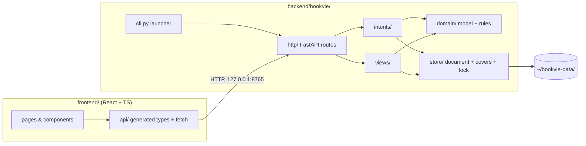
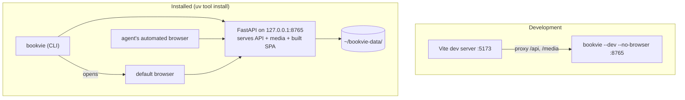
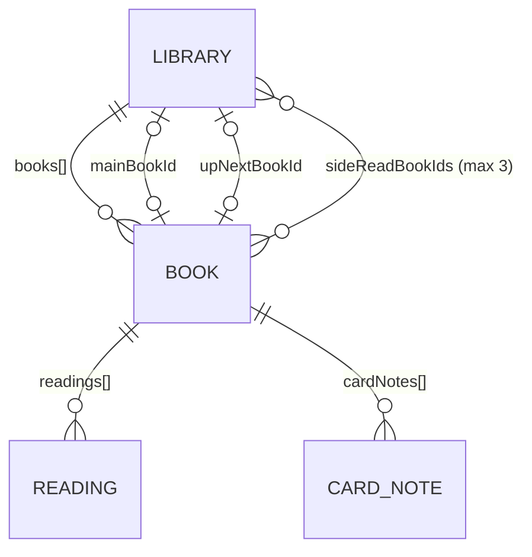

# Architecture Spine: bookvie

## Design Paradigm

**Server-owned domain, intent API, server-computed views.** One local Python process is the only reader and writer of the data folder. Browsers (the user's and the cataloging agent's) are clients. They send **intents** (one user action each) and render **views** (read models the server computes). The client holds no domain state of its own.



Dependency direction (an arrow means "may import"): `http → intents, views → domain`; `intents, views → store`; `domain` imports nothing from the other layers; `store` imports only `domain` types. Export is `GET /api/export`, implemented in `intents/export` but not under `/api/intents/`; restore is the intent `POST /api/intents/restore` (`intents/restore`). The frontend imports only `api/`, never server internals.

## Invariants & Rules

### AD-1: One local process owns the data folder [ADOPTED]

- **Binds:** A1, all persistence, FR-2 (agent entry)
- **Prevents:** browser-local storage (IndexedDB, localStorage, File System Access) splitting the agent's catalog from the user's; any code other than `store/` writing data files, or reading them outside the AD-4 lock.
- **Rule:** All data lives in one folder on disk, and only the server touches it. Every write goes through `store/`, except `bookvie.lock`, which the launcher's `instance.py` creates, hands over and removes before and after the server runs (AD-5). The one read outside `store/` is export: `intents/export` packages `library.json` (the bytes on disk) and the referenced covers itself, while holding the AD-4 lock, because export *is* the data folder packaged (AD-14; decided in story 2.1, reconciled in Epic 2 retro item 1). No feature may persist domain data in the browser.

### AD-2: The text store is one JSON document, written atomically [ADOPTED]

- **Binds:** A3, Data-safety NFR, FR-22, FR-23
- **Prevents:** partial writes; a second store; two code paths serializing differently.
- **Rule:** All textual data is a single `library.json` with the shape in AD-18. `store.serialize()` is the only function that produces its bytes: UTF-8, camelCase keys, nulls kept, keys in model order, 2-space indent, non-ASCII written as is (`ensure_ascii=False`), LF line endings, exactly one trailing newline. Every commit writes a temp file in the same folder, fsyncs it, renames it over the original, and then fsyncs the folder so the rename survives a power cut (skipped on filesystems that can't fsync a folder). The rename is the commit: a failed folder fsync after it is logged, not reported. If any step fails, the original is untouched and the intent reports `couldnt_save`. A change may instead report that nothing changes (`store.UNCHANGED`, AD-9's no-op): then nothing is written, and any new files it brought are removed again under the same AD-4 lock (story 4.4). Before the first commit, every start fsyncs the data folder's parent (and the parent of any ancestor it creates) and the data folder itself, so the data folder, `covers/` and `.staging/` survive a power cut even after an interrupted earlier start. A failed flush refuses startup, except for a parent bookvie can't read, which is logged and skipped. At startup the server deletes leftover `library.json.tmp*` and `local-state.json.tmp*` files from an interrupted write (AD-15), and exits non-zero with a message naming the path if the data folder isn't writable. If `library.json` is missing but `covers/` holds files, startup is refused before `library.json` or `covers/` changes (any entry in `covers/` counts, and an unreadable `covers/` is refused too): an empty library would let the AD-12 sweep delete every cover (decided in story 1.13). The message says to restore `library.json` or empty `covers/`.

### AD-3: Domain rules live only in the server; mutations arrive only as intents [ADOPTED]

- **Binds:** FR-1, FR-3, FR-5 to FR-10, FR-14, FR-17, FR-22, FR-23, A2, A3
- **Prevents:** rules duplicated in TypeScript and Python without a shared check (the sanctioned pre-checks are below); stale whole-library writes overwriting another browser's changes; one user action split across several calls that can half-fail.
- **Rule:** Each user action is exactly one intent call: `POST /api/intents/<verb>`. An intent validates, applies **every** consequence, runs `domain.check_invariants()`, and commits once (AD-2), or it changes nothing: it returns a refusal, or, when it asks for what is already so, a 200 no-op that commits nothing and so runs no `check_invariants()` (AD-9; story 4.4). An edit is never such a no-op: `edit-book` and `edit-card-note` commit an unchanged edit (AD-9; story 5.2). No CRUD or PATCH endpoints on entities, and no whole-document write endpoint. A client may pre-check an input against a rule the server also enforces, with the server's exact copy, to refuse it without a round trip:
  - the page field's range check ("Page must be between 0 and N.", story 3.3, `frontend/src/lib/pageField.ts`);
  - the Start dialog's "Which page?" (story 4.7, `frontend/src/components/StartDialog.tsx`), which the dialog asks only for a Side read. It reuses that range check, and refuses an empty value with "Which page? is required."

  The server still refuses the same input with the same copy. A shared case table keeps the range check in step (`frontend/src/lib/pageField.cases.json`, read by both the client's unit tests and `backend/tests/test_update_page.py`). Known gap: nothing shared keeps "Which page?"'s empty-value copy in step. Each side's tests hard-code it, and the e2e test never reaches the server (open in `deferred-work.md`). A pre-check never adds a rule the server lacks. Every intent is `multipart/form-data` with a JSON part named `intent`, including those with no file (`delete-book`, `set-spine-color`), so every route parses its body one way. Intents that carry a file (`add-book`, `edit-book`, `restore`) add a file part. Each is still one call and at most one commit.
- **Concurrency across tabs:** intents carry no version and no precondition. Each applies to the server's current state (AD-4 serializes them; AD-19 Targeting), so the last intent wins for every field it sends (A2). An open form keeps the values it opened with, and AD-7's refetch doesn't change them, so a stale form in one tab can undo a change made in another: an Edit panel opened before a popover color change puts the old color back on save, and a stale "Remove cover" removes a cover uploaded later. Within one tab the Edit panel is modal, so this can't happen; reloading shows the current data. This is A2 as written; the silent loss it allows (retro F-R1) is closed as an accepted deviation for single-tab use (Oleg, 2026-11-03). Revisit, with a document `revision` and an `expectedRevision` refusal, if the cataloging agent ever edits an existing Book while the app is open in a tab.

### AD-4: All writes, export and restore are serialized

- **Binds:** AD-2, AD-3, AD-14
- **Prevents:** two concurrent requests both loading state and one silently discarding the other; an intent overwriting a restore; an export capturing a half-replaced cover.
- **Rule:** One in-process lock covers *apply intent → write files → commit document → swap in-memory state*. `export` and `restore` hold the same lock: export while it builds the zip (not while it sends it), and restore for the whole operation, staging included. Views read the committed in-memory state. The one write outside the lock is `local-state.json` ("Last export", AD-15), written after the download has gone out. It never touches `library.json` or `covers/`, and it is atomic on its own (story 2.1). Two views read it from disk, outside the lock: `views/backup` and `views/shelf` (home, story 3.1).

### AD-5: One server instance per data folder [ADOPTED]

- **Binds:** AD-1, CLI
- **Prevents:** two processes writing the same folder.
- **Rule:** The server holds `bookvie.lock` (PID and port) in the data folder, created with exclusive-create so two launches can't both take it. When `bookvie` finds a live lock, it opens the browser at the recorded URL and exits. A lock is live only when its PID is alive **and** `GET /api/health` on the recorded port answers `{ "app": "bookvie", "dataDir": "<path>", "pid": <int> }` for this data folder (`pid` added in story 1.2 for the AD-16 hand-over). A lock younger than 5 seconds may belong to a server that is still starting: a second launch polls health instead of taking it over, and if nothing answers in time it says "bookvie is starting in another window; try again." and exits 1. Any other lock (dead PID, a reused PID, no answer) is taken over. On SIGINT or SIGTERM the server waits for the AD-4 lock, then removes `bookvie.lock` and exits.

### AD-6: The server owns domain numbers and selections; the client owns presentation [ADOPTED]

- **Binds:** FR-4, FR-7, FR-11, FR-15, FR-16, FR-17, FR-18, FR-19, FR-20, FR-24
- **Prevents:** percentage, Measured pace, days left, Waiting order, stats or library scope being computed in two places with different results.
- **Rule:**
  - **The server computes:** percentages (`floor(page × 100 ÷ pages)`, so 100% only at the last page; story 3.1, `domain/progress`), Measured pace, days left, pages left (per Book and library scope), Waiting for you and its order (every paused Reading except the Up next Book's, `pausedAt` oldest first with a Reading that has none before all, then the title key, then Book id; `pausedAt` itself is never sent; story 4.2), whether Home's Up next is paused (`upNext.paused`, story 4.1), each Book's role and its waiting page (Main book, then Up next, then waiting for a paused Reading; `views/shelf` `_role_reading`; stories 4.1 and 4.6), a Book's Card notes in page order (`pageStart`, then `createdAt`, ties keeping stored order; `views/shelf` `card_note_views`, story 5.1), the `card-notes` view's groups (one per Book that has notes, ordered by the title key, then Book id; `?book=<id>` scopes it to that Book's group, empty when it has none; story 5.3), the Main book's note count on Home (`cardNoteCount`, story 5.3), the Home bookcase slice's priority, stats for a requested date range including the bars, and the "X of Y finished" meter.
  - **Stats view:** `GET /api/views/stats?from=YYYY-MM-DD&to=YYYY-MM-DD`, both inclusive local dates; omit both for All time. Response `{ books, pages, bucket: "month" | "year", buckets: [{ period, books, pages }] }`; `bucket` is `year` when the range exceeds 24 months. The browser resolves presets to dates: This month = the 1st..today, This year = 1 January..today, Last year = the full year. All time with no finished Reading returns 0 books, 0 pages and no buckets.
  - **The client may only apply presentation to the views it has fetched:**
    - catalog sort, using `Intl.Collator`, per the UX;
    - filter chips;
    - packing spines into rows by viewport width, and on Home choosing up to 3 of those rows from the view's `slicePriority` (Book ids: the Main book, then Up next, then finishes newest first; story 3.5): free slots up to 3 are filled from the first bookcase rows, priority ids not on the shelf are ignored, and the Main book's row comes first with the others in bookcase order (`frontend/src/lib/slice.ts`);
    - the gauge's ticks: 0 · round(pages ÷ 2) · pages, the half tick dropped under 4 pages (story 3.1);
    - case-insensitive substring text search (Search titles, Search card notes). It compares the text as stored, with no Unicode normalisation (unlike the server's title key), so a decomposed accent can fall outside a match (Epic 5 retro E5-R3, accepted). Search card notes wraps each match in `<mark>` and counts the matching notes itself for "N notes match." (`lib/cardNotes.ts`, `lib/useSearchCount.ts`; story 5.3);
    - Book detail's Card notes block showing the first three notes of the view's page order, and every matching note while its search holds text (stories 5.1 and 5.3);
    - pile order and shuffle, with an injectable random source (`lib/cardNotes.ts` `shuffled`; story 5.4);
    - copy and date formatting, including relative "N days ago" counted in local calendar days;
    - the Quick pace calculator's arithmetic. Days to finish = max(1, ceil(pages left ÷ pages per day)), and the finish date = today + days: the same rounding and minimum as the server's days left. With nothing left to read, or a pages-per-day of zero or less, it shows no days (EXPERIENCE.md → Pace calculator).
  - **Days left** is `max(1, ceil(pages left ÷ Measured pace))`, and null when there is no Measured pace, when it is 0, or when no pages are left (story 3.4); the client then omits "~N days left".

### AD-7: The client never patches cached state

- **Binds:** frontend data layer, FR-14 (finish moment), A2, A3, Couldn't-save pattern, Tone NFR
- **Prevents:** optimistic UI showing a change that was refused or never written; features refreshing different subsets of views; the finish moment replaying.
- **Rule:** No optimistic updates. View queries are keyed `['view', name, params]`. After every intent response, success or refusal, the client invalidates **all** views. All views also refetch when the window regains focus or becomes visible. A success live-region announcement is made only after the refetched views have rendered. On `couldnt_save` or a network failure, the UI keeps the user's input and shows "Couldn't save. Your data wasn't changed." The finish moment plays only in the tab that received the successful `finish-reading` response, never because of a view change (story 3.7). It is carried as router state on the navigation to Home and cleared from that history entry once Home consumes it. When the finish lands while another Book is Main, the state is dropped unplayed, so a reload never replays it (retro item 22). The moment scrolls the finished spine into view if needed, then fills it from its current fill to full over about 600 ms with the highlight ring. A finished re-read plays the ring only. Under reduced motion the fill and ring are instant and the scroll uses `behavior: 'auto'`. A finish of a Book that wasn't Main when the Finish dialog opened stays on Book detail: focus moves to the page `h1`, then the `status` region reads "Finished *X*.", and no moment plays (story 4.5).
- **Last-page start:** a start that returns `reachedLastPage` (AD-19) carries the started Book's id as router state to Home. Home opens the Finish dialog for that Book once per history entry, and only when its home view shows that Book as Main at its last page with no other dialog of that entry open. Otherwise the hand-off is dropped, never applied to another Book, and a reload never reopens it (Epic 4 retro item 36).
- **Dialogs read fresh views:** a dialog that fixes its answers when it opens (Start, Finish) waits for a `book` view fetched after it mounted, never a cached copy, because only active views refetch after an intent (retro item 22). Known gap: some lines still read the home view as cached, so a stale dialog can name the wrong Main book or Up next (open in `deferred-work.md`). They are the Start dialog's trade-off and displacement lines (`upNext.id`, `upNext.paused`; story 4.1), and the Pause Confirm dialog's displacement line and whether it shows at all (`usePauseFlow`; story 4.3).

### AD-8: Python is the contract's source of truth; TS types are generated [ADOPTED]

- **Binds:** all intents, views and error codes
- **Prevents:** hand-written TS types drifting from the Python models.
- **Rule:** Pydantic models define every intent body, view, success response and error code. TS types are generated from FastAPI's OpenAPI, using alias names, with `openapi-typescript` into `frontend/src/api/generated/`. They're never edited by hand. `npm run check:api` regenerates the types and fails on any diff.

### AD-9: One response contract for success and failure

- **Binds:** all intents, A3, FR-2 outcome exposure
- **Prevents:** endpoints inventing their own error shapes; FastAPI's default `{"detail":[…]}` reaching the client; the UI unable to tell "refused" from "not saved", or unable to report several fields at once.
- **Rule:**
  - **Success:** HTTP 200 with `{ "ok": true, "ids"?: {<name>: <uuid>}, "reachedLastPage"?: true }`.
  - **Failure:** `{ "error": { "kind": "refusal" | "couldnt_save" | "couldnt_export", "code": "<snake_case>", "message": "<user copy>", "fields"?: [{ "field", "code", "message" }] } }`.
    - HTTP 422 means field validation or a refused upload. For field validation `code` is `invalid_fields`, and `fields` lists every failing field. `start-reading`'s `page` ("Which page?") is such a field: required for a Side read, and a whole number from 0 to the Book's pages whenever it is sent (story 4.7). For uploads: a cover that isn't a supported image is a field error, and a refused restore archive is a `refusal` with one of the AD-14 codes, `restore_invalid`, `restore_newer_version` or `restore_unsafe`, with no `fields`. `restore_unsafe` shows `restore_invalid`'s copy. A restore body over the upload limit plus 64 KiB of multipart framing is 422 `restore_unsafe`: refused before anything is read when `Content-Length` says so, otherwise as soon as the counted bytes pass the limit while the form is parsed. Either way it is before the restore takes the lock (story 2.3).
    - HTTP 413 `cover_too_large` means a cover upload over 20 MB (AD-12); `fields` carries "Cover must be 20 MB or smaller."
    - HTTP 409 means a state rule (e.g. `duplicate_book`, `pages_below_current_page`). An intent whose target is no longer in a state it can act on is refused, never applied to another Book: `book_not_found` (the Book was deleted), `not_main_book` (`update-page` or `pause` for a Book that isn't Main), `reading_already_finished`, `already_main` (`start-reading` for the Main book), `main_cannot_be_up_next`, `main_cannot_be_side_read`, `side_reads_full` ("You already have 3 side reads. Remove one first."), `card_note_not_found` (`edit-card-note` or `delete-card-note` for a note the Book no longer has, another Book's note id included; checked after `book_not_found` and before the fields; story 5.2). A 409 refusal about one field (e.g. `pages_below_current_page`) includes `fields`.
    - HTTP 404 `book_not_found` (kind `refusal`) comes from a view, not an intent: `GET /api/views/book` for an id no Book has (decided in story 1.11), and `GET /api/views/card-notes?book=<id>` likewise (story 5.3). The client shows its not-found page.
    - On an intent route, a body that can't be parsed (broken multipart, a part over 1 MB, too many fields) is 422 `invalid_fields` on `intent`, the same refusal as a malformed `intent` part (retro item 8).
  - Unknown `/api` paths aren't enveloped: a GET or HEAD 404s through the SPA route, and any other method gets Starlette's 405 `{detail}`. No real route answers `{detail}`.
    - An intent that would change nothing is a no-op success, not a refusal. These return 200, change nothing and commit nothing:
      - `set-up-next` for the Book already Up next (story 4.4);
      - `mark-side-read` for a Book already a Side read, checked before `side_reads_full` (story 4.7);
      - `unmark-side-read` for a Book that isn't one (story 4.7).

      The intent's change returns `store.UNCHANGED`, so `Store.apply` skips the commit under the AD-4 lock (AD-2). An edit is not a no-op: `edit-book` and `edit-card-note` commit an unchanged edit as normal (story 5.2).
    - HTTP 500 or 503 means `couldnt_save`. A restore write fault (staging, cover copy-in or the document commit) is 503 `couldnt_save`. When `check_invariants()` fails after validation passed, that is a server bug: the intent commits nothing, logs the failed rule to stderr, and returns 500 `couldnt_save`.
    - HTTP 503 with kind and code `couldnt_export` means export failed to read the data; nothing was sent (AD-14).
  - A global `RequestValidationError` handler maps framework validation errors into this shape. The server owns all message copy (PRD §5 Tone), and the client renders it as is; the exceptions are AD-3's pre-checks, which show the server's copy verbatim before sending. Error codes are an enum in the contract.

### AD-10: Duplicate detection is a server refusal

- **Binds:** FR-3
- **Prevents:** the duplicate rule being implemented in the form and skipped by other paths.
- **Rule:** `add-book`, and `edit-book` when title, author or ISBN changed, refuse with 409 `duplicate_book` unless the intent carries `confirmDuplicate: true`. "Add anyway" resends the same intent with that flag. ISBN normalization and author-set comparison live in `domain/`.

### AD-11: Stored, not recomputed

- **Binds:** A4, FR-1, FR-14, FR-16, FR-24
- **Prevents:** stats or spine colors changing when Pages or the cover is edited later; the UI unable to tell a user's color from a derived one.
- **Rule:** These values are stored, never recomputed on read:
  - **Book spine colors:** `spineColorUser` (null = automatic), `spineColorFromCover` (computed once per uploaded cover), `spineColorCurated` (assigned at creation), and the resolved `spineColor` (user, else from-cover, else curated). The resolved color is re-resolved only by intents that change one of its inputs.
  - **Finished Reading:** `finishDate` (a local date) and `finishedPages` (the page count at finish).
  - **Back-filled Reading:** `startDate: null`.

### AD-12: Covers use immutable names; files go in before the document and come out after it

- **Binds:** A5, FR-1, FR-21, FR-22, FR-23
- **Prevents:** a failed commit leaving a document pointing at an overwritten image; browsers showing a cached old cover; dangling references.
- **Rule:**
  - The server downscales every uploaded cover to a long edge of at most 1200px, after re-decoding it with Pillow, which rejects anything that isn't an image. Uploads are capped at 20 MB, counted while streaming; a larger upload is refused with 413 `cover_too_large` (AD-9).
  - **Decoding:** EXIF orientation is applied before downscaling (`ImageOps.exif_transpose`). Pillow's `MAX_IMAGE_PIXELS` stays on, and a decompression bomb is refused like a non-image. CMYK is converted to RGB, and only the first frame of an animated image is kept. Formats Pillow can't decode without a plugin, such as HEIC, are refused with a message naming the supported formats (JPEG, PNG, WebP); no HEIC plugin is added.
  - **Output:** covers are re-encoded as JPEG, or PNG when the image has transparency. `<ext>` comes from the output format, never from the uploaded file name.
  - Each upload is stored under a new server-minted name, `covers/<book-id>-<uuid>.<ext>`, recorded in the Book's `coverFile`. A name is never reused or overwritten.
  - **The order is always,** unless the change is a no-op: write the new files (temp + rename), commit the document, then delete files no Book references. When the change turns out to be a no-op (AD-2, AD-9), the new files are deleted again and nothing is committed. No intent sends files with a possible no-op today.
  - **After the commit:** once the document commit succeeds, the intent has succeeded. A failure while deleting unreferenced files or emptying `.staging/` is logged to stderr and left for the startup sweep; the response is still 200, never `couldnt_save`.
  - **Remove cover:** `edit-book` with `removeCover: true` (offered only when a cover exists) clears `coverFile` and `spineColorFromCover`, re-resolves `spineColor` (AD-11), and deletes the file after the commit, per the order above.
  - Covers are served at `/media/covers/<file>` with immutable caching.
  - **No staging for covers:** each new cover is written as `covers/<name>.tmp*`, fsynced and renamed into place. `.staging/` is restore's scratch only (AD-14).
  - **Restored covers:** restore stores an archive's covers byte for byte, through the same temp + rename. The upload and output rules above (downscale, re-encode, minted name) don't apply; each referenced cover only has to be present and decodable. A name already in `covers/` is never overwritten: its file is kept, and when the archive's copy differs that is only logged (story 2.2).
  - At startup the server removes cover files that no Book references, including `covers/*.tmp*` leftovers. When `library.json` is missing but `covers/` holds files, startup is refused instead (AD-2).

### AD-13: Versioned document; one migration chain [ADOPTED]

- **Binds:** A6, FR-22, FR-23, startup load
- **Prevents:** restore and startup handling old formats differently; a newer file being half-understood; a migration bug destroying the only copy.
- **Rule:**
  - `library.json` carries an integer `schemaVersion`.
  - A single ordered migration chain in `store/migrations/` upgrades older versions, both at startup and on restore.
  - Store models use `extra="forbid"`: unknown keys are refused, never silently dropped. Every persisted-shape change bumps `schemaVersion` by exactly 1 with exactly one migration step, and a test asserts the chain is contiguous from 1 to the current version.
  - Before a startup migration rewrites the file, the server copies the original to `library.v<N>.bak.json`.
  - The chain runs in memory and the result is committed once. If any step raises, the server exits non-zero with a message, and the original file and its backup are unchanged.
  - A newer version or an invalid file is refused, and nothing changes.

### AD-14: Export is the data folder packaged; restore validates, then applies the AD-12 order [ADOPTED]

- **Binds:** FR-22, FR-23, A6
- **Prevents:** an export format that drifts from storage; a restore that fails halfway; malicious or damaged archives.
- **Rule:**
  - **Export:** `GET /api/export` returns one `.zip` holding `library.json` (the bytes on disk) and `covers/` (always present as a directory entry, even when empty) with every cover the library references, and nothing else. Unreferenced files in `covers/` are left out: the startup sweep would delete them anyway (story 2.1). The request guard requires `X-Bookvie-Export: 1` on this route (AD-16). Under the AD-4 lock the zip is built into a spooled temp file (in memory up to ~10 MB, then on disk); the lock is released, then the file is sent. A read failure happens before any header is sent and returns 503 `couldnt_export`. "Last export" (AD-15) is recorded only after the last byte has been sent with no client disconnect; a HEAD request or an aborted download records nothing. The server can't know whether the browser kept the file, so "Last export" means "last complete download".
  - **Restore route:** `POST /api/intents/restore`, multipart (AD-3), with the file in the `archive` part. Refusals are 422: `restore_invalid` (not a zip, damaged, no `library.json`, schema or invariant failure, missing or undecodable cover), `restore_newer_version`, and `restore_unsafe` (a path, symlink, duplicate, entry or size rule; same user copy as `restore_invalid`). A write fault before the commit is 503 `couldnt_save` (AD-9).
  - **Restore validation:** restore empties `.staging/`, then unpacks into it. It accepts only the entries `library.json`, the `covers/` directory and `covers/<name>` with a plain name: no absolute paths, no `..`, no symlinks. Names are compared under NFC + casefold (`NFC(casefold(NFC(name)))`): two names equal that way are duplicates, and so is a cover whose name differs only in case or Unicode form from one already in `covers/`, because on a case-insensitive filesystem, or on APFS (which ignores Unicode normalization), they would share one file (story 2.3; Unicode form added by Epic 2 retro action 2). Full casefolding also matches pairs APFS keeps apart, such as `ß` and `ss`; those are refused too, on the safe side. A cover whose name inside `covers/` is over 200 UTF-8 bytes is refused, which keeps it and its `<name>.tmp` + 8-character temp under the 255-byte file-name limit (minted names are 77 bytes); if the filesystem still rejects a staged file's name (ENAMETOOLONG, EILSEQ, EINVAL), that is `restore_unsafe` too, while any other write failure stays `couldnt_save`. A missing `covers/` counts as empty.
  - **Restore limits:** the upload is at most 1 GiB, the archive holds at most 5,000 entries (directory entries included), and at most 1 GiB is extracted. A central directory over 1 KiB per allowed entry is refused before it is parsed. The extracted size is counted on the bytes actually written, never on sizes declared in the zip headers, and extraction stops before the chunk that would pass the limit. An entry that inflates past its declared size is `restore_unsafe` even under the limit (story 2.3). These limits fit about 2,000 Books with downscaled covers (about 300 KB each) plus `library.json` up to its 10 MB performance ceiling. Then it validates the whole archive: schema, migrations, AD-18 invariants, and every referenced cover present and decodable.
  - **Refusal precedence:** the first rule broken decides the code. In order: a central directory over its limit (`restore_unsafe`); not a zip (`restore_invalid`); the upload size, entry count and name rules (`restore_unsafe`); no `library.json` (`restore_invalid`); unpacking, where passing a size rule or a file name the filesystem rejects is `restore_unsafe` and a damaged entry `restore_invalid`; a newer `schemaVersion` (`restore_newer_version`, decided before model validation and the cover checks); anything else (`restore_invalid`). A body far over the upload limit is already refused by the body cap (AD-9).
  - **Restore apply:** following the AD-12 order, restore adds the archive's covers, commits the document via AD-2, then deletes covers the new document doesn't reference.
  - **Failure and cleanup:** a failure before the commit leaves current data untouched. `.staging/` is emptied after every restore, refused or not, and at startup.
  - **Round trip:** export → restore at the same `schemaVersion` reproduces byte-identical `library.json` and covers. The one exception is AD-12's no-overwrite rule: a cover name already in `covers/` with different bytes keeps its file. Minted names are never reused, so only a hand-made archive reaches it.

### AD-15: State that is not exported [ADOPTED]

- **Binds:** A6, FR-22 "Last export"
- **Prevents:** "Last export" disagreeing between browsers; UI preferences polluting the export.
- **Rule:** The last-export timestamp is stored in `local-state.json` in the data folder, as `{"lastExportAt": "<ISO-8601 with offset>"}`. It's outside the export, and restore never touches it (an archive entry with that name is `restore_unsafe`). It is written like a commit (temp `local-state.json.tmp*`, fsync, rename, folder fsync) but outside the AD-4 lock (AD-4); a write failure is only logged, because the download already succeeded. Its readers are `views/backup` and `views/shelf` (home, story 3.1). A missing file reads as no export yet; an unreadable or malformed one is logged and read the same way, and the next export overwrites it (story 2.1). UI preferences (theme, catalog view, sort) live in browser `localStorage`, per browser, wrapped in try/catch with defaults.

### AD-16: Stable loopback address, local trust

- **Binds:** CLI, FR-2 (agent navigation), security
- **Prevents:** the cataloging skill losing the app behind a random port; LAN or cross-site access to the user's data.
- **Rule:**
  - **Binding:** the server binds `127.0.0.1` only, on port `8765` by default. `--port` overrides it, and the lock records the actual port.
  - **Port conflict:** if the port is held by a process that isn't bookvie, startup exits with a message naming the port and `--port`. If `GET /api/health` on that port answers as bookvie for another data folder, the message says so and names that folder instead. If it answers for this data folder, this launch took over the lock of a server that is in fact alive. When health reports a live `pid`, it hands the lock back by rewriting `bookvie.lock` as the running server's `{pid, port}`. Either way it then opens the browser at that server (prints the URL with `--no-browser`) and exits 0 (decided in story 1.2).
  - **Request guard:** requests are rejected when their `Host` isn't `127.0.0.1:<port>` or `localhost:<port>`, or when an `Origin` is present and isn't one of those. With `--dev`, the Vite dev origin is also allowed.
  - **Fetch metadata:** a simple cross-site GET carries no `Origin`, so requests to `/api/*` and `/media/*` are also rejected when `Sec-Fetch-Site` is present and isn't `same-origin` or `none`. `same-site` is refused because any app on another loopback port is same-site. A missing header passes (curl, the cataloging agent, browsers too old to send it), so GET routes still avoid side effects where they can. The one GET with a side effect, `/api/export` (it records "Last export"), also requires exactly one `X-Bookvie-Export: 1`, which the app's export fetch sends: a cross-site `` or no-cors GET can't set a custom header, and a cross-site fetch that sets one needs a CORS preflight, whose foreign `Origin` the guard refuses. This holds in browsers that send no `Sec-Fetch-Site`; scripts add the header. SPA routes and `/assets` stay open to cross-site links. `--dev` needs no exception: the Vite proxy forwards the browser's `same-origin` value.
  - **No authentication:** anything on the machine that can reach the loopback port is trusted.
  - **SPA routes:** the server serves the built SPA and falls back to `index.html` for client routes.

### AD-17: The Agent Label Contract is a public interface

- **Binds:** FR-2, the New book panel, the Duplicate dialog, Search titles
- **Prevents:** a refactor renaming a label and silently breaking unattended cataloging.
- **Rule:** EXPERIENCE.md → Agent Label Contract is the single source of truth. The Playwright e2e suite drives those flows only by the exact accessible names in that table. Changing a name there is a breaking change that needs a contract update first.

### AD-18: Canonical document shape and its invariants

- **Binds:** every intent, view and migration; FR-1, FR-5 to FR-8, FR-14, FR-17
- **Prevents:** two epics storing the same entity in different places, e.g. Card notes nested in one epic and top-level in another; pointers left dangling after a delete.
- **Rule:**
  - `library.json` is `{ schemaVersion, mainBookId|null, upNextBookId|null, sideReadBookIds[], books[] }`. Each Book carries `id`, `createdAt` (timestamp, for the Date added sort), `ownership` (`owned`), `coverFile|null`, the AD-11 color fields, and its PRD fields. It owns its nested `readings[]` and `cardNotes[]` (`{ id, text, pageStart, pageEnd|null, createdAt }`). A Card note's `pageEnd` is null for one page and otherwise greater than `pageStart`, never equal to it: `add-card-note` and `edit-card-note` parse the Page field on the server (`domain/note_pages`), storing "42–42" as 42 with `pageEnd: null` (story 5.1). Known gap: `check_invariants()` doesn't check this, nor a non-blank `text`, so a restored file can hold `pageEnd == pageStart` or an empty note (Epic 5 retro E5-R1, open as retro item 49). Nothing else is top-level.
  - Main book, Up next and Side reads exist only as root pointers. `domain.check_invariants()` runs before every commit and enforces:
    - Book ids are unique in the library, and Reading and Card note ids are unique within their Book (added with the Side-read rule, `spec-unique-side-reads-and-directory-fsync.md`). Known gap: a Card note id repeated across two Books passes (Epic 5 retro E5-R2, open as retro item 49);
    - every pointer references an existing Book;
    - the Main book is neither Up next nor a Side read;
    - no Book is a Side read more than once, and there are at most 3 Side reads;
    - a Book has at most one unfinished Reading;
    - the Main book has an unfinished Reading;
    - card-note pages and an unfinished Reading's `currentPage` are within the Book's page count. A Reading's `startPage` (a whole number from 0) is deliberately not bounded by the page count, so it can exceed Pages after an edit (Epic 4 retro item 35).
  - Pointers change only inside an intent's commit:
    - `start-reading`, `pause` and `set-up-next` move them as AD-19 states. Starting a Book also removes it from `sideReadBookIds`.
    - `mark-side-read` and `unmark-side-read` add a Book to `sideReadBookIds` or remove it, and nothing else (story 4.7).
    - Deleting a Book clears every pointer to it.
    - `finish-reading` clears `mainBookId` and `upNextBookId` when they name the Book, and removes it from `sideReadBookIds` (story 4.5).
    - An edit-book back-fill on a Book with no Readings removes it from `sideReadBookIds` and leaves `upNextBookId` (Epic 4 retro item 34).

    A vacated Main book or Up next stays empty: nothing fills it by itself.

### AD-19: Reading identity and status

- **Binds:** FR-1 (edit-mode Finished on), FR-5 to FR-11, FR-14, FR-15, FR-17 (Card note targeting), FR-24
- **Prevents:** a resumed Reading still counting as paused; two unfinished Readings on a re-read; the page update and the Finish dialog both finishing a Reading.
- **Rule:**
  - **Fields:** a Reading stores `id`, `startDate|null`, `startPage` (a whole number from 0: the page a new Reading starts at, 0 on a back-fill, unchanged by a resume; added in `schemaVersion` 2 by Epic 4 retro item 35, whose migration step sets it to 0 on every v1 Reading, so Measured pace is unchanged for old data), `currentPage`, `purpose|null`, `lastProgressUpdate|null` (timestamp; set by `update-page` and by `start-reading`; null on a back-filled Reading, and the re-entry line then omits "Last updated"), `pausedAt|null` (a local date, overwritten on every pause and never cleared, not by resume nor by finish), `finishDate|null`, `finishedPages|null`, `purposeFulfilled|null` and `rating|null`.
  - **Current Reading:** a Book's current Reading is its single unfinished Reading.
  - **Status:** `domain.reading_status()` is the only status function. A Reading is *finished* if it has a `finishDate`, *active* if its Book is `mainBookId`, and *paused* otherwise. `pausedAt` is ignored while the Reading is active.
  - **Starting:** one `start-reading` intent resumes the current Reading, or creates a new one when the Book has none. It does all of the following in the same commit:
    - **The previous Main book.** Starting while another Book *Y* is Main pauses *Y*'s Reading (`pausedAt` = today) and makes *Y* `upNextBookId` (FR-7; stories 3.2 and 4.1). With no Main book, `upNextBookId` stays as it is, except that it becomes `null` when it was the started Book.
    - **The displaced Up next** only loses the pointer, and its Readings are untouched. So a paused one is in Waiting for you, and a Side read stays on the side (a paused Side read is in both). One that is neither is back in the catalog.
    - **A sent `page`** ("Which page?") becomes the Reading's `currentPage`, even below the paused page, and a new Reading's `startPage`. It is required for a Side read (422 on `page` without it) and honored for any Book. The started Book leaves `sideReadBookIds` (story 4.7).
    - **The Purpose** is stored trimmed, null when empty (`domain/purpose`).
  - **Pausing and Up next:** `pause` pauses the Main book's current Reading (`pausedAt` = today, overwriting an earlier one; nothing else of it changes), clears `mainBookId` and makes the Book `upNextBookId`, displacing an earlier Up next as above (story 4.3). `set-up-next` moves only `upNextBookId`, with the same displacement. The Main book can't be Up next (story 4.4).
  - **Back-filled finishes in edit:** edit-book's Finished on adds or moves a *past* finish only. With an active or paused Reading that has a start date, a new or changed date after that start is refused ("Finished on can't be after *date*, when the current reading started."); the start day itself is allowed (retro item 21). A back-fill on a Book with no Readings finishes it, so the Book leaves `sideReadBookIds` in the same commit; `upNextBookId` stays (Epic 4 retro item 34). Known gap: moving the latest finish before another finished Reading's dates is not yet refused (open in `deferred-work.md`).
  - **Finishing:** only `finish-reading` sets `finishDate` on a current Reading; edit-book's Finished on sets it on a past or back-filled Reading (above). `finish-reading` finishes any Book's current Reading, Main or not. For a Book with no Readings it appends a back-filled Reading (`startDate` null). In the same commit it clears `mainBookId` and `upNextBookId` when they name the Book, and removes the Book from `sideReadBookIds` (story 4.5). `update-page`, or `start-reading` with a `page`, at the last page saves the page and returns `reachedLastPage: true`. The client sends a `page` only for a Side read, so in practice that is a Side read's start. The client then opens the Finish dialog for that Book (AD-7).
  - **Targeting:** intents address `bookId` (and `readingId` where a finished Reading is edited, `cardNoteId` where a Card note is edited or deleted; story 5.2) and apply to the server's current state. A2 last-write-wins applies to confirmation dialogs too. [ADOPTED]

### AD-20: Time is injected and local

- **Binds:** domain, FR-10, FR-11, FR-14, FR-16, AD-19
- **Prevents:** tests and code disagreeing on "today"; finish dates shifting by timezone.
- **Rule:** `domain/` never calls the system clock directly. It receives a `Clock` (now, plus today as a local date in the machine timezone) that tests replace. Local dates are `YYYY-MM-DD`; timestamps are ISO 8601 with offset. Measured pace (`domain/pace`) is Σ max(`finishedPages` − `startPage`, 0) ÷ Σ (finishDate − startDate + 1) over every finished Reading with a start date, re-reads included. Only tracked pages count, so a Side read started at p.300 adds only the pages after it (Epic 4 retro item 35). It excludes back-filled Readings and any Reading finished before it started, counts a missing `finishedPages` as 0, and lives only in `domain/` (story 3.4). The browser computes its own "today" for presentation (AD-6), so in e2e tests the Playwright fixture sets the browser clock (`page.clock`) to the same date it passes as `--fake-today`, and the browser `timezoneId` to the server's pinned `TZ`. The pinned zone is `Europe/Madrid`: `check:py` and `check:e2e` run with `TZ=Europe/Madrid`, and Playwright sets `timezoneId: 'Europe/Madrid'`. DST boundary tests use the last Sundays of March and October. Views don't carry the server's date.

## Consistency Conventions

| Concern | Convention |
| --- | --- |
| Naming | Domain terms exactly as PRD §3 (Book, Reading, Main book, Up next, Waiting for you, Side read, Card note). Python `snake_case`; JSON fields and TS `camelCase` (Pydantic alias generator). Intent paths are kebab-case verbs under `/api/intents/<verb>`; views are nouns under `GET /api/views/<name>`. |
| IDs | Server-generated UUID v4 strings. The client never mints IDs. An id the client needs next comes back in the success `ids` (`add-book`'s `bookId`); one no client uses is not returned (`start-reading`'s new Reading id, story 3.2). The one exception is `add-card-note`'s `cardNoteId`: the app reads no id after an add, but the agent skills that write to bookvie are expected to (story 5.1, kept by Oleg). None reads it yet; drop it if none does once those skills exist. |
| Dates | AD-20. Server and browser share the machine timezone. |
| Title ordering (server) | One key for every server-side title ordering: NFKD, strip combining marks, casefold; ties by Book id. The client's catalog sort uses `Intl.Collator` (AD-6). |
| Errors | AD-9. User-facing copy follows PRD §5 Tone (no exclamation marks, no praise, no red failure states). |
| Logging | Server logs to stderr in the launching terminal. No telemetry, no network calls out. |
| Config | CLI flags `--data-dir` (default `~/bookvie-data`), `--port` (default 8765), `--no-browser` (tests) and `--dev`. No config file. |
| Testing | pytest for `domain/` and `intents/` (every FR consequence, refusal code and `check_invariants` rule) with a fake `Clock`. Playwright e2e for flows and the label contract (AD-17), run against a temporary `--data-dir`. One install smoke test: build, `uv tool install`, start, load `/`. `npm run check` runs them all (Structural Seed). |

## Stack

| Name | Version |
| --- | --- |
| Python | 3.14 |
| uv (packaging, `uv tool install`) | 0.13.x |
| hatchling (build backend) | 1.33.x |
| FastAPI | 0.162.x |
| Pydantic | 2.14.x |
| Uvicorn | 0.54.x |
| python-multipart (multipart intents) | 0.0.x |
| Pillow (cover downscale, color derivation) | 13.x |
| React | 19.3.x |
| TypeScript | 5.9.x |
| Vite (react-ts template) | 8.3.x |
| openapi-typescript | 7.13.x |
| TanStack Query | 5.x |
| React Router (library mode, `createBrowserRouter`) | 8.5.x |
| Playwright (`@playwright/test`) | 1.64.x |
| pytest (dev) | 9.x |
| pytest-cov (dev) | 7.1.x |
| Hypothesis (dev) | 6.170.x |
| httpx (dev, FastAPI `TestClient`) | 0.28.x |

(dev) marks the Python dev dependency group; everything else Python is runtime. Frontend packages are build-time only (Node never runs at runtime).

Styling is CSS Modules per component over one `frontend/src/styles/tokens.css` holding the DESIGN.md custom properties; no CSS framework.

TypeScript stays on 5.9 because openapi-typescript 7.13 requires TS ^5. The Vite template's default TS 7 is overridden.

## Structural Seed



**Build and install:** `npm run build` writes the SPA into `backend/bookvie/http/static/`, which is gitignored. The hatchling wheel target ships it anyway: `[tool.hatch.build.targets.wheel] packages = ["bookvie"]`, `artifacts = ["bookvie/http/static/**"]`; the install smoke test proves the SPA is in the installed tool. `uv tool install --reinstall ./backend` installs the global `bookvie` command. Upgrading means rebuilding and reinstalling. Node is needed only to build, never at runtime.

**Check:** the root `package.json` defines `npm run check`, which runs `check:py` (`uv run --project backend pytest` with the coverage gate), then `check:api` (`npm --prefix frontend run check:api`), then `check:e2e` (Playwright), then `check:smoke` (isolated install smoke test), stopping at the first failure.

```text
~/bookvie-data/
  library.json            # the whole textual store (AD-2, AD-18)
  library.v<N>.bak.json   # pre-migration copies (AD-13)
  covers/                 # <book-id>-<uuid>.<ext>, ≤1200px long edge; restored covers keep their bytes (AD-12)
  .staging/               # restore scratch, emptied before and after every restore and at startup (AD-14)
  local-state.json        # last export timestamp, not exported; .tmp* leftovers swept at startup (AD-15)
  bookvie.lock            # pid + port (AD-5)
```



```text
bookvie/
  package.json              # npm run check → check:py, check:api, check:e2e, check:smoke
  backend/
    pyproject.toml          # hatchling; console script bookvie = bookvie.cli:main; wheel artifacts bookvie/http/static/**
    bookvie/
      cli.py                # flags, start server, open browser, signals
      instance.py           # bookvie.lock, loopback socket, health probe (AD-5)
      http/                 # FastAPI app, routes, Host/Origin guard, error handler, static/
      intents/              # one module per intent (add_book, edit_book, delete_book, set_spine_color, start_reading, edit_purpose, update_page, finish_reading, pause, set_up_next, add_card_note (its `check_card_note_fields` function is reused by edit_card_note), edit_card_note, delete_card_note, restore), except side_reads (mark-side-read and unmark-side-read), export; shared: book_form, intent_model, commit, cover (decode, downscale), contract (error enum)
      views/                # read models: shelf (home, catalog, book detail), card_notes, backup; models (view shapes)
      domain/               # model (entities), invariants (check_invariants), book_fields (form parser), labels (form order, shared failures), finished_on (Finished on parser, long date), spine_color (curated rotation, AD-11 resolve), duplicates (ISBN), cover_color, clock, progress (percent, current_reading, reading_status), pace (Measured pace, days left), purpose, ordering (title key), note_pages (Card note Page parser)
      store/                # store.py (serialize, load/commit, covers, AD-4 lock, staging); fs.py (filesystem seam); restore.py (unpack); local_state.py; migrations/
    tests/
  frontend/
    src/
      api/generated/        # openapi-typescript output, never edited (AD-8)
      api/                  # fetch wrapper, AD-9 envelope, query keys, invalidate-all
      styles/tokens.css     # DESIGN.md custom properties; components use CSS Modules
      lib/                  # client rules and presentation: pageField (+ .cases.json, AD-3), gauge, slice, cardNotes (page refs, search, highlight, pile order), useSearchCount ("N notes match.") (AD-6)
      pages/  components/
    e2e/                    # Playwright, label-contract driven
```

## Capability → Architecture Map

Rows for features not built yet name their planned modules (for example `views/stats`).

| Capability / Area | Lives in | Governed by |
| --- | --- | --- |
| FR-1 Book fields, FR-3 Duplicate | `intents/add_book`, `edit_book`, `delete_book`, `set_spine_color`; `domain/` | AD-3, AD-9, AD-10, AD-11, AD-12, AD-18 |
| FR-2 Agent-friendly form | `frontend` New book panel | AD-9, AD-16, AD-17 |
| FR-4, FR-20, FR-24 Catalog, filter/sort, bookcase | `views/shelf`, `views/models`; client presentation | AD-6, AD-11 |
| FR-5 to FR-9 Main book, pause, Up next, Side reads, Purpose | `intents/start_reading`, `pause`, `set_up_next`, `side_reads` (mark, unmark), `edit_purpose`; `views/shelf` (home `upNext` with `paused`, `waiting`, `sideReads`); Home's Up next, Waiting for you and On the side panes | AD-3, AD-4, AD-6, AD-7, AD-9, AD-18, AD-19 |
| FR-10, FR-11 Page update, re-entry | `intents/update_page`; `views/shelf` (home); `domain/pace`, `domain/progress` | AD-6, AD-7, AD-19, AD-20 |
| FR-14 Finish | `intents/finish_reading` | AD-7, AD-11, AD-18, AD-19, AD-20 |
| FR-15 Quick pace calculator | `views/` (pages left, Measured pace); client arithmetic | AD-6, AD-20 |
| FR-16 Stats | `views/stats` | AD-6, AD-11, AD-20 |
| FR-17 to FR-19 Card notes | `intents/add_card_note`, `edit_card_note`, `delete_card_note`; `domain/note_pages`; `views/card_notes` (Card notes page), `views/shelf` (Book detail's `cardNotes`, home `cardNoteCount`); the Card notes page, Book detail's Card notes block and the pile | AD-3, AD-6, AD-7, AD-9, AD-18, AD-19 |
| FR-21 Cover | `intents/cover` (decode, downscale); `store/store.py` (write, sweep); `intents/edit_book` (Remove cover); `/media/covers` | AD-11, AD-12 |
| FR-22, FR-23 Export / restore | `GET /api/export` (`intents/export`), `POST /api/intents/restore` (`intents/restore`); `store/restore` (unpack), `store/store.py` (`replace_all`), `store/local_state`; `views/backup`, `views/shelf` (home's "Last export") | AD-4, AD-13, AD-14, AD-15 |
| A1 shared storage | `store/`, `cli.py`, `instance.py` | AD-1, AD-5, AD-16 |

## Deferred

- **Exact intent and view list and their field shapes beyond AD-18 and AD-19:** owned by the Pydantic models once written (AD-8).
- **Spine-color derivation algorithm and curated-palette assignment order:** a `domain/` detail, constrained only by AD-11.
- **Distribution beyond the user's machine** (PyPI, Homebrew, signed binaries): out of scope.
- **CI provider:** none is required. pytest, Playwright, `check:api` and the install smoke test run locally until a CI is chosen.
- **Later features** (Shelves, Goals, Sequences, Donation, Wishlist): each adds fields under a new `schemaVersion` plus a migration (AD-13). No structure is reserved now.
- **Stale confirmation guard (a version precondition on intents):** not built (AD-3, AD-19, A2; retro F-R1). The shape would be a document `revision` returned by every view and an `expectedRevision` that intents send and the server refuses on mismatch. Revisit if a stale Start dialog ever pauses the wrong book in practice, if a stale Start or Pause dialog's displacement line names the wrong Up next (they read the cached home view, AD-7), or if the cataloging agent edits an existing Book while the app is open in a tab.
- **Performance:** the full rewrite per intent and in-memory views are sized for about 500 Books and a few thousand Card notes. Revisit if `library.json` grows past roughly 10 MB.
