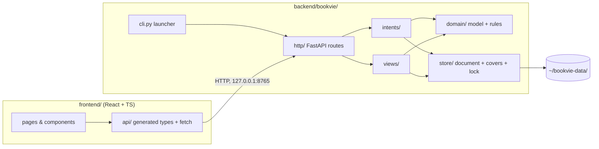
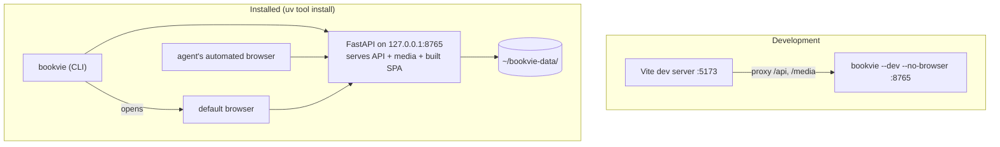
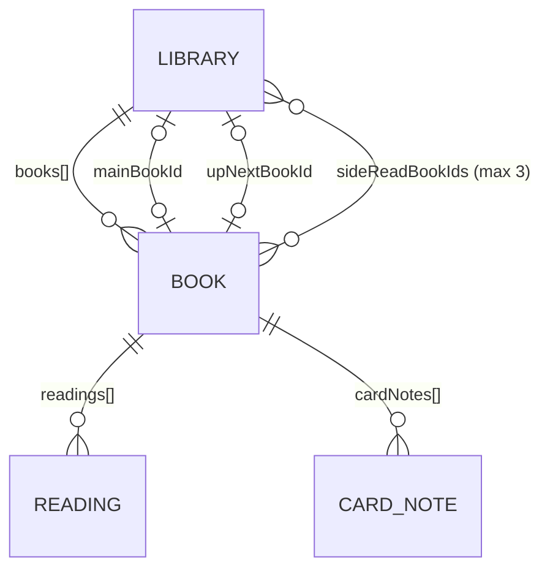

# Architecture Spine: bookvie

## Design Paradigm

**Server-owned domain, intent API, server-computed views.** One local Python process is the only reader and writer of the data folder. Browsers (the user's and the cataloging agent's) are clients. They send **intents** (one user action each) and render **views** (read models the server computes). The client holds no domain state of its own.



Dependency direction (an arrow means "may import"): `http → intents, views → domain`; `intents, views → store`; `domain` imports nothing from the other layers; `store` imports only `domain` types. Export and restore are intents (`intents/export`, `intents/restore`). The frontend imports only `api/`, never server internals.

## Invariants & Rules

### AD-1: One local process owns the data folder [ADOPTED]

- **Binds:** A1, all persistence, FR-2 (agent entry)
- **Prevents:** browser-local storage (IndexedDB, localStorage, File System Access) splitting the agent's catalog from the user's; any code other than `store/` touching data files.
- **Rule:** All data lives in one folder on disk, and only the server's `store/` module reads or writes it. No feature may persist domain data in the browser.

### AD-2: The text store is one JSON document, written atomically [ADOPTED]

- **Binds:** A3, Data-safety NFR, FR-22, FR-23
- **Prevents:** partial writes; a second store; two code paths serializing differently.
- **Rule:** All textual data is a single `library.json` with the shape in AD-18. `store.serialize()` is the only function that produces its bytes: UTF-8, camelCase keys, nulls kept, keys in model order, 2-space indent. Every commit writes a temp file in the same folder, fsyncs it, and renames it over the original. If any step fails, the original is untouched and the intent reports `couldnt_save`.

### AD-3: Domain rules live only in the server; mutations arrive only as intents [ADOPTED]

- **Binds:** FR-1, FR-3, FR-5 to FR-10, FR-14, FR-17, FR-22, FR-23, A2, A3
- **Prevents:** rules duplicated in TypeScript and Python; stale whole-document writes overwriting another browser's changes; one user action split across several calls that can half-fail.
- **Rule:** Each user action is exactly one intent call: `POST /api/intents/<verb>`. An intent validates, applies **every** consequence, runs `domain.check_invariants()`, and commits once (AD-2), or it changes nothing and returns a refusal. No CRUD or PATCH endpoints on entities, and no whole-document write endpoint. Intents that carry a file (`add-book`, `edit-book`, `restore`) are `multipart/form-data` with a JSON part named `intent` and a file part. They are still one call and one commit.

### AD-4: All writes, export and restore are serialized

- **Binds:** AD-2, AD-3, AD-14
- **Prevents:** two concurrent requests both loading state and one silently discarding the other; an intent overwriting a restore; an export capturing a half-replaced cover.
- **Rule:** One in-process lock covers *apply intent → write files → commit document → swap in-memory state*. `export` and `restore` hold the same lock. Views read the committed in-memory state.

### AD-5: One server instance per data folder [ADOPTED]

- **Binds:** AD-1, CLI
- **Prevents:** two processes writing the same folder.
- **Rule:** The server holds `bookvie.lock` (PID and port) in the data folder. When `bookvie` finds a live lock, it opens the browser at the recorded URL and exits. A lock whose PID is dead is taken over. On SIGINT or SIGTERM the server waits for the AD-4 lock, then removes `bookvie.lock` and exits.

### AD-6: The server owns domain numbers and selections; the client owns presentation [ADOPTED]

- **Binds:** FR-4, FR-7, FR-11, FR-15, FR-16, FR-18, FR-19, FR-20, FR-24
- **Prevents:** percentage, Measured pace, days left, Waiting order, stats or library scope being computed in two places with different results.
- **Rule:**
  - **The server computes:** percentages, Measured pace, days left, pages left (per Book and library scope), Waiting for you order, which Books form the Home bookcase slice and in what row priority, stats for a requested date range including the per-month bars, and the "X of Y finished" meter.
  - **The client may only apply presentation to the views it has fetched:**
    - catalog sort, using `Intl.Collator`, per the UX;
    - filter chips;
    - packing spines into rows by viewport width;
    - case-insensitive substring text search (Search titles, Search card notes);
    - pile order and shuffle;
    - copy and date formatting, including relative "N days ago" counted in local calendar days;
    - the Quick pace calculator's arithmetic. Days to finish = ceil(pages left ÷ pages per day), and the finish date = today + days. It uses the same rounding as the server's days left.

### AD-7: The client never patches cached state

- **Binds:** frontend data layer, A2, A3, Couldn't-save pattern, Tone NFR
- **Prevents:** optimistic UI showing a change that was refused or never written; features refreshing different subsets of views; the finish moment replaying.
- **Rule:** No optimistic updates. View queries are keyed `['view', name, params]`. After every intent response, success or refusal, the client invalidates **all** views. All views also refetch when the window regains focus or becomes visible. A success live-region announcement is made only after the refetched views have rendered. On `couldnt_save` or a network failure, the UI keeps the user's input and shows "Couldn't save. Your data wasn't changed." The finish moment (a single ~600ms spine fill) plays only in the tab that received the successful `finish-reading` response, never because of a view change.

### AD-8: Python is the contract's source of truth; TS types are generated [ADOPTED]

- **Binds:** all intents, views and error codes
- **Prevents:** hand-written TS types drifting from the Python models.
- **Rule:** Pydantic models define every intent body, view, success response and error code. TS types are generated from FastAPI's OpenAPI, using alias names, with `openapi-typescript` into `frontend/src/api/generated/`. They're never edited by hand. `npm run check:api` regenerates the types and fails on any diff.

### AD-9: One response contract for success and failure

- **Binds:** all intents, A3, FR-2 outcome exposure
- **Prevents:** endpoints inventing their own error shapes; FastAPI's default `{"detail":[…]}` reaching the client; the UI unable to tell "refused" from "not saved", or unable to report several fields at once.
- **Rule:**
  - **Success:** HTTP 200 with `{ "ok": true, "ids"?: {<name>: <uuid>}, "reachedLastPage"?: true }`.
  - **Failure:** `{ "error": { "kind": "refusal" | "couldnt_save", "code": "<snake_case>", "message": "<user copy>", "fields"?: [{ "field", "code", "message" }] } }`.
    - HTTP 422 means field validation. `code` is `invalid_fields`, and `fields` lists every failing field.
    - HTTP 409 means a state rule (e.g. `duplicate_book`, `pages_below_current_page`).
    - HTTP 500 or 503 means `couldnt_save`.
  - A global `RequestValidationError` handler maps framework validation errors into this shape. The server owns all message copy (PRD §5 Tone), and the client renders it as is. Error codes are an enum in the contract.

### AD-10: Duplicate detection is a server refusal

- **Binds:** FR-3
- **Prevents:** the duplicate rule being implemented in the form and skipped by other paths.
- **Rule:** `add-book`, and `edit-book` when title, author or ISBN changed, refuse with 409 `duplicate_book` unless the intent carries `confirmDuplicate: true`. "Add anyway" resends the same intent with that flag. ISBN normalization and author-set comparison live in `domain/`.

### AD-11: Stored, not recomputed

- **Binds:** A4, FR-1, FR-14, FR-16, FR-24
- **Prevents:** stats or spine colors changing when Pages or the cover is edited later; the UI unable to tell a user's color from a derived one.
- **Rule:** These values are stored, never recomputed on read:
  - **Book spine colors:** `spineColorUser` (null = automatic), `spineColorFromCover` (computed once per uploaded cover), `spineColorCurated` (assigned at creation), and the resolved `spineColor` (user, else from-cover, else curated). The resolved color is re-resolved only by intents that change one of its inputs.
  - **Finished Reading:** `finishDate` (a local date) and `finishedPages` (the page count at finish).
  - **Back-filled Reading:** `startDate: null`.

### AD-12: Covers use immutable names; files go in before the document and come out after it

- **Binds:** A5, FR-1, FR-21, FR-22, FR-23
- **Prevents:** a failed commit leaving a document pointing at an overwritten image; browsers showing a cached old cover; dangling references.
- **Rule:**
  - The server downscales every uploaded cover to a long edge of at most 1200px, after re-decoding it with Pillow, which rejects anything that isn't an image. Uploads are capped at 20 MB.
  - Each upload is stored under a new server-minted name, `covers/<book-id>-<uuid>.<ext>`, recorded in the Book's `coverFile`. A name is never reused or overwritten.
  - **The order is always:** write the new files (temp + rename), commit the document, then delete files no Book references.
  - Covers are served at `/media/covers/<file>` with immutable caching.
  - At startup the server removes cover files that no Book references.

### AD-13: Versioned document; one migration chain [ADOPTED]

- **Binds:** A6, FR-22, FR-23, startup load
- **Prevents:** restore and startup handling old formats differently; a newer file being half-understood; a migration bug destroying the only copy.
- **Rule:**
  - `library.json` carries an integer `schemaVersion`.
  - A single ordered migration chain in `store/migrations/` upgrades older versions, both at startup and on restore.
  - Before a startup migration rewrites the file, the server copies the original to `library.v<N>.bak.json`.
  - A newer version or an invalid file is refused, and nothing changes.

### AD-14: Export is the data folder packaged; restore validates, then applies the AD-12 order [ADOPTED]

- **Binds:** FR-22, FR-23, A6
- **Prevents:** an export format that drifts from storage; a restore that fails halfway; malicious or damaged archives.
- **Rule:**
  - **Export:** `GET /api/export` returns one `.zip` holding `library.json` and `covers/`, and nothing else. It is read under the AD-4 lock.
  - **Restore validation:** restore unpacks into `.staging/` inside the data folder. It accepts only the entries `library.json` and `covers/<name>`: no absolute paths, no `..`, at most 2 GB uncompressed. Then it validates the whole archive: schema, migrations, AD-18 invariants, and every referenced cover present and decodable.
  - **Restore apply:** following the AD-12 order, restore adds the archive's covers, commits the document via AD-2, then deletes covers the new document doesn't reference.
  - **Failure and cleanup:** a failure before the commit leaves current data untouched. `.staging/` is emptied at startup.
  - **Round trip:** export → restore at the same `schemaVersion` reproduces byte-identical `library.json` and covers.

### AD-15: State that is not exported [ADOPTED]

- **Binds:** A6, FR-22 "Last export"
- **Prevents:** "Last export" disagreeing between browsers; UI preferences polluting the export.
- **Rule:** The last-export timestamp is stored in `local-state.json` in the data folder. It's outside the export, and restore never touches it. UI preferences (theme, catalog view, sort) live in browser `localStorage`, per browser, wrapped in try/catch with defaults.

### AD-16: Stable loopback address, local trust

- **Binds:** CLI, FR-2 (agent navigation), security
- **Prevents:** the cataloging skill losing the app behind a random port; LAN or cross-site access to the user's data.
- **Rule:**
  - **Binding:** the server binds `127.0.0.1` only, on port `8765` by default. `--port` overrides it, and the lock records the actual port.
  - **Port conflict:** if the port is held by a process that isn't bookvie, startup exits with a message naming the port and `--port`.
  - **Request guard:** requests are rejected when their `Host` isn't `127.0.0.1:<port>` or `localhost:<port>`, or when an `Origin` is present and isn't one of those. With `--dev`, the Vite dev origin is also allowed.
  - **No authentication:** anything on the machine that can reach the loopback port is trusted.
  - **SPA routes:** the server serves the built SPA and falls back to `index.html` for client routes.

### AD-17: The Agent Label Contract is a public interface

- **Binds:** FR-2, the New book panel, the Duplicate dialog, Search titles
- **Prevents:** a refactor renaming a label and silently breaking unattended cataloging.
- **Rule:** EXPERIENCE.md → Agent Label Contract is the single source of truth. The Playwright e2e suite drives those flows only by the exact accessible names in that table. Changing a name there is a breaking change that needs a contract update first.

### AD-18: Canonical document shape and its invariants

- **Binds:** every intent, view and migration; FR-1, FR-5 to FR-8, FR-17
- **Prevents:** two epics storing the same entity in different places, e.g. Card notes nested in one epic and top-level in another; pointers left dangling after a delete.
- **Rule:**
  - `library.json` is `{ schemaVersion, mainBookId|null, upNextBookId|null, sideReadBookIds[], books[] }`. Each Book carries `id`, `createdAt` (timestamp, for the Date added sort), `ownership` (`owned`), `coverFile|null`, the AD-11 color fields, and its PRD fields. It owns its nested `readings[]` and `cardNotes[]` (`{ id, text, pageStart, pageEnd|null, createdAt }`). Nothing else is top-level.
  - Main book, Up next and Side reads exist only as root pointers. `domain.check_invariants()` runs before every commit and enforces:
    - every pointer references an existing Book;
    - the Main book is neither Up next nor a Side read;
    - there are at most 3 Side reads;
    - a Book has at most one unfinished Reading;
    - the Main book has an unfinished Reading;
    - card-note pages and unfinished Reading pages are within the Book's page count.
  - Deleting a Book clears every pointer to it in the same commit. A vacated Main book or Up next stays empty.

### AD-19: Reading identity and status

- **Binds:** FR-5 to FR-11, FR-14, FR-15, FR-24
- **Prevents:** a resumed Reading still counting as paused; two unfinished Readings on a re-read; the page update and the Finish dialog both finishing a Reading.
- **Rule:**
  - **Fields:** a Reading stores `id`, `startDate|null`, `currentPage`, `purpose|null`, `lastProgressUpdate` (timestamp; set by `update-page` and by `start-reading`), `pausedAt|null` (a local date, overwritten on every pause), `finishDate|null`, `finishedPages|null`, `purposeFulfilled|null` and `rating|null`.
  - **Current Reading:** a Book's current Reading is its single unfinished Reading.
  - **Status:** `domain.reading_status()` is the only status function. A Reading is *finished* if it has a `finishDate`, *active* if its Book is `mainBookId`, and *paused* otherwise. `pausedAt` is ignored while the Reading is active.
  - **Starting:** one `start-reading` intent resumes the current Reading, or creates a new one when the Book has none.
  - **Finishing:** only `finish-reading` sets `finishDate`. `update-page`, or `start-reading` with a Side read's starting page, at the last page saves the page and returns `reachedLastPage: true`. The client then opens the Finish dialog.
  - **Targeting:** intents address `bookId` (and `readingId` where a finished Reading is edited) and apply to the server's current state. A2 last-write-wins applies to confirmation dialogs too. [ADOPTED]

### AD-20: Time is injected and local

- **Binds:** domain, FR-10, FR-11, FR-14, FR-16, AD-19
- **Prevents:** tests and code disagreeing on "today"; finish dates shifting by timezone.
- **Rule:** `domain/` never calls the system clock directly. It receives a `Clock` (now, plus today as a local date in the machine timezone) that tests replace. Local dates are `YYYY-MM-DD`; timestamps are ISO 8601 with offset. Measured pace counts days inclusively (finishDate − startDate + 1), excludes back-filled Readings, and lives only in `domain/`.

## Consistency Conventions

| Concern | Convention |
| --- | --- |
| Naming | Domain terms exactly as PRD §3 (Book, Reading, Main book, Up next, Waiting for you, Side read, Card note). Python `snake_case`; JSON fields and TS `camelCase` (Pydantic alias generator). Intent paths are kebab-case verbs under `/api/intents/<verb>`; views are nouns under `GET /api/views/<name>`. |
| IDs | Server-generated UUID v4 strings, returned in the success `ids`. The client never mints IDs. |
| Dates | AD-20. Server and browser share the machine timezone. |
| Errors | AD-9. User-facing copy follows PRD §5 Tone (no exclamation marks, no praise, no red failure states). |
| Logging | Server logs to stderr in the launching terminal. No telemetry, no network calls out. |
| Config | CLI flags `--data-dir` (default `~/bookvie-data`), `--port` (default 8765), `--no-browser` (tests) and `--dev`. No config file. |
| Testing | pytest for `domain/` and `intents/` (every FR consequence, refusal code and `check_invariants` rule) with a fake `Clock`. Playwright e2e for flows and the label contract (AD-17), run against a temporary `--data-dir`. One install smoke test: build, `uv tool install`, start, load `/`. |

## Stack

| Name | Version |
| --- | --- |
| Python | 3.14 |
| uv (packaging, `uv tool install`) | 0.13.x |
| FastAPI | 0.162.x |
| Pydantic | 2.14.x |
| Uvicorn | 0.54.x |
| Pillow (cover downscale, color derivation) | 13.x |
| React | 19.3.x |
| TypeScript | 5.9.x |
| Vite (react-ts template) | 8.3.x |
| openapi-typescript | 7.13.x |
| TanStack Query | 5.x |
| Playwright (`@playwright/test`) | 1.64.x |
| pytest | 9.x |

TypeScript stays on 5.9 because openapi-typescript 7.13 requires TS ^5. The Vite template's default TS 7 is overridden.

## Structural Seed



**Build and install:** `npm run build` writes the SPA into `backend/bookvie/http/static/`, which is gitignored but explicitly included as package data. `uv tool install --reinstall ./backend` installs the global `bookvie` command. Upgrading means rebuilding and reinstalling. Node is needed only to build, never at runtime.

```text
~/bookvie-data/
  library.json            # the whole textual store (AD-2, AD-18)
  library.v<N>.bak.json   # pre-migration copies (AD-13)
  covers/                 # <book-id>-<uuid>.<ext>, ≤1200px long edge (AD-12)
  .staging/               # restore scratch, emptied at startup (AD-14)
  local-state.json        # last export timestamp, not exported (AD-15)
  bookvie.lock            # pid + port (AD-5)
```



```text
bookvie/
  backend/
    pyproject.toml          # console script: bookvie = bookvie.cli:main; includes http/static
    bookvie/
      cli.py                # flags, lock check, start server, open browser, signals
      http/                 # FastAPI app, routes, Host/Origin guard, error handler, static/
      intents/              # one module per intent, incl. export, restore
      views/                # one module per view
      domain/               # entities, check_invariants, reading_status, ISBN/duplicate, pace, Clock
      store/                # serialize, load/commit, covers, lock, migrations/
    tests/
  frontend/
    src/
      api/generated/        # openapi-typescript output, never edited (AD-8)
      api/                  # fetch wrapper, AD-9 envelope, query keys, invalidate-all
      pages/  components/
    e2e/                    # Playwright, label-contract driven
```

## Capability → Architecture Map

| Capability / Area | Lives in | Governed by |
| --- | --- | --- |
| FR-1 Book fields, FR-3 Duplicate | `intents/add_book`, `edit_book`, `delete_book`; `domain/` | AD-3, AD-9, AD-10, AD-11, AD-12, AD-18 |
| FR-2 Agent-friendly form | `frontend` New book panel | AD-9, AD-16, AD-17 |
| FR-4, FR-20, FR-24 Catalog, filter/sort, bookcase | `views/catalog`, `views/home`; client presentation | AD-6, AD-11 |
| FR-5 to FR-9 Main book, pause, Up next, Side reads, Purpose | `intents/start_reading`, `pause`, `set_up_next`, `mark_side_read`, `edit_purpose` | AD-3, AD-4, AD-18, AD-19 |
| FR-10, FR-11 Page update, re-entry | `intents/update_page`; `views/home` | AD-6, AD-7, AD-19, AD-20 |
| FR-14 Finish | `intents/finish_reading` | AD-7, AD-11, AD-19, AD-20 |
| FR-15 Quick pace calculator | `views/` (pages left, Measured pace); client arithmetic | AD-6, AD-20 |
| FR-16 Stats | `views/stats` | AD-6, AD-11, AD-20 |
| FR-17 to FR-19 Card notes | `intents/*_card_note`; `views/card_notes` | AD-3, AD-6, AD-18 |
| FR-21 Cover | `store/covers`; `/media/covers` | AD-12 |
| FR-22, FR-23 Export / restore | `intents/export`, `intents/restore`; `store/` | AD-4, AD-13, AD-14, AD-15 |
| A1 shared storage | `store/`, `cli.py` | AD-1, AD-5, AD-16 |

## Deferred

- **Frontend router and styling approach:** any choice that satisfies AD-7 and implements DESIGN.md tokens works. The first frontend story picks them. CSS custom properties from DESIGN.md are the expected default.
- **Exact intent and view list and their field shapes beyond AD-18 and AD-19:** owned by the Pydantic models once written (AD-8).
- **Spine-color derivation algorithm and curated-palette assignment order:** a `domain/` detail, constrained only by AD-11.
- **Distribution beyond the user's machine** (PyPI, Homebrew, signed binaries): out of scope.
- **CI provider:** none is required. pytest, Playwright, `check:api` and the install smoke test run locally until a CI is chosen.
- **Later features** (Shelves, Goals, Sequences, Donation, Wishlist): each adds fields under a new `schemaVersion` plus a migration (AD-13). No structure is reserved now.
- **Stale confirmation guard:** not built (AD-19, A2). Revisit if a stale Start dialog ever pauses the wrong book in practice.
- **Performance:** the full rewrite per intent and in-memory views are sized for about 500 Books and a few thousand Card notes. Revisit if `library.json` grows past roughly 10 MB.
